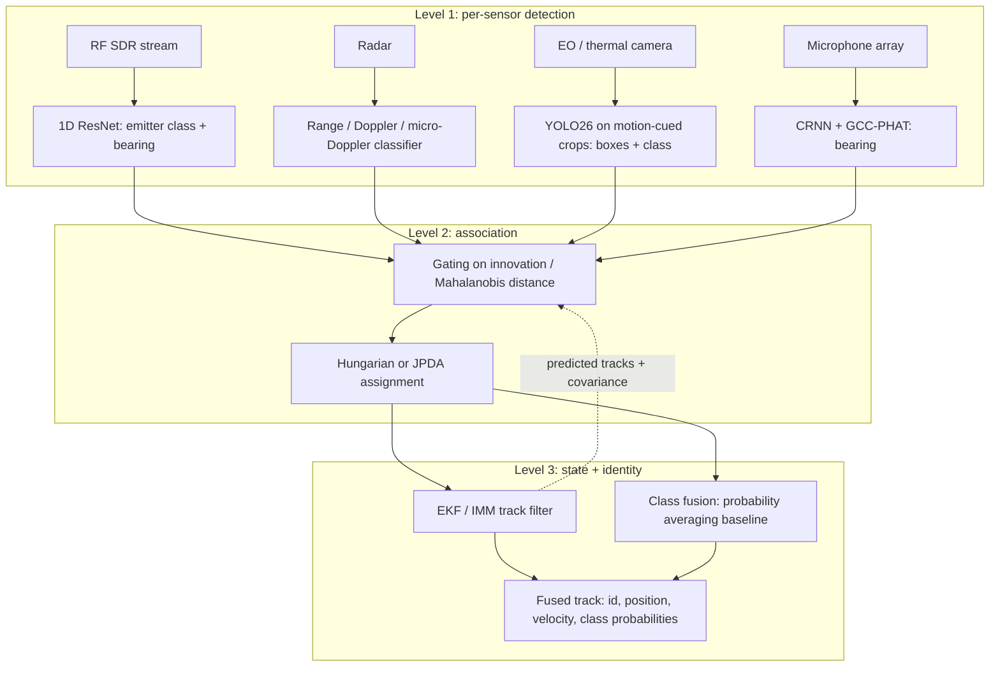

# AI Technical Architectures & Engineering Guide for Drone Defense

Signal models, neural architectures, fusion and edge-deployment notes for AI-based counter-UAS perception. The vision-specific design (detector choice, POV, kinematics) lives in [07](07_deep_learning_architectures_cnn_transformer_mamba.md), [08](08_camera_angles_and_operational_pov_selection.md) and [09](09_monocular_depth_frame_tracking_and_kinematics.md). This file covers the building blocks shared across modalities.

> [!NOTE]
> **Revised 2026-09-21.** Fixes: the micro-Doppler model now follows the standard rotor-blade formulation; the decomposition objective is correctly labelled VMD (SVMD is its successive variant); the TDOA sign convention was corrected; the feature-pyramid strides were off by one level; the RF "ResNet" had no residual connections; the fusion stage no longer defaults to Dempster-Shafer; deployment commands target YOLO26.
>
> **Revised 2026-09-22.** Fixes:
> * SAHI is flagged as compute-heavy, not "cheapest".
> * PRF requirement made explicit; blade-flash period fixed for odd blade counts; microphone-count wording corrected.
> * The fusion diagram now shows the tracker-association loop.
> * The EKF notes add asynchronous timestamps and Joseph-form covariance updates.
> * Frame dropping now requires true timestamps.

---

## 1. Signal Processing & Mathematical Transforms

### 1.1 Radio Frequency (RF) Signal Representation
Software-defined radios digitise the band of interest into complex baseband samples at rate $f_s$:

$$s[n] = I[n] + j\,Q[n] = A[n]\, e^{j \phi[n]}$$

Two common inputs for neural models:
1. **Raw I/Q tensor** of shape $(2, N)$, with row 0 = $I$ and row 1 = $Q$. Fed to 1D CNNs or complex-valued CNNs (see [§2.2](#22-rf-classifier-1d-resnet-on-raw-iq)).
2. **Spectrogram** from the short-time Fourier transform:
   $$X(m, \omega) = \sum_{n} s[n]\, w[n - m]\, e^{-j \omega n}$$
   with a Hann or Hamming window $w$. $|X(m,\omega)|^2$ is an image that standard 2D backbones can consume (RFUAV ships a pre-rendered spectrogram set, see [03](03_datasets_and_benchmarks_catalog.md#rfuav)).

---

### 1.2 Radar Micro-Doppler
A target moving with radial velocity $v_b$ produces a bulk Doppler shift

$$f_D = \frac{2 v_b}{\lambda} = \frac{2 v_b f_c}{c}.$$

Rotor blades add periodic modulation on top: the **micro-Doppler** effect. For $N$ rigid blades of length $L$ rotating at angular rate $\Omega$, observed at elevation angle $\beta$, the standard model (Chen, *The Micro-Doppler Effect in Radar*, 2011) gives the baseband return as

$$s(t) = L\, e^{-j\frac{4\pi}{\lambda}(R_0 + v_b t)} \sum_{k=0}^{N-1} \operatorname{sinc}\!\left[\frac{4\pi}{\lambda}\frac{L}{2}\cos\beta\,\cos\!\Big(\Omega t + \varphi_0 + \tfrac{2\pi k}{N}\Big)\right] e^{-j\Phi_k(t)},$$

$$\Phi_k(t) = \frac{4\pi}{\lambda}\frac{L}{2}\cos\beta\,\cos\!\Big(\Omega t + \varphi_0 + \tfrac{2\pi k}{N}\Big).$$

The blade-tip micro-Doppler swings up to

$$f_{\text{mD,max}} = \frac{2\, \Omega L \cos\beta}{\lambda}.$$

*Worked example:* a 12 cm blade at 6,000 rpm has a tip speed of ≈ 75 m/s. At X-band ($\lambda$ = 3 cm) that gives $f_{\text{mD,max}}$ ≈ 5 kHz. A pulsed radar with I/Q sampling sees Doppler unambiguously only within ±PRF/2, so capturing the full signature needs **PRF ≳ 2·f<sub>mD,max</sub> ≈ 10 kHz**. For a CW radar the same bound applies to the baseband sampling rate.

```
Micro-Doppler time-frequency signature (schematic)
Frequency
   ^        blade-tip "flashes": period 2π/(NΩ) for even N, π/(NΩ) for odd N
   |    /\    /\    /\    /\    /\    /\
+f_mD|---/--\--/--\--/--\--/--\--/--\--/--\---
 f_D |========================================   body Doppler
-f_mD|---\--/--\--/--\--/--\--/--\--/--\--/---
   +------------------------------------------> time
```

#### Mode decomposition (VMD / SVMD)
To separate body motion from blade harmonics, the radar return $y(t)$ can be split into $K$ narrow-band modes $u_k(t)$ with centre frequencies $\omega_k$. The objective below is **Variational Mode Decomposition** (VMD; Dragomiretskiy & Zosso, 2014):

$$\min_{\{u_k\},\{\omega_k\}} \sum_{k} \left\| \partial_t\!\left[\Big(\delta(t) + \tfrac{j}{\pi t}\Big) * u_k(t)\right] e^{-j \omega_k t} \right\|_2^2 \quad \text{s.t.} \quad \sum_k u_k(t) = y(t).$$

*Successive* VMD (SVMD) extracts modes one at a time with extra penalty terms, so $K$ need not be fixed in advance. Plain STFT spectrograms remain the common baseline: DIAT-µSAT reaches 95-97% with VGG features on spectrogram images ([01 §4.1](01_research_papers_compendium.md#41-diat-µsat-small-aerial-targets-micro-doppler-signatures-and-their-classification-using-cnn)).

---

### 1.3 Acoustic Direction-of-Arrival (DoA)
For microphones at positions $\mathbf{d}_i$ and a far-field source in unit direction $\mathbf{u}(\theta, \phi)$ (pointing *toward* the drone), the plane wave reaches microphone $i$ at $t_i = t_0 - \mathbf{d}_i \cdot \mathbf{u} / c$. The time difference of arrival is therefore

$$\tau_{ij} = t_i - t_j = -\frac{(\mathbf{d}_i - \mathbf{d}_j)\cdot \mathbf{u}(\theta,\phi)}{c}.$$

Microphones closer to the source hear it first, hence the minus sign.

**GCC-PHAT** estimates $\tau_{ij}$ by whitening the cross-spectrum so that only phase remains, which sharpens the peak and suppresses reverberation:

$$R_{ij}^{\text{PHAT}}(\tau) = \frac{1}{2\pi}\int_{-\infty}^{\infty} \frac{S_i(\omega) S_j^*(\omega)}{\left|S_i(\omega) S_j^*(\omega)\right|}\, e^{j\omega\tau}\, d\omega, \qquad \hat\tau_{ij} = \arg\max_\tau R_{ij}^{\text{PHAT}}(\tau).$$

Each $\hat\tau_{ij}$ constrains the projection of $\mathbf{u}$ onto one baseline $\mathbf{d}_i - \mathbf{d}_j$, and the constraints are solved by least squares or a learned regressor. At least **three non-collinear microphones** are needed for azimuth and elevation. A *planar* array still cannot tell "above the plane" from "below", which a ground-level array looking at the sky resolves trivially. A non-planar (e.g. tetrahedral) array removes the ambiguity outright.

---

## 2. Neural Architectures

### 2.1 Optical & Thermal Detectors
Distant drones occupy a few pixels to a few dozen pixels (see [13](13_system_requirements_and_geometry_budget.md#2-pixels-on-target-the-constraint-that-dominates-everything)). Standard YOLO heads predict at strides 8, 16 and 32 (P3-P5). A **P2 head at stride 4** keeps more spatial detail for the smallest targets.

```
FEATURE PYRAMID WITH A P2 HEAD (1280×1280 input)

Input 1280×1280
   |
[Stem]            stride 2   → 640×640
   |
[Stage 1]         stride 4   → 320×320  ──►  P2 head  (micro targets, < ~16 px)
   |
[Stage 2]         stride 8   → 160×160  ──►  P3 head  (small targets)
   |
[Stage 3]         stride 16  →  80×80   ──►  P4 head  (medium)
   |
[Stage 4 + SPPF]  stride 32  →  40×40   ──►  P5 head  (large / close)
```

Practical levers, in order of *engineering effort*:
1. **Resolution and tiling (SAHI).** Slice 4K frames into overlapping 640-1280 px tiles, batch them through the detector and merge the boxes ([obss/sahi](https://github.com/obss/sahi)). Easiest to adopt, but the most expensive in **compute**: a full 4K frame is 32 tiles of 640 px, about 80 ms per frame on a T4. Use motion-cued crops plus a periodic full scan ([13 §3.1](13_system_requirements_and_geometry_budget.md#31-compute-what-full-resolution-detection-costs)).
2. **Small-object-aware training.** YOLO26's STAL guarantees positive label assignments for tiny boxes ([01 §8.1](01_research_papers_compendium.md#81-ultralytics-yolo26-unified-real-time-end-to-end-vision-models)).
3. **An extra P2 head.** Costs compute at high resolution. Only add it if tiling plus STAL still misses targets.
4. **Attention blocks.** YOLO11's C2PSA and YOLOv10's PSA are *partial / position-sensitive* self-attention. They are not the separate "Polarized Self-Attention" module from Liu et al. (2021). Treat attention as a later ablation, not a default.

---

### 2.2 RF Classifier: 1D ResNet on Raw I/Q
A compact residual network for raw I/Q bursts. Each block adds a shortcut: identity, or a 1×1 conv when the shape changes. *(Tested with PyTorch 2.12: output shape, gradients, shortcut path and variable-length input.)*

```python
import torch
import torch.nn as nn


class ResBlock1d(nn.Module):
    """Basic 1D residual block: two 3-tap convs plus a shortcut (1x1 conv when shape changes)."""
    def __init__(self, in_ch, out_ch, stride=1):
        super().__init__()
        self.body = nn.Sequential(
            nn.Conv1d(in_ch, out_ch, kernel_size=3, stride=stride, padding=1, bias=False),
            nn.BatchNorm1d(out_ch),
            nn.ReLU(inplace=True),
            nn.Conv1d(out_ch, out_ch, kernel_size=3, padding=1, bias=False),
            nn.BatchNorm1d(out_ch),
        )
        self.shortcut = nn.Identity() if stride == 1 and in_ch == out_ch else nn.Sequential(
            nn.Conv1d(in_ch, out_ch, kernel_size=1, stride=stride, bias=False),
            nn.BatchNorm1d(out_ch),
        )
        self.relu = nn.ReLU(inplace=True)

    def forward(self, x):
        return self.relu(self.body(x) + self.shortcut(x))


class RFDroneResNet(nn.Module):
    """1D ResNet over raw I/Q bursts. Input: (batch, 2, N) with row 0 = I, row 1 = Q."""
    def __init__(self, num_classes=37):  # 37 = RFUAV device classes
        super().__init__()
        self.stem = nn.Sequential(
            nn.Conv1d(2, 64, kernel_size=7, stride=2, padding=3, bias=False),
            nn.BatchNorm1d(64),
            nn.ReLU(inplace=True),
        )
        self.layers = nn.Sequential(
            ResBlock1d(64, 128, stride=2),
            ResBlock1d(128, 256, stride=2),
            ResBlock1d(256, 512, stride=2),
        )
        self.head = nn.Sequential(nn.AdaptiveAvgPool1d(1), nn.Flatten(), nn.Linear(512, num_classes))

    def forward(self, x):
        return self.head(self.layers(self.stem(x)))


if __name__ == "__main__":
    model = RFDroneResNet()
    logits = model(torch.randn(8, 2, 2048))
    print(logits.shape)  # torch.Size([8, 37])
```

Note that RFUAV's 37 classes are mostly **RC transmitters and ground links**, so this model learns to fingerprint control links, not airframes ([03](03_datasets_and_benchmarks_catalog.md#rfuav)).

---

## 3. Multi-Sensor Data Fusion Architecture



The dotted edge matters: association gates each new measurement against the *predicted* tracks, so levels 2 and 3 form a loop rather than a one-way pipeline.

Design notes:
* **Association.** Start with gating plus the Hungarian algorithm (or JPDA in clutter). Graph neural networks are a research option, not a prerequisite.
* **Identity fusion.** Two 2026 studies found that **Dempster-Shafer and conflict-discounted fusion did not beat simple probability averaging** on anti-UAV benchmarks ([01 §6.3-6.4](01_research_papers_compendium.md#63-evidential-deep-learning-for-multi-modal-anti-uav-detection)). Use averaging as the baseline, and adopt anything fancier only if it wins on your data.
* **Kinematics.** A constant-velocity Kalman filter already fuses asynchronous RF and radar well on real flights ([01 §6.2](01_research_papers_compendium.md#62-fusion-of-cellular-isac-and-passive-rf-sensing-for-uav-detection-and-tracking)). Camera-only kinematics are covered in [09](09_monocular_depth_frame_tracking_and_kinematics.md).

### EKF state and multi-sensor update
State (position, velocity, acceleration):
$$\mathbf{x}_k = \begin{bmatrix} x & y & z & \dot{x} & \dot{y} & \dot{z} & \ddot{x} & \ddot{y} & \ddot{z} \end{bmatrix}^T$$

1. **Predict**:
   $$\mathbf{x}_{k|k-1} = \mathbf{F}\mathbf{x}_{k-1|k-1}, \qquad \mathbf{P}_{k|k-1} = \mathbf{F}\mathbf{P}_{k-1|k-1}\mathbf{F}^T + \mathbf{Q}$$
2. **Update** (one pass per arriving measurement $\mathbf{z}^i_k$: radar $[r,\theta,\phi]$, camera $[\theta,\phi]$ or pixels, RF $[\theta]$):
   $$\mathbf{y}^i_k = \mathbf{z}^i_k - h^i(\mathbf{x}_{k|k-1}), \quad \mathbf{S}^i_k = \mathbf{H}^i\mathbf{P}_{k|k-1}\mathbf{H}^{iT} + \mathbf{R}^i, \quad \mathbf{K}^i_k = \mathbf{P}_{k|k-1}\mathbf{H}^{iT}(\mathbf{S}^i_k)^{-1}$$
   $$\mathbf{x}_{k|k} = \mathbf{x}_{k|k-1} + \mathbf{K}^i_k\mathbf{y}^i_k, \qquad \mathbf{P}_{k|k} = (\mathbf{I} - \mathbf{K}^i_k\mathbf{H}^i)\mathbf{P}_{k|k-1}$$

   Practical details that decide whether this works:
   * **Asynchronous sensors:** predict to *each measurement's own timestamp* before applying it, using the true $\Delta t$.
   * **Angles:** wrap angle residuals to $(-\pi, \pi]$.
   * **Numerical stability:** prefer the Joseph form $\mathbf{P} = (\mathbf{I}-\mathbf{K}\mathbf{H})\mathbf{P}(\mathbf{I}-\mathbf{K}\mathbf{H})^T + \mathbf{K}\mathbf{R}\mathbf{K}^T$, which keeps $\mathbf{P}$ symmetric positive-definite under rounding.

   The choice of $\mathbf{F}$ and $\mathbf{Q}$ is discussed in [09 §3](09_monocular_depth_frame_tracking_and_kinematics.md#3-kinematic-state-estimation-position-velocity--acceleration).

---

## 4. Edge Deployment (NVIDIA Jetson / TensorRT)

Set the latency budget from the requirements in [13 §3](13_system_requirements_and_geometry_budget.md#3-latency-budget). There is no universal "25 ms" rule. What matters is detection range divided by closing speed.

1. **Export YOLO26 to TensorRT on the target device.** Engines are specific to the GPU and the TensorRT version, so build on the Jetson itself. Set `imgsz` to your **tile/crop size**: 1280 below; use 640 if you tile at 640.
   ```bash
   # FP16 engine using the NMS-free one-to-one head
   yolo export model=cuas_yolo26s.pt format=engine half=True imgsz=1280 nms=False

   # INT8 engine; calibration images come from the dataset YAML
   yolo export model=cuas_yolo26s.pt format=engine int8=True data=drone.yaml imgsz=1280 nms=False
   ```
   Or go via ONNX + `trtexec` when you need manual control:
   ```bash
   yolo export model=cuas_yolo26s.pt format=onnx imgsz=1280 nms=False
   trtexec --onnx=cuas_yolo26s.onnx --saveEngine=cuas_yolo26s_int8.engine --int8 --fp16 --calib=calibration_cache.bin
   ```
2. **Re-validate after quantisation.** INT8 cuts weight memory about 4× versus FP32, but speed-ups vary by model and device (measure, don't assume). Low-contrast, few-pixel targets are the first thing quantisation hurts, so **compare $AP_S$ and recall at your operating threshold before and after**, on your own held-out footage.
3. **Decouple I/O from inference.** Camera, SDR and radar acquisition run on their own threads writing to ring buffers. The inference thread always takes the newest frame and drops stale ones rather than queueing them. Because frames get dropped, **stamp every frame at capture** and give the tracker and filter the real $\Delta t$, not an assumed 1/30 s.
