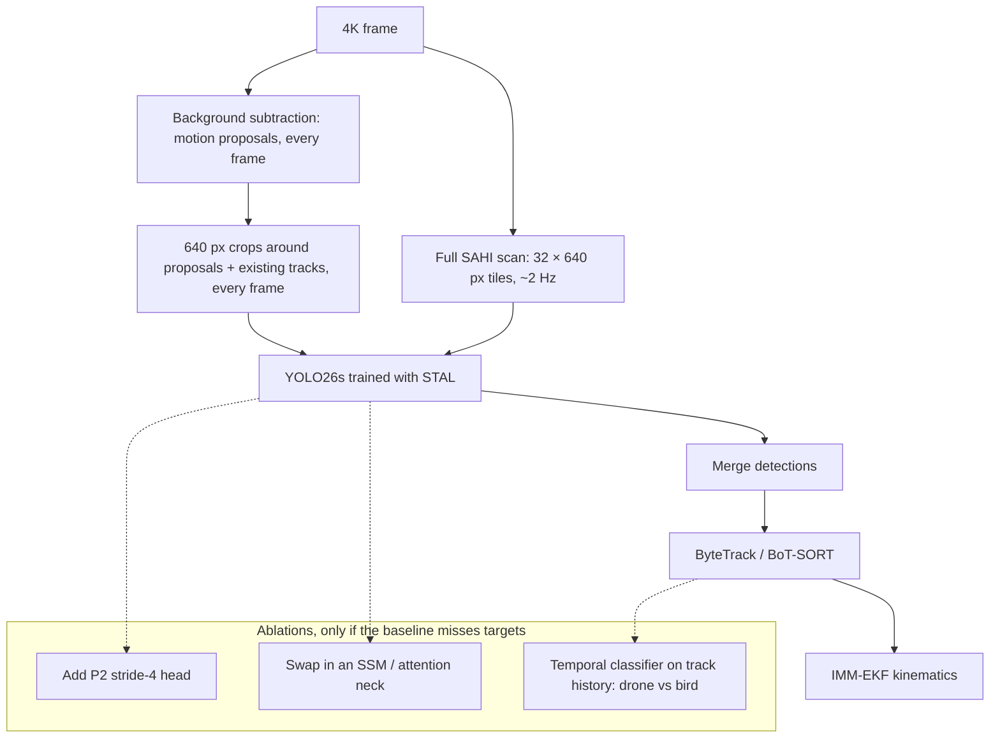

# Deep Learning Architectures for Drone Detection: CNN vs. Transformer vs. Mamba & Runtime Environment Guide

Which network families, frameworks and environments suit a real-time, vision-based counter-UAS detector, and what the current YOLO lineage actually looks like.

> [!NOTE]
> **Revised 2026-09-21.** The previous version called "YOLO26" speculative. It is an official Ultralytics family (see [01 §8.1](01_research_papers_compendium.md#81-ultralytics-yolo26-unified-real-time-end-to-end-vision-models) and the log in [11](11_research_deliberations_and_user_pushback_log.md)). Also corrected: YOLO11's attention block, the "downsample by 32×" claim, Mamba's edge-deployment readiness, and "MambaSOD", which is *salient*-object detection rather than small-object detection.

---

## 1. Runtime Environments & Compute

### 1.1 Environment managers

> Name collision: **Mamba the package manager** (a fast conda re-implementation) has nothing to do with **Mamba the state-space neural network** in §2.

| Tool | What it is | CUDA / C++ handling | Best use here |
| :--- | :--- | :--- | :--- |
| **conda** | Python-based package + environment manager | Ships CUDA/cuDNN binaries from conda channels | Legacy setups; its solver is slow on large environments |
| **mamba / micromamba** | C++ re-implementation of conda | Same conda-forge binaries, much faster solving | Default if you want conda-style environments |
| **pixi** | Rust tool built on the conda ecosystem, with lockfiles (`pixi.lock`) | Conda binaries, reproducible per-platform locks | Teams that need exact reproducibility of mixed C++/Python stacks |
| **uv** | Rust replacement for pip/venv | PyPI wheels only. PyTorch CUDA wheels bundle their own CUDA runtime, but you still need a compatible NVIDIA driver | Pure-Python projects; the fastest installer |
| **Docker + NVIDIA Container Toolkit** | Containers with GPU pass-through | Image pins the whole CUDA stack | Production and Jetson deployment (NVIDIA publishes L4T base images) |

### 1.2 Where to run it

| Platform | Strengths | Constraints |
| :--- | :--- | :--- |
| **Windows (native)** | Direct GUI, local camera / RTSP | Compiling custom CUDA ops (some Mamba/SSM kernels, some splatting rasterizers) is painful |
| **WSL2 (Ubuntu on Windows)** | Linux toolchain with GPU access | Recommended default on a Windows workstation |
| **Google Colab** | Cheap T4/A100 access, zero setup | Ephemeral storage and session limits; slow for 100k-image datasets |
| **Rented GPU (RunPod, Lambda, …)** | Large NVMe + big GPUs | Hourly cost; use for long training runs |
| **Jetson (Orin family)** | The actual edge target | Build TensorRT engines on the device ([05 §4](05_ai_technical_architectures.md#4-edge-deployment-nvidia-jetson--tensorrt)) |

### 1.3 Is PyTorch the right framework?
**Yes, for this project**, for concrete reasons rather than popularity:
* The chosen stack (Ultralytics YOLO26, SAHI, ByteTrack/BoT-SORT via Ultralytics, gsplat if splatting is ever used) is PyTorch-native.
* The export path PyTorch → ONNX → TensorRT is the supported route onto Jetson.

Alternatives (JAX, Mojo/MAX, Burn, Candle, tinygrad) are evaluated in [11 §3](11_research_deliberations_and_user_pushback_log.md#3-alternatives-to-pytorch). None of them has a drop-in replacement for the detector stack.

---

## 2. Architecture Families

```
          compute vs. image size (schematic)
compute
  ^                                   Transformer (global self-attention)
  |                                   O(N²) in tokens: 4K frames need tiling or windowing
  |
  |              Mamba / SSM (2D selective scans)
  |              O(N) in tokens, global context; runtime support still maturing
  |
  |     CNN (YOLO family)
  |     O(N) in pixels, local receptive field growing with depth; best-optimised kernels
  |
  +--------------------------------------------------------> tokens / pixels (N)
```

| Family | Mechanism | Strengths | Weaknesses for tiny drones | Deployment on Jetson today |
| :--- | :--- | :--- | :--- | :--- |
| **CNN** | Shared sliding kernels | Strong local priors (edges, rotors, texture); mature INT8 TensorRT kernels | At a few pixels, a drone and a bird are nearly **information-identical in a single frame**. That is a data limit more than a receptive-field limit, and it is fixed by **temporal cues** (tracking, motion pattern) rather than by more spatial context | **Excellent** |
| **RNN / ConvLSTM** | Recurrent hidden state | Cheap temporal memory | Sequential, so hard to parallelise; rarely used for per-frame detection now | Fair |
| **Transformer** (ViT, RT-DETR, DETR variants) | Self-attention | Global context; NMS-free set prediction | Quadratic cost at high resolution, so tiling or windowing is needed at 4K | Good for RT-DETR-class models (TensorRT supports them) |
| **State-space (Mamba / Vision Mamba)** | Selective linear recurrences scanned across the image | Global context at linear cost | No verified drone-detection result in [01](01_research_papers_compendium.md) | **Immature**: selective-scan ops are custom CUDA kernels with limited ONNX/TensorRT support. Benchmark on the device before committing |

**Takeaway:** use a CNN detector (YOLO26) for per-frame detection and put the temporal reasoning in the tracker and filter ([09](09_monocular_depth_frame_tracking_and_kinematics.md)). Treat SSM backbones as a later research ablation, not the baseline.

---

## 3. The YOLO Lineage

| Version | Year | Key idea |
| :--- | :--- | :--- |
| **YOLOv8** (Ultralytics) | 2023 | Anchor-free, decoupled head; long-time industrial baseline |
| **YOLOv9** | 2024 | Programmable Gradient Information (PGI) and GELAN |
| **YOLOv10** (Tsinghua) | 2024 | NMS-free training via consistent dual label assignments; partial self-attention (PSA) |
| **YOLO11** (Ultralytics) | 2024 | C3k2 blocks and **C2PSA** (partial/position-sensitive attention, *not* "Polarized Self-Attention") |
| **YOLOv12** | 2025 | Attention-centric design: area attention, R-ELAN |
| **YOLOv13** | 2025 | Hypergraph-based adaptive correlation enhancement (HyperACE) |
| **YOLO26** (Ultralytics) | 2026 | Optional NMS-free one-to-one head, DFL removed, MuSGD, Progressive Loss, **STAL** for small objects; tasks include detection, segmentation, pose, OBB and **depth** (`yolo26*-depth`, trained on NYU Depth V2) |
| **YOLO27** (Ultralytics) | *announced, unreleased* | Preview only: no weights, code or date as of 2026-09-21. N/S models keep only a fine and a coarse detection scale; M/L are query-based and NMS-free. **Watch, don't plan on it** |

**Correction to the previous version:** "YOLO26" is not a layer index or a speculative name. It is the current Ultralytics release, with an arXiv paper ([arXiv:2606.03748](https://arxiv.org/abs/2606.03748)). The general lesson still stands: check version names against the official docs before building on them, in either direction.

---

## 4. Recommended Detector Architecture

Stride matters, but less dramatically than the old text claimed. Standard YOLO heads start at **stride 8** (P3), so a 12-px drone covers about 1.5 cells, not "a fractional sub-pixel". That is still thin, which is why the levers below are ordered by cost.



1. **Baseline:** YOLO26s on motion-cued crops, plus a periodic full SAHI scan, plus the tracker. Full-frame tiling at 30 FPS costs ~20 TFLOP/s and does not fit on-device ([13 §3.1](13_system_requirements_and_geometry_budget.md#31-compute-what-full-resolution-detection-costs)). Measure recall versus pixels-on-target on your own footage ([13 §2](13_system_requirements_and_geometry_budget.md#2-pixels-on-target-the-constraint-that-dominates-everything)).
2. **If small targets are missed:** add the P2 head (stride 4 keeps 4× more cells than P3).
3. **If birds cause false alarms:** add a temporal classifier over the track (motion regularity, flapping periodicity) *before* trying bigger spatial backbones.
4. **SSM / attention necks:** a research ablation. Keep it only if it wins on-device, not just on a desktop GPU.
