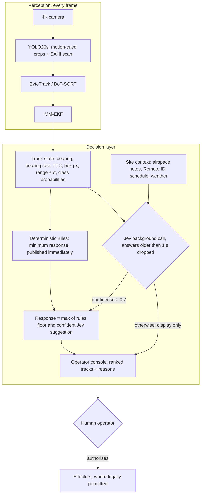

# TypeSafe Jev: Advisory Decision Layer for the C-UAS Pipeline

How to use **Jev**, TypeSafe AI's non-generative "System One" model (launched 2026-09-15), to make this project's decision layer stronger. Also covers where it should *not* sit.

> [!IMPORTANT]
> **Status 2026-09-23: deferred, not being built.** Sign-up is closed. For this project's current scope (1-2 cameras, a remote site with approved testers, few simultaneous tracks, detection only), Jev's strengths have little to work on: folding in free-text context and ranking many tracks. Its drone-vs-bird answer never sees pixels either. The effort goes into a calibrated drone-vs-not-drone classifier over track history instead ([14](14_build_log_and_experiments.md)). The rules floor below (`rules_floor()`, `combine()`) is still the plan for the decision layer, and the advisor slot stays pluggable. Revisit if access opens or the scope grows (many tracks, airspace context).

> [!NOTE]
> **Revised 2026-09-21.** Product facts were re-checked against launch coverage and developer guides (sources at the end). Corrections: results are read from `response.answers[...]`, not `response.nouls/choices/scores`; `state` can be a dict; "sub-15 ms on edge" was unverified and has been removed (Jev is a cloud API); 40 m/s × 80 ms is 3.2 m, not "< 3 m". **Architecture change:** Jev now advises and escalates. Deterministic rules set the minimum response, and only a human authorises effectors (the reasoning is in §2).
>
> **Revised 2026-09-22.** Three fixes to the reference design:
> 1. The rules response is now published **immediately**. The previous code waited up to 0.6 s for Jev before returning anything, contradicting rule 1 below.
> 2. A Remote ID match can no longer silence an imminent track, because Remote ID broadcasts are unauthenticated and can be spoofed.
> 3. §5 now validates the numbers the code actually uses, and recommends a shadow-mode rollout.
> 4. (later the same day) `rules_floor()` only treated tracks *inside* the zone as imminent. A track still outside the zone, closing with a 5 s TTC and a spoofed Remote ID, got `log_only`, contrary to rule 3. Imminence now comes from TTC alone. The floor can also reach `request_engagement_decision` on its own, and `combine()` ignores response labels it doesn't know.

---

## 1. What Jev Is (Verified)

| Item | Value |
| :--- | :--- |
| Maker / launch | TypeSafe AI (founders Diogo Almeida, Erik Gafni, Sasha Sheng); launched **2026-09-15** with a $40M seed round led by DCVC |
| Access | **Limited early access** (waitlist) via TypeSafe's API; also listed on Vercel AI Gateway as `typesafe-ai/jev` |
| Deployment | **Cloud API only.** No on-premises or edge build announced |
| Output | Typed answers only, no prose: **`Noul`** (yes/no probability), **`Choice`** (one of N options + confidence + per-option probabilities), **`Score`** (position on an ordered scale) |
| Training | **RLCD** (Reinforcement Learning for Calibrated Decisions): probabilities are optimised against outcomes, aiming for calibrated confidence |
| Latency | **70-500 ms end-to-end** (vendor figure) |
| Price | $0.042 per million input tokens; output free |
| Limits (per guides) | 1,200 requests/min, 250k tokens/s; 64k-token context for state + questions |

**Calibration, defined.** A model is calibrated if, among all the times it says "85%", it is right about 85% of the time:
$$\mathbb{E}\big[\,\lvert \mathbb{P}(\hat{Y}=Y \mid \hat{P}=p) - p \rvert\,\big] \approx 0.$$
RLCD targets this on TypeSafe's training distribution. **Nobody has measured it on drone-track data**, so you have to measure it yourself (§5).

---

## 2. Does Jev Make the System Stronger?

**Yes, in the right role.** Jev is good at combining *heterogeneous, partly textual* context into a small set of calibrated, typed judgements, quickly and cheaply. It does **not** improve what the camera can see, and it should not be the component that authorises force.

| Where Jev genuinely helps | Why |
| :--- | :--- |
| **Folding in context rules can't parse**: airspace notes, contractor flight bookings, operator remarks, weather, time of day | This is Jev's core strength: unstructured state in, typed decision out |
| **Ranking many simultaneous tracks** for one operator (`Score`) | Triage is the real bottleneck in swarms and busy airspace |
| **Escalating ambiguous tracks** (`Noul` drone-vs-bird, `Choice` response level) | Calibrated probabilities are exactly what thresholds need, *once verified* |
| **Offline work**: pre-labelling tracks for review, mining hard negatives (birds) for retraining | No latency pressure, and the value compounds |

| Where it does not help, or hurts | Why |
| :--- | :--- |
| **Detection range / pixels on target** | Set by optics ([13](13_system_requirements_and_geometry_budget.md)). Warning time comes from here, not from decision latency |
| **Kinematic accuracy** | Jev can only reason over what the filter outputs. At 165 m a wide 4K camera has ±40 m range error ([09 §3.4](09_monocular_depth_frame_tracking_and_kinematics.md#34-what-is-actually-observable-from-one-camera)) |
| **Being the sole trigger for effectors** | It adds a network dependency (outages, rate limits), is not auditable the way fixed rules are, and its calibration on this domain is unknown. Autonomy-in-weapons policy (e.g. DoD Directive 3000.09) expects appropriate human judgement over the use of force |

**Latency in context.** A 40 m/s FPV covers **3.2 m** during an 80 ms Jev call and 20 m during a 500 ms one. If the camera first detects it at 150 m (that needs roughly a 48° lens or narrower, aimed near the horizon; see [13](13_system_requirements_and_geometry_budget.md)), the whole warning window is ~3.75 s, so Jev's worst case uses about 13% of it. That is acceptable for *advice*, which is why the rules must never *wait* for Jev.

---

## 3. Architecture: Rules Set the Floor, Jev Can Raise It, a Human Decides



Rules:
1. **The rules layer always produces a response on time**, even with no network. It never waits for Jev.
2. **Jev can raise the response level, never lower it.** A confident "this is the booked contractor flight" is shown to the operator as context, but it does not silence a rules-level alert.
3. **Unauthenticated inputs cannot lower a response either.** Remote ID can be spoofed, so it only relaxes the response for tracks that are not already imminent. "Imminent" means closing with a short time-to-collision, whether the track is inside the zone yet or not.
4. **No code path triggers an effector.** The top response level is "request an engagement decision" from a human. The rules reach it on their own for a likely drone with a TTC under ~3 s, because the human decision needs those seconds.

---

## 4. Reference Implementation

Uses the published SDK surface (`TypeSafeClient`, `Noul`, `Choice`, `Score`, `client.system_one(state=..., questions=...)`, `response.answers[key]`).

The operator console calls `rules_floor()` on every track update and shows the result at once. It calls `request_advice()` on significant changes. When advice arrives, it re-displays `combine(floor, advice)`.

*Tested against a mock of the SDK interface: rules floor (including a spoofed Remote ID on an imminent track both inside and outside the zone, the decide-now level, and a drone loitering in the zone), raise-never-lower, the low-confidence path, an unknown response label, non-blocking return (under 1 ms), dropping stale answers, silent errors, and lazy client creation. Not yet run against the live API.*

**Implemented (2026-09-29):** the rules floor and `combine` now live in `cuas/rules.py`, without the Jev calls, and are unit-tested on the cases above. The track field is `drone_prob`: the calibrated p(drone) from `cuas.classify`, fed by `cuas.pipeline`.

**Changed in `cuas/rules.py` on 2026-10-01** (the block below is the earlier reference version and was not re-run): a TTC of exactly 0 counts as imminent; the classifier's label wins over p; and a track that is *not yet classified* (`drone_prob` is `None`, or label "unknown") and closing gets `slew_ptz_for_identification` instead of `log_only`. It does not alert: on real tracks of distant aircraft and birds, time to collision reads under 3 s once or twice a minute ([19 §2](19_design_review_parameters_and_novel_directions.md#2-code-review-findings-closer-evaluation-fixes)).

`ttc_s` is the time to reach the **camera** (optical expansion, [09 §1.3](09_monocular_depth_frame_tracking_and_kinematics.md#13-method-c-looming-cues--optical-expansion-time-to-collision)), not to the zone edge: range is too coarse to compute the latter. The camera sits inside the protected zone, so set `IMMINENT_TTC_S` to include the time to cross the zone.

```python
"""
cuas_advisor.py
TypeSafe Jev as an ADVISORY layer on top of the YOLO26 -> tracker -> IMM-EKF pipeline.

Division of authority:
  * rules_floor()    - deterministic, auditable minimum response. Synchronous; never touches the network.
  * request_advice() - asks Jev in the background; its answer arrives later via a callback, or never.
  * combine()        - pure merge: Jev may RAISE the response above the rules floor, never lower it.
  * Human operator   - the only one who can authorise an effector. Nothing in this file triggers one.
"""
import time
from concurrent.futures import ThreadPoolExecutor

from typesafe_sdk import Choice, Noul, Score, TypeSafeClient

# Ordered from least to most urgent. The top level asks a human for a decision; it does not act.
RESPONSES = ["log_only", "slew_ptz_for_identification", "alert_operator", "request_engagement_decision"]

JEV_MAX_AGE_S = 1.0          # advice arriving later than this describes a stale track state; drop it
JEV_MIN_CONFIDENCE = 0.7     # below this, Jev's escalation is shown to the operator but not applied
IMMINENT_TTC_S = 10.0        # site policy: a closing track due at the camera within this time is imminent
DECIDE_NOW_TTC_S = 3.0       # site policy: this close, a human decision barely fits (13 section 3), so ask for one now

QUESTIONS = {
    "drone_not_bird": Noul(
        instructions="The track's motion history and appearance cues are more consistent with a drone than with a bird."
    ),
    "suggested_response": Choice(
        instructions="Which response level best fits this track, given the site context and airspace notes?",
        criteria={
            "log_only": "Routine or authorised traffic, or moving away from the protected zone.",
            "slew_ptz_for_identification": "Unidentified; a closer look with the zoom camera would resolve it.",
            "alert_operator": "Unauthorised drone approaching or loitering near the protected zone.",
            "request_engagement_decision": "Unauthorised drone closing fast on the protected zone; a human must decide now.",
        },
    ),
    "priority": Score(
        instructions="How urgently should the operator look at this track compared with the other active tracks?",
        criteria=["Background", "Low", "Moderate", "High", "Immediate"],
    ),
}

_pool = ThreadPoolExecutor(max_workers=4)
_client = None


def _jev():
    global _client
    if _client is None:
        _client = TypeSafeClient()    # reads TYPESAFE_API_KEY; defaults to jev-latest
    return _client


def rules_floor(track: dict) -> str:
    """Deterministic minimum response from hard, auditable conditions. Thresholds are site policy."""
    ttc = track["ttc_s"]                  # time to reach the camera, from optical expansion (09 section 1.3); None if not closing
    imminent = ttc is not None and 0 < ttc < IMMINENT_TTC_S    # inside OR outside the zone
    drone = track["detector_drone_prob"] >= 0.5
    in_zone = track["in_protected_zone"]
    # Imminence is checked BEFORE Remote ID on purpose: Remote ID is an unauthenticated broadcast and can be
    # spoofed, so a "friendly" ID must never silence an imminent track.
    if imminent and drone and ttc < DECIDE_NOW_TTC_S:
        return "request_engagement_decision"      # asks a human; nothing here acts
    if imminent and (drone or in_zone):
        return "alert_operator"
    if track["remote_id_authorised"]:
        return "log_only"                         # only non-imminent tracks get this far
    if drone and in_zone:
        return "alert_operator"                   # unidentified drone loitering inside the zone
    if drone or in_zone:
        return "slew_ptz_for_identification"
    return "log_only"


def combine(floor: str, advice) -> str:
    """Final response: the rules floor, raised (never lowered) by confident Jev advice."""
    if advice and advice["suggested"] in RESPONSES and advice["confidence"] >= JEV_MIN_CONFIDENCE:
        return max(floor, advice["suggested"], key=RESPONSES.index)
    return floor


def request_advice(track: dict, site_context: dict, on_advice) -> None:
    """Ask Jev in the background. Calls on_advice(track_id, advice) from a worker thread if a fresh
    answer arrives; stays silent on timeout, error or rate limit, so the rules floor simply stands."""
    sent = time.monotonic()
    future = _pool.submit(_jev().system_one, state={"track": track, "site": site_context}, questions=QUESTIONS)

    def _done(f):
        if f.cancelled() or f.exception() is not None or time.monotonic() - sent > JEV_MAX_AGE_S:
            return
        a = f.result().answers
        on_advice(track["track_id"], {
            "p_drone": a["drone_not_bird"].noul,
            "suggested": a["suggested_response"].choice,
            "confidence": a["suggested_response"].confidence,
            "priority": a["priority"].score,   # ordinal level; confirm 0- vs 1-based indexing in the SDK docs
        })

    future.add_done_callback(_done)


if __name__ == "__main__":
    # Fields the perception stack actually produces (see 09 section 3.4): bearing, rates, TTC, and
    # range WITH its uncertainty, instead of point estimates the camera cannot really observe.
    track = {
        "track_id": 104,
        "track_age_s": 6.2,
        "detector_drone_prob": 0.81,
        "detector_bird_prob": 0.12,
        "box_width_px": 9.5,
        "bearing_deg": 178.4,
        "elevation_deg": 7.9,
        "bearing_rate_deg_s": -0.4,
        "ttc_s": 6.8,
        "range_m": 165.0, "range_1sigma_m": 40.0,
        "closing_speed_mps": 24.0, "closing_speed_1sigma_mps": 9.0,
        "in_protected_zone": True,
        "remote_id_authorised": False,
    }
    site = {
        "zone": "substation perimeter, restricted",
        "airspace_notes": "Contractor survey flight booked 14:00-15:00 (DJI Matrice 350, north field only).",
        "local_time": "14:20", "weather": "overcast, light wind",
    }

    floor = rules_floor(track)
    print("rules (immediate):", floor)    # the operator console gets this at once
    request_advice(track, site, lambda tid, adv: print("with Jev:", combine(floor, adv), adv))
    _pool.shutdown(wait=True)             # demo only: wait for the background answer before exiting
```

Operational notes:
* **Call Jev per track state change** (new track, zone entry, TTC crossing a threshold), not per frame. That respects the rate limit and keeps the worker pool from filling with late calls.
* **`on_advice` runs on a worker thread.** Hand the advice to the console's own thread (for example through a queue) rather than updating the UI directly.
* **Data leaves your site.** Track data and site notes go to a third-party cloud. Check that this is acceptable for your deployment, and read TypeSafe's terms of service for defence use before building on it. No usage restrictions were stated in the launch coverage reviewed, which is not the same as permission.

---

## 5. Before Trusting Jev: Validate It on Your Tracks

Jev's outputs play two different roles, and each needs its own test:

| Output | How it is used | How to validate it |
| :--- | :--- | :--- |
| `p_drone` (`Noul`) | Shown to the operator | **Calibration (ECE)** against confirmed ground truth (PTZ or operator), below. This has an objective answer |
| `suggested` + `confidence` (`Choice`) | **Can raise the response** via `combine()` | No objective ground truth: the right response is a policy judgement. Measure **escalation precision** (the share of Jev-raised responses the operator agreed were warranted) and **extra alerts per hour** |

**Rollout:**
1. Start in **shadow mode**: log `combine()`'s output but act on the rules floor only.
2. Switch escalation on once escalation precision is acceptable over a few hundred tracks, including bird season.
3. Tune `JEV_MIN_CONFIDENCE` from those logs. Uncalibrated escalation costs operator trust through alert fatigue, even though it can never silence an alert.

Expected calibration error for `p_drone`:

```python
import numpy as np

def expected_calibration_error(p, y, bins=10):
    """ECE: bin predictions by confidence, compare mean prediction with observed frequency per bin."""
    p, y = np.asarray(p, float), np.asarray(y, float)
    idx = np.minimum((p * bins).astype(int), bins - 1)
    return sum(abs(p[idx == b].mean() - y[idx == b].mean()) * np.mean(idx == b)
               for b in range(bins) if np.any(idx == b))
```
*(Tested: ≈0.003 on synthetic calibrated data, 0.125 on a synthetic overconfident model, as theory predicts.)* For reference, a published RGB-thermal anti-UAV fusion model reached ECE 0.057 ([01 §6.4](01_research_papers_compendium.md#64-uncertainty-aware-multimodal-anti-uav-detection-via-evidential-fusion-and-conflict-discounted-belief-aggregation)). If `p_drone` proves comparably calibrated on **your** tracks, it becomes a candidate for a rules input too (e.g. "slew the PTZ if p_drone ≥ 0.8"). Until then it stays display-only.

---

## 6. Summary: Where Each Component Sits

| Function | Component | Jev's role |
| :--- | :--- | :--- |
| Pixel detection | YOLO26s on motion-cued crops + periodic SAHI scan | None |
| Track association | ByteTrack / BoT-SORT | None |
| Kinematics | IMM-EKF | None (consumes its output and uncertainty) |
| Minimum response | Deterministic rules | None, by design |
| Drone-vs-bird second opinion | Jev `Noul` | **Display only** until its calibration is measured (§5) |
| Folding in airspace notes and schedules | Jev `Choice` | **Primary value-add**; can raise the response once shadow mode passes (§5) |
| Ranking tracks for the operator | Jev `Score` | **Primary value-add** |
| Authorising effectors | Human operator | None |

**Sources:** [Jev on Wikipedia](https://en.wikipedia.org/wiki/Jev_(AI_model)) · [DCVC announcement](https://www.dcvc.com/news-insights/typesafe-emerges-from-stealth-with-a-new-way-of-doing-ai/) · [How to Use Jev (DEV Community)](https://dev.to/valyuai/how-to-use-jev-a-practical-guide-to-typesafes-system-one-model-g5e) · [What Is Jev? (Firecrawl)](https://www.firecrawl.dev/blog/what-is-jev) · [Jev API pricing (APIMaster)](https://apimaster.ai/blog/jev-api)
