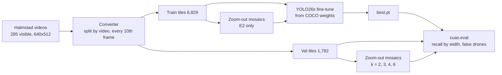

# Detector Training: Methods, Results, Capabilities & Limitations

A standalone write-up of how the drone detector is trained and evaluated, what the experiments so far show, and what they do *not* show. It is written to be readable by someone new to the project (e.g. a supervisor) and to be reproducible. The running log of every run is [14](14_build_log_and_experiments.md); this document explains the method and interprets the results.

> [!NOTE]
> Written 2026-09-24, covering E1, E2, E11 and E12; extended to E14, E15, the seed check, E20 and E21 (2026-10-01). Update §6, §8 whenever an experiment finishes. Numbers come from the Colab run outputs recorded in [14](14_build_log_and_experiments.md).

---

## 1. What We Are Trying to Find Out

The system's warning time is set by how far away a drone can be detected. That range follows directly from one number: **the smallest drone, in pixels, that the detector reliably finds**, $w_{\min}$ ([13 §2](13_system_requirements_and_geometry_budget.md#2-pixels-on-target-the-constraint-that-dominates-everything)):

$$R_{\max} = \frac{f_x \cdot S}{w_{\min}}$$

where $f_x$ is the focal length in pixels and $S$ the drone's size. Halving $w_{\min}$ doubles detection range with the same camera. So the training experiments ask two questions, in this order:

1. **How small can a drone be and still be found?** (recall versus box width, and $w_{\min}$)
2. **How often is something else called a drone?** (birds, aircraft, empty sky: the "drone eyes" problem)

Headline accuracy scores (mAP) are recorded but are *not* the target, because they average over sizes and hide exactly the small-target behaviour that matters here.

---

## 2. The Pipeline, End to End

Code: `cuas/datasets/halmstad.py` (converter), `cuas/zoomout.py` (simulated distance), `cuas/eval.py` (metrics), with Ultralytics doing the training. Colab cells: `experiments/E1_baseline_detector.ipynb`. The code map and setup are in [14 §2, §3](14_build_log_and_experiments.md#2-code-map).

---

## 3. Data

### 3.1 Source
The **Halmstad multi-sensor drone dataset** (Svanström, Alonso-Fernandez & Englund, 2021; CC0, [repo](https://github.com/DroneDetectionThesis/Drone-detection-dataset)): real outdoor video with four labelled classes. Only the **visible** videos are used (the project is vision-only). It was chosen because it is freely usable, small enough to iterate on quickly (357 MB), and, unusually, labels the **distractors** (birds, airplanes, helicopters) as well as drones.

Measured on Colab, 2026-09-23:

| | Videos | Frames | Resolution |
| :--- | ---: | ---: | :--- |
| Visible set | 285 | 89,233 | 640×512 (all) |

| Class | Labelled boxes | Median width | 10th percentile | Under 8 px |
| :--- | ---: | ---: | ---: | ---: |
| Drone | 34,676 | 33.8 px | 23.0 px | 0% |
| Bird | 12,791 | 26.7 px | 22.2 px | 0% |
| Airplane | 18,583 | 40.9 px | 24.5 px | 0% |
| Helicopter | 18,717 | 72.4 px | 25.6 px | 0% |

**Key property: the dataset contains no small drones.** Almost every target is wider than ~20 px, so on its own it cannot answer question 1. §3.4 explains the workaround.

### 3.2 Label problems found and handled
* **Some videos stop being labelled partway through** (12 videos, all birds in the first ten listed). For example, V_BIRD_005 has 1 label for 302 frames and V_BIRD_009 37 for 325. The target may still be visible in the unlabelled frames, so the converter **skips everything past the last label**. Otherwise a visible bird would be taught as "nothing here".
* **One labelled target per frame.** Flocks and multi-drone scenes leave other objects unlabelled. The converter therefore takes **no "empty background" frames from bird videos**. Unlabelled objects in other videos remain a known source of error (§7). **Update 2026-09-24:** unlabelled frames are *not* reliably empty either (real drones found in them), so the converter no longer uses them as background.

### 3.3 Split and sampling
* **Split by video, not by frame** (80/20, stratified per class, fixed seed). Neighbouring frames are near-duplicates: a frame-level split puts copies of test frames in training and inflates every score. The cost is a small validation set in *independent* terms: **~57 videos**.
* **Every 10th labelled frame** is kept (neighbours add little new information), plus occasional target-absent frames from non-bird videos as background examples.
* Result: **6,829 training images** (135 background-only) and **1,782 validation images** (23 background-only). Validation contains 703 drones, 293 birds, 383 airplanes and 380 helicopters.
* Frames are saved as 640-px tiles (here the whole 640×512 frame). Tiles, never downscaled frames, are used at every stage, so a drone keeps its true pixel size ([13 §3.1](13_system_requirements_and_geometry_budget.md#31-compute-what-full-resolution-detection-costs)).

### 3.4 Simulated distance ("zoom-out" mosaics)
To test drones smaller than the dataset contains, frames are **shrunk k-fold and tiled k×k into one image of the original size** (`cuas/zoomout.py`). A 34-px drone becomes about 17 / 11 / 8.5 / 5.6 px at k = 2 / 3 / 4 / 6. Tiling, rather than shrinking a single frame, matters: the detector letterboxes its input to 640 px, which would scale a lone small image straight back up.

| Set | Images | Purpose |
| :--- | ---: | :--- |
| Val k = 2 / 3 / 4 / 6 | 445 / 198 / 111 / 49 | Evaluation for E1 and E2: fills the 4-16 px size bins |
| Train k = 2 / 3 / 4 / 6 | 1,707 / 758 / 426 / 189 | Extra training data for E2 only (+45%) |

**This is a proxy, and an optimistic one.** Area-downscaling averages away sensor noise and blur, so a shrunken drone is *cleaner* than a genuinely distant one, which also suffers haze, lens softness and heavier compression. The mosaics also have hard seams between cells that real frames don't. Results in the small bins are therefore an upper bound on real-world small-target recall.

---

## 4. Model and Training Configuration

| Item | Setting | Why |
| :--- | :--- | :--- |
| Model | **Ultralytics YOLO26s** (9.9 M parameters, 22.8 GFLOPs at 640) | Current Ultralytics family with STAL small-target label assignment ([07](07_deep_learning_architectures_cnn_transformer_mamba.md)); "s" is a balance of accuracy and edge speed |
| Starting point | **COCO-pretrained** `yolo26s.pt`, fine-tuned to 4 classes | Far less data needed than training from scratch |
| Class-head transfer | Ultralytics copies pretrained class heads by name: **bird and airplane start from COCO's heads; drone and helicopter start from scratch** | Distractor classes get a head start. Keep this in mind when comparing per-class numbers |
| Input size | 640 px | Matches the tile size, so no rescaling |
| Batch / epochs | 16 / up to 40, **early stopping after 15 epochs without improvement** | E1 stopped at epoch 27 (best at 12); E2's best came before epoch 24 of 40. 40 is a **ceiling kept identical across experiments** for comparability, not a target. **Overfitting safeguards:** `best.pt` is chosen on validation, not training; early stopping; and final numbers come from a held-out test that training never touches (choosing the best of N epochs on val flatters val slightly). **If a run is still improving at its last epochs,** don't bolt on epochs: the learning rate has decayed linearly to 1% and mosaic is off for the final 10. Rerun with a longer schedule (e.g. 80 epochs, patience 20) and compare on the held-out test. Only worth it if the best epoch is in the last few *and* val is still rising |
| Optimizer | **AdamW, lr 0.00125, momentum 0.9**, weight decay 0.0005, 3 warm-up epochs, linear decay to 1% | Chosen by `optimizer=auto` for every run so far (< 10,000 iterations at the nominal batch 64: E1 ≈ 4,300, E2 ≈ 6,200, E12 ≈ 9,100, E14 9,680). **Pinned in `train_local.py` since 2026-10-01:** above 10,000, auto switches to MuSGD at lr 0.01, and E14 was ~520 images short of that, which would have changed the optimizer along with the data (19 §2 #3). MuSGD stays a planned test (E10) |
| Activation | **SiLU** (Ultralytics default) | Changing it would discard the pretrained weights; not worth testing yet ([14 §5](14_build_log_and_experiments.md#5-findings-so-far)) |
| Losses | Box (gain 7.5), classification (0.5), L1 box term (YOLO26 has no DFL) | Defaults |
| Augmentation | Defaults: mosaic 1.0 (off for the last 10 epochs), **scale ±0.5**, translate 0.1, horizontal flip 0.5, HSV jitter (h 0.015, s 0.7, v 0.4), light blur/CLAHE (p 0.01) | E1 is deliberately a default baseline. Scale augmentation shrinks images, which interacts with small targets (E2b) |
| Precision / seed | Mixed precision (AMP), seed 0, deterministic | Reproducibility |
| Hardware / software | Colab Tesla T4 (15 GB); Ultralytics 8.4.161, PyTorch 2.11 + CUDA 12.8, Python 3.13 | E1 used 5.4 GB of GPU memory; ~2 min 10 s per epoch plus ~15 s validation |

**E2 differs from E1 in one thing only:** the zoom-out training mosaics are added. Same model, schedule, augmentation and evaluation.

**E12 differs from E2 in its data:**
* It trains on 14,476 images: clean Halmstad, Anti-UAV300 **train** sequences (every 40th frame, on-screen display inpainted, **positive 640-px tiles only**), and zoom-out mosaics of both.
* It runs on the local RTX 4060 (verified identical to Colab, [16 #24](16_training_run_log.md#2026-09-25-e12-multi-dataset-training-local)).
* Its operating threshold is chosen on Anti-UAV **val** by F1, then the held-out Anti-UAV **test** is scored once.

---

## 5. How Results Are Measured

`cuas/eval.py`, applied to the native validation set **pooled with** its zoom-out copies:

* **Matching:** a predicted "drone" box counts as a hit if it overlaps a labelled drone with **IoU ≥ 0.3** (greedy, highest score first, one prediction per drone). 0.3 rather than the usual 0.5 because 1 px of box error on a 6-px drone already costs ~30% IoU.
* **Recall by box width**, in bins 0-4, 4-8, 8-12, 12-16, 16-24, 24-32, 32-64 and 64+ px. Width, not area, because doc 13's range formula uses width.
* **$w_{\min}$** = the lowest bin edge from which **every** bin with ≥ 20 drones has recall ≥ 0.8.
* **False "drone" boxes**, split three ways: extra boxes **on a real drone** (duplicates or misplaced: a box-merging problem), those on a labelled bird, airplane or helicopter (confusion), and those on **background**, which are also binned by predicted width.
* **A confidence sweep** (0.1, 0.25, 0.4, 0.55). The detector's threshold trades recall against false alarms, so no single threshold tells the whole story.
* **From 2026-10-04 the headline comparison scores are threshold-free:** the drone class's AP and its recall at 10 background false alarms per 1000 frames (`experiments/e35_metrics.py`), because every threshold-based comparison so far has been confounded by where each model's threshold fell ([19 §11](19_design_review_parameters_and_novel_directions.md#11-validation-and-scoring-what-we-use-and-whether-it-is-right)). The per-width table at a validation-chosen threshold stays, as a description of one operating point.
* Ultralytics' own per-class precision / recall / mAP on native-size validation is recorded too, for comparison with the literature.

**Statistical caution.** Validation frames come from ~57 videos, and frames within a video are strongly correlated, so the effective sample size is closer to 57 than 1,782. E1's validation mAP50 moved by ±3-5 points between consecutive epochs. **Differences between experiments smaller than that aren't evidence of anything** until per-video bootstrap confidence intervals are added (planned).

---

## 6. Results So Far

### 6.1 E1: baseline (native-size training only)
Ultralytics validation, native size, best epoch 12 of 27:

| Class | Precision | Recall | mAP50 | mAP50-95 |
| :--- | ---: | ---: | ---: | ---: |
| **Drone** | 0.85 | **0.875** | 0.852 | 0.351 |
| Bird | 0.87 | **0.71** | 0.80 | 0.418 |
| Airplane | 0.73 | 0.81 | 0.835 | 0.415 |
| Helicopter | 0.87 | 0.89 | 0.917 | 0.369 |
| All | 0.83 | 0.82 | 0.851 | 0.388 |

Drone recall by width (native + zoom-out, conf 0.25):

| Width | 0-4 | 4-8 | 8-12 | 12-16 | 16-24 | 24-32 | 32-64 | 64+ |
| :--- | ---: | ---: | ---: | ---: | ---: | ---: | ---: | ---: |
| Drones | 93 | 920 | 828 | 450 | 479 | 312 | 390 | 38 |
| Recall | 0.00 | **0.03** | **0.36** | **0.74** | 0.92 | 0.96 | 0.99 | 1.00 |

**$w_{\min}$ = 16 px** (at confidence 0.1 and 0.25).

False "drone" boxes at conf 0.25: bird 13, airplane 18, helicopter 5 (confusion), and **326 on background over 2,585 images**. At conf 0.1: 24 / 50 / 21 and 1,570.

### 6.3 E11: a different dataset (Anti-UAV300 visible)
No training. E1 (conf 0.25) and E2 (conf 0.4) were evaluated on Anti-UAV300 visible val (67 sequences, 1,462 drones) and test (91 sequences, 2,009 drones): a different camera, site, drone models and lighting. The burned-in on-screen display was inpainted and Full HD frames tiled at 640. The local pipeline was verified to reproduce the Colab results exactly first.

| Test split | Native (median ~120 px) | k4 (~29 px) | k8 (~14 px) | k12 (~10 px) | k16 (~7 px) |
| :--- | ---: | ---: | ---: | ---: | ---: |
| E1 drone recall | 0.0% | 0.5% | 2.2% | 0.4% | 0.0% |
| E2 drone recall | 0.0% | 2.8% | 1.1% | 3.8% | 3.2% |
| E1 drones boxed as another class | 66% | 60% | 36% | 5% | 0% |
| E2 drones boxed as another class | 14% | 56% | 59% | 52% | 47% |

Validation shows the same pattern. The "another class" is almost always **airplane**, then helicopter.

### 6.2 E2: training on simulated distance
Same as E1 plus 3,080 zoom-out training mosaics (9,909 images). The Colab session disconnected and training resumed from epoch 24 and ran all 40 epochs.

Ultralytics validation, native size:

| Class | Precision | Recall | mAP50 | mAP50-95 | vs E1 |
| :--- | ---: | ---: | ---: | ---: | :--- |
| **Drone** | 0.863 | **0.875** | 0.873 | 0.359 | Same recall, slightly better mAP |
| Bird | 0.885 | 0.763 | 0.852 | 0.455 | Recall +5 points |
| Airplane | 0.784 | 0.713 | 0.776 | 0.423 | **Recall −10 points** |
| Helicopter | 0.941 | 0.90 | 0.916 | 0.351 | Similar |

Drone recall by width (native + zoom-out):

| Width | 0-4 | 4-8 | 8-12 | 12-16 | 16-24 | 24-32 | 32-64 | 64+ |
| :--- | ---: | ---: | ---: | ---: | ---: | ---: | ---: | ---: |
| E1, conf 0.25 | 0.00 | 0.03 | 0.36 | 0.74 | 0.92 | 0.96 | 0.99 | 1.00 |
| **E2, conf 0.25** | 0.47 | **0.86** | **0.97** | 0.96 | 0.99 | 1.00 | 0.99 | 1.00 |
| **E2, conf 0.4** | 0.40 | 0.80 | 0.95 | 0.94 | 0.93 | 0.96 | 0.91 | 1.00 |

**$w_{\min}$: 4 px at conf 0.25, 8 px at conf 0.4** (E1: 16 px).

False "drone" boxes: conf 0.25: bird 0, airplane 2, helicopter 5, background 447. conf 0.4: 0 / 2 / 4 / 109.

### 6.4 E12: multi-dataset training (Halmstad + Anti-UAV train split)
* Trained locally. Best epoch 21; early stop at 36; plateau from epoch ~6.
* Threshold chosen on Anti-UAV val by F1: **conf 0.4** (val recall 0.964, precision 0.762).
* Ultralytics val (mixed Halmstad + Anti-UAV val tiles, optimistic because it also selected the epoch):

| Class | Precision | Recall | mAP50 | mAP50-95 | vs E2 |
| :--- | ---: | ---: | ---: | ---: | :--- |
| **Drone** | 0.958 | **0.939** | 0.973 | 0.594 | Different val set (adds Anti-UAV), so not directly comparable |
| Bird | 0.827 | 0.799 | 0.842 | 0.447 | |
| Airplane | 0.744 | **0.675** | 0.771 | 0.414 | Third decline in a row (0.81 → 0.71 → 0.675) |
| Helicopter | 0.896 | 0.913 | 0.903 | 0.400 | |

**Held-out Anti-UAV test**, drone recall by width (native + k4/8/12/16, conf 0.4; E2 at its own val-chosen 0.1):

| Width | 0-4 | 4-8 | 8-12 | 12-16 | 16-24 | 24-32 | 32-64 | 64+ | Pooled |
| :--- | ---: | ---: | ---: | ---: | ---: | ---: | ---: | ---: | ---: |
| Drones | 540 | 1,462 | 1,638 | 1,365 | 1,103 | 743 | 1,203 | 1,667 | 9,721 |
| E2 | 0.00 | 0.07 | 0.07 | 0.05 | 0.05 | 0.08 | 0.06 | 0.00 | 0.049 |
| **E12** | 0.61 | **0.79** | **0.86** | 0.91 | 0.90 | 0.88 | 0.95 | 0.89 | **0.867** |

* **`w_min` 8 px.**
* By set: native 0.899, k4 0.896, k8 0.857, k12 0.854, k16 (~7 px) 0.826.
* Drones boxed as another class: E2 5,064, **E12 13**.
* **False drones: 0 on distractors, 1,568 on background over 2,217 images** (271 on the 2,038 native frames), and 819 on real drones. Precision 0.78.

**Halmstad val (regression check), same thresholds:**

| conf | Pooled recall E2 / E12 | Native recall E2 / E12 | Background FAs E2 / E12 |
| :--- | :--- | :--- | :--- |
| 0.25 | 0.933 / 0.952 | - | 14 / 60 |
| 0.40 | 0.887 / 0.888 | **0.933 / 0.848** | 4 / 19 |

**What the Anti-UAV background false alarms are** (96 inspected, [16 #34](16_training_run_log.md#2026-09-25-e12-multi-dataset-training-local)):
* **Night lights**, about 40%: lamps, lit windows, light streaks.
* **Ground clutter**, about 35%: buildings, cranes, pylons.
* **Dark foliage or cloud**, about 15%.
* **Small grey blobs**, about 10%, which may be unlabelled drones.
* They are large: median 97 px, scores 0.43-0.66.

---

### 6.5 E14: hard-negative mining (Colab L4, 2026-09-30; confirmed 2026-10-01)

Trained as `E14_hardneg_yolo26s_L4`: early stop after 28 epochs (best epoch 13), 1.22 h. Ultralytics val mAP50 0.896 (E12: 0.899). Evaluated with `e12_eval.py`, then compared locally with `compare_runs.py` (`C:\cuas_data\runs\cmp_E12_E14L4.txt`).

| Native Anti-UAV **test** (recall / precision / background FAs per 1000 frames) | E12 | E14 |
| :--- | :--- | :--- |
| conf 0.10 | 0.937 / 0.479 / 547 | 0.896 / 0.585 / 159 |
| conf 0.25 | 0.919 / 0.607 / 262 | 0.870 / 0.736 / 63 |
| conf 0.40 | 0.899 / 0.689 / 133 | 0.833 / 0.815 / 34 |
| conf 0.55 | 0.858 / 0.782 / 48 | 0.762 / 0.877 / 15 |
| conf 0.70 | 0.757 / 0.878 / 6.4 | 0.468 / 0.942 / 2.0 |

* **At their own val-chosen thresholds** (E12 0.40, E14 0.55), E14 looks far cleaner on test: background FAs 133 → 15 per 1000 frames, precision +0.19. But recall drops 0.137 [0.104, 0.171]. That is mostly the threshold moving.
* **At matched recall** (`--match`: E14 at 0.21, where its native val recall equals E12's 0.990), paired per-video bootstrap on test:
  * background FAs −59 per 1000 frames [−93, −24], i.e. 271 → 151 (−44%);
  * precision +0.021 [+0.001, +0.042];
  * recall −0.023 [−0.038, −0.007].
  * **So hard negatives gave a modest real cut in background false alarms at a small recall cost, not the 9× the own-threshold comparison suggests.**
* Across the sweep, the two precision-recall curves nearly coincide in the middle (E14 0.40 ≈ E12 between 0.55 and 0.70). E12 is better at the highest recall.
* **Halmstad goes the other way:** E14 has more background FAs (9.1 vs 2.8 per 1000 frames at 0.25; 4.0 vs 0 at 0.40), though higher recall at 0.40 (0.933 vs 0.848). The Anti-UAV negatives did not transfer as "cleaner" to Halmstad.
* **Threshold transfer:** Halmstad drones score 0.40-0.55 for both models (E12 0.848 → 0.310 recall between those thresholds). A threshold chosen on one dataset does not carry over; set it on deployment footage.
* Correction note: the first read (16 #50) used only E12's sweep and said "no better trade-off". E14's own sweep and the paired test refine that to a small real gain (17 §7 row 26).
* One seed each, different GPUs (E12 on the 4060, E14 on the L4). E18's `E18_base_s1` gives the seed-to-seed spread.

### 6.6 E15: a dataset never trained on (DUT Anti-UAV test, 2026-10-01)

Each model at its Anti-UAV-val threshold, on 2,200 DUT images (2,245 drones, median 55 px). The Colab and local runs agree (E12 recall 0.141 both).
* **E12:** recall 0.141 [0.126, 0.156], precision 0.54, 84 background FAs per 1000 images. 547 drones boxed as another class (helicopter 347, airplane 184, bird 16).
* **E14:** recall 0.076, precision 0.61.
* **The evaluation is correct.** The contact sheets show ground-truth boxes squarely on the drones. The conversion and the padding/tiling were checked.

| DUT test, by background around the drone | Drones | E12 @ 0.40: as drone / as another aircraft class / missed | E14 @ 0.55: same |
| :--- | ---: | :--- | :--- |
| **Sky** (ring texture < 5; in scope) | 1,279 | 0.18 / **0.38** / 0.43 (any class 0.57) | 0.09 / 0.16 / 0.75 (any class 0.25) |
| Clutter (buildings, trees, ground; out of scope) | 966 | 0.08 / 0.06 / 0.86 | 0.06 / 0.02 / 0.92 |

* **Two failures, separated by background** (`e15_dut.py` now reports this split):
  * **Out of scope:** 43% of DUT drones are against buildings, trees or ground, often close and large. They are almost never found (86% missed). The planned camera looks at sky (13 §2.4), so this matters less.
  * **In scope, the class head:** of sky-background drones, E12 *localises* 57% but names only 18% "drone"; **38% are called helicopter or airplane**. That is E11's COCO-head failure again, on drones that look unlike the training data: close, large and clearly visible quadcopters, where Halmstad and Anti-UAV are mostly small and distant.
* **Meaning:** the in-domain numbers (Anti-UAV test recall 0.90) do not generalise to a new dataset. The publishable cross-dataset number today is poor. The levers are:
  * (a) the class head: E13, a single "drone" class or merged aircraft classes, revived;
  * (b) more varied training data: DUT's own train split, Drone-vs-Bird, synthetic;
  * (c) at system level, treat drone/helicopter/airplane detections all as *aircraft candidates* and let the track classifier (M2) decide.

### 6.7 Seed noise: `E18_base_s1` against E14 (2026-10-01)

The E14 recipe again with seed 1, on the same GPU type (16 #55). Full table in [19 §3.1](19_design_review_parameters_and_novel_directions.md#31-seed-noise).

| Native frames | E14 (seed 0) | E18_base_s1 (seed 1) |
| :--- | :--- | :--- |
| Anti-UAV test at 0.55 (both runs' val-chosen threshold): recall / precision / background FAs per 1000 | 0.762 / 0.877 / 14.7 | 0.843 / 0.792 / 12.8 |
| Halmstad val at 0.55: recall | 0.138 | 0.599 |
| DUT test recall | 0.076 | 0.149 |
| At matched recall, seed 1 − seed 0, test background FAs per 1000 | | −13.2 [−22.3, −5.5] |

* **Two seeds of one recipe differ "clearly" under the per-video bootstrap.** The interval covers which videos happen to be in the test set, not which weights training happened to produce.
* **§6.5's verdict on hard negatives is not established.** At the same test recall (~0.90), background false alarms per 1000 frames are 133 (E12 `best.pt`), 62 (E12 `last.pt`), 159 (E14 seed 0 `best.pt`), 46 (E14 seed 0 `last.pt`) and 64 (E14 recipe, seed 1): the spread follows the seed and the checkpoint, not the recipe ([19 §3.1](19_design_review_parameters_and_novel_directions.md#31-seed-noise)). Three seeds per arm are needed to say whether hard negatives help.
* **What does not survive from §6.6:** "E14 is worse than E12 on DUT (0.076 against 0.141)". The same recipe gives 0.149 with another seed.
* The score scale moves between seeds, so a threshold belongs to one set of weights. `w_min` at a val-chosen threshold was 8 px (E12) and is 12 px here.

### 6.8 E21: degraded real frames (2026-10-01)

E12 at 0.4, every evaluation image degraded just before the detector ([19 §3.2](19_design_review_parameters_and_novel_directions.md#32-e21-degraded-real-frames) has all twelve rows).

| Drone recall | Halmstad native (~34 px) | Halmstad k4 (~8.5 px) | Anti-UAV test k8 (~14 px) |
| :--- | ---: | ---: | ---: |
| Clean | 0.848 | 0.931 | 0.857 |
| Noise σ 4 grey levels | 0.663 | 0.619 | 0.815 |
| Blur σ 1.5 px | 0.629 | 0.349 | 0.768 |
| JPEG quality 25 | 0.805 | 0.280 | 0.651 |
| Blur 1.0 + noise 6 + JPEG 40 | 0.373 | **0.076** | 0.462 |

**The working `w_min` of 8 px is a clean-image number.** §7.3 said the mosaics were optimistic; this measures by how much.

### 6.9 E20: the system on whole videos (2026-10-01)

Detections → tracker → track classifier → label over the 57 held-out Halmstad videos ([19 §3.3](19_design_review_parameters_and_novel_directions.md#33-e20-the-whole-system-on-held-out-videos)). With the detector's class votes: **0 false drone declarations in 5.9 minutes of bird, airplane and helicopter video** (upper 95% bound 30 per hour), 23 of 23 drone videos declared, median 1.03 s after the drone appears. With the track-only classifier: 7 false declarations (71 per hour). In-domain only.

**E26 (2026-10-05): the track decision by accumulated evidence** (`cuas/decide.py`, 16 #74). The same tracks, two rules for when a track becomes "drone"; settings chosen on cross-fitted training videos, validation scored once:

| Track-only classifier, cross-fitted TRAIN videos (23.2 min non-drone, 91 drone videos) | Hold rule | Sequential evidence |
| :--- | :--- | :--- |
| About 5 false declarations per hour | hold 3 s: **68**/91 drone videos, median delay 4.07 s | evidence 5.0: **78**/91, 3.23 s |
| About 10 per hour | hold 2 s: 78/91, 3.03 s | evidence 4.0: 80/91, 2.70 s |
| About 20 per hour | hold 1.5 s (18.1/h): 79/91, 2.53 s | evidence 2.5 (20.7/h): 81/91, 1.87 s |
| About 39 per hour | hold 1 s: 81/91, 2.03 s | evidence 1.5: 81/91, 1.37 s |
| Declare on the first drone window (the program until now) | hold 0: 145 per hour, 83/91, 1.03 s | - |
| **VAL, scored once at the settings chosen on train** (5.9 min, 23 drone videos) | hold 3 s: 1 false (10/h), 16/23, 4.12 s | **evidence 5.0: 1 false (10/h), 18/23, 3.13 s** |

* **At every matched false-declaration rate the sequential rule declares as many or more drone videos, sooner.** At about 5 per hour it finds 10 more of 91 drone videos, 0.8 s earlier.
* The one validation false declaration survives every setting of both rules: one non-drone track the classifier is confident about. No decision rule removes that; better features or the detector's class do.
* With detector features the in-domain rate is already 0; on training videos the sequential rule reaches 0 false declarations 1.7 s sooner than the hold rule (evidence 5.0: 2.37 s against hold 3 s: 4.03 s).
* **Adopted in the program:** `python -m cuas` now declares at evidence 5.0 (`--evidence`, 0 = the old rule). The price is delay: about 2.3 s instead of 1.0 s after a track starts. Choose the value on site footage by false declarations per hour.

### 6.10 E18: the full add-on model (2026-10-01)

`E18_full_s0` (AELAN + MPDA + RMPDA, E14 recipe, seed 0, 40 epochs) against the two seeds of the plain model, each at its val-chosen 0.55 ([19 §3.5](19_design_review_parameters_and_novel_directions.md#35-e18-the-full-add-on-model)):

| Native frames | Plain, seed 0 | Plain, seed 1 | Full add-ons |
| :--- | ---: | ---: | ---: |
| Anti-UAV test recall / precision | 0.762 / 0.877 | 0.843 / 0.792 | 0.791 / 0.841 |
| Halmstad val recall | 0.138 | 0.599 | 0.398 |
| DUT test recall | 0.076 | 0.149 | 0.106 |
| Anti-UAV val background FAs at matched recall | 15 | 12 | 80 |

**No evidence of a gain:** between the two plain seeds wherever it was held out, worse on Anti-UAV val, 1.35× the training time. Capacity was not the missing term (§7.2: memorisation, not underfitting).

**The three ablations (2026-10-02, [19 §3.6](19_design_review_parameters_and_novel_directions.md#36-e18-the-three-ablations-and-the-control)):**

| `best.pt`, native frames | Plain, seed 0 (E14) | Plain, seed 1 | Full | Attention only | Deformable only (AELAN) | ECA control |
| :--- | ---: | ---: | ---: | ---: | ---: | ---: |
| Epochs run (patience 15) | 28 | 40 | 40 | 29 | 39 | 40 |
| Threshold chosen on val | 0.55 | 0.55 | 0.55 | 0.40 | 0.40 | 0.55 |
| Anti-UAV test at 0.55: recall | 0.762 | 0.843 | 0.791 | 0.802 | 0.805 | 0.849 |
| Anti-UAV test at 0.55: background FAs per 1000 | 14.7 | 12.8 | 11.3 | 40.2 | 8.8 | 26.0 |
| Background FAs per 1000 at test recall 0.83-0.85 (threshold) | 33.9 (0.40) | 12.8 (0.55) | 25.0 (0.40) | **97.2** (0.40) | 21.6 (0.40) | 26.0 (0.55) |
| Test background boxes at val recall 0.944 (2,038 frames) | 30 | 3 | 13 | 24 | 10 | 14 |
| Val background boxes at val recall 0.944 (1,481 frames) | 15 | 12 | **80** | 10 | 2 | 5 |
| Halmstad val recall at 0.55 | 0.138 | 0.599 | 0.398 | 0.240 | 0.425 | 0.575 |
| Halmstad val recall at 0.40 | 0.933 | 0.923 | 0.919 | 0.930 | 0.900 | 0.950 |
| DUT test recall (own threshold) | 0.076 | 0.149 | 0.106 | 0.108 | 0.174 | 0.089 |
| DUT background false drones (2,200 images) | 95 | 92 | 27 | 132 | 271 | 117 |

* **No add-on beats the second plain seed** on any held-out measure. Attention only is worse (97 background false alarms per 1000 frames at test recall ~0.85 against 13-34).
* **The ECA control, a near-null change, is called "better" than plain seed 0** on test and Halmstad recall, as much as any add-on. Plain seed 0 is the weakest of the six runs; comparisons against it flatter everything.
* **All six runs miss at least 83% of DUT drones.** E18 is closed.

### 6.11 E28, the unlabelled-object count, and final weights compared (2026-10-01, night)

Three checks that came out of the wider literature sweep ([19 §10](19_design_review_parameters_and_novel_directions.md#10-wider-literature-sweep-what-we-are-doing-wrong)); no training.

* **E28: multi-scale inference on DUT** (E12 `best.pt`, conf 0.4). Native tiles: recall 0.141. With the whole frame added as one tile: 0.165. With a half-scale pass too: 0.170. Drones of 64-128 px go 0.10 → 0.19 and 128-256 px 0.06 → 0.12; background false drones go 184 → 235 → 277. About one extra false drone per drone gained, and 526 missed drones are still boxed as another class. **Scale is a small part of the DUT failure; not added to the program.**
* **Unlabelled objects in the training tiles.** E12 over its own 10,272 training tiles: 25 confident "drone" boxes that touch no label (13 Halmstad, 12 Anti-UAV), mostly clutter when looked at. A lower bound, because the model trained on those tiles. **Too few to act on.**
* **Final weights, E12 against E14 at matched validation recall** (`cmp_E12_E14L4_last.txt`; E12 at 0.55, E14 at 0.37). Anti-UAV test: background false alarms −35.8 per 1000 frames [−64.1, −15.5], recall −0.017 [−0.046, +0.010]. Halmstad val: recall +0.226 [+0.133, +0.335], because E12's Anti-UAV-chosen threshold removes a quarter of Halmstad drones. E14's final weights at their own threshold (0.4): native test recall 0.870 [0.826, 0.909], 22.6 background false alarms per 1000 frames, pooled `w_min` 8 px. **The same two runs as §6.5, so this does not add a seed:** the verdict on hard negatives stays "not established" ([19 §3.1](19_design_review_parameters_and_novel_directions.md#31-seed-noise)).

### 6.12 E13: drone-only training (2026-10-02)

Trained with drone labels only, to stop DUT drones being boxed as helicopter or airplane ([19 §3.7](19_design_review_parameters_and_novel_directions.md#37-e13-drone-only-training)).

* **In-domain: equal to plain seed 1.** Anti-UAV test at 0.55: 0.852 / 0.792 / 12.3 against 0.843 / 0.792 / 12.8; Halmstad 0.595 against 0.599; no bird or aircraft called drone.
* **On DUT: recall 0.041, the worst run.** 97% of sky drones are missed outright; none is boxed as another class because there is no other class.
* **The hypothesis is refuted.** The four-class model finds unseen drones with its airplane and helicopter heads, not with a drone head that is then out-voted. **Keep four classes**; the drone class needs more varied drone data.

### 6.13 Two plain seeds under the fixed protocol (2026-10-03)

40 epochs, no early stopping, final weights ([19 §3.1](19_design_review_parameters_and_novel_directions.md#31-seed-noise)):

| Final weights, native frames | Plain, seed 1 | Plain, seed 2 |
| :--- | ---: | ---: |
| Threshold chosen on val | 0.55 | 0.55 |
| Anti-UAV test at 0.55: recall / precision / background FAs per 1000 | 0.859 / 0.784 / 17.2 | 0.843 / 0.780 / 15.2 |
| Anti-UAV test at 0.40 | 0.886 / 0.738 / 35.8 | 0.864 / 0.737 / 30.9 |
| Anti-UAV test at 0.25 | 0.906 / 0.693 / 67.2 | 0.884 / 0.700 / 56.9 |
| Halmstad val recall at 0.55 / 0.40 | 0.716 / 0.954 | 0.772 / 0.950 |
| DUT test recall / background false drones | 0.138 / 81 | 0.157 / 90 |
| Pooled test `w_min` | 12 px | 12 px |
| E21, ~8.5 px, clean | 0.816 | 0.804 |
| E21, ~8.5 px, blur 1.0 + noise 6 + JPEG 40 | 0.150 | 0.111 |
| E21, ~8.5 px, held-out: motion 5 + shot noise + WebP 30 | 0.019 | 0.006 |
| E21, native size (~34 px), clean → trained-kind combination → held-out combination | 0.716 → 0.232 → 0.115 | 0.772 → 0.425 → 0.215 |

* **The seeds agree:** within 0.02 in test recall at each threshold, no clear difference at matched recall. §6.7's spread was mostly early stopping and `best.pt`.
* **These are E22's baselines.** At ~8.5 px, recall falls from about 0.81 to 0.11-0.15 under the degradations E22 trains on, and to 0.01-0.02 under the held-out ones.

### 6.14 E22a: training on degraded images (three seeds, 2026-10-04)

**Result over three seeds** (16 #67), each E22a run paired with the plain run of its seed, 40 epochs, final weights:

| Final weights; seeds 1 / 2 / 0, then the mean | Plain (threshold 0.55) | E22a, degraded training (threshold 0.40) |
| :--- | ---: | ---: |
| **~8.5 px, blur + noise + JPEG** (kinds E22 trains on) | 0.150 / 0.111 / 0.099 = **0.12** | 0.313 / 0.320 / 0.316 = **0.32** |
| **~8.5 px, motion + shot noise + WebP** (held out) | 0.019 / 0.006 / 0.010 = **0.01** | 0.147 / 0.071 / 0.084 = **0.10** |
| ~8.5 px, clean | 0.816 / 0.804 / 0.827 = 0.82 | 0.866 / 0.869 / 0.871 = 0.87 |
| ~14 px: trained kinds | 0.465 / 0.465 / 0.434 = 0.45 | 0.771 / 0.755 / 0.731 = 0.75 |
| ~14 px: held out | 0.511 / 0.532 / 0.556 = 0.53 | 0.711 / 0.677 / 0.665 = 0.68 |
| ~34 px: trained kinds | 0.232 / 0.425 / 0.447 = 0.37 | 0.811 / 0.855 / 0.879 = 0.85 |
| ~34 px: held out | 0.115 / 0.215 / 0.135 = 0.16 | 0.558 / 0.607 / 0.351 = 0.51 |
| Anti-UAV test, native, both at 0.55: recall | 0.859 / 0.843 / 0.834 = 0.845 | 0.882 / 0.868 / 0.861 = 0.870 |
| Anti-UAV test at 0.55: background FAs per 1000 frames | 17.2 / 15.2 / 11.8 | 10.8 / 18.2 / 14.2 |
| Halmstad val recall at 0.40 | 0.954 / 0.950 / 0.943 = 0.949 | 0.895 / 0.937 / 0.945 = 0.926 |
| Halmstad val recall at 0.55 | 0.716 / 0.772 / 0.725 = 0.738 | 0.556 / 0.613 / 0.569 = 0.579 |
| DUT recall (own threshold) | 0.138 / 0.157 / 0.118 = 0.138 | 0.103 / 0.158 / 0.117 = 0.126 |
| DUT background false drones | 81 / 90 / 66 | 246 / 211 / 89 |

* **The robustness gain holds in all three seeds, and it is far outside the seed spread** (plain seeds differ by about 0.02 on clean data). The three E22a seeds are within 0.007 of each other at ~8.5 px under the trained kinds.
* **It carries to the held-out degradations** at every size, so it is not the generator being learned.
* **Clean Anti-UAV test: recall +0.023, +0.017, +0.018 at matched validation recall, "better" under the per-video bootstrap in all three pairs,** with no clear difference in false alarms. Degraded training did not cost clean accuracy; it added a little.
* **Costs.** Halmstad drones score lower (recall −0.16 at 0.55, −0.02 at 0.40; the threshold belongs to the site anyway, 19 §3.10). **DUT is not helped:** recall 0.126 against 0.138, with more false drones at E22a's own lower threshold.
* **At ~8.5 px, 0.32 under the trained kinds and 0.10 under the held-out ones is still low.** What remains is a pixel budget question ([18](18_hardware_optimisation_and_realtime_latency.md)), not a training one.
* **Verdict: adopt `--degrade` as the base recipe.** It is the first training change in this project whose effect is several times the seed spread.
* **Checked without a threshold (E35, 19 §11.3):** Anti-UAV test AP 0.853 → 0.889 (seed spread 0.013); recall at 10 false alarms per 1000 frames 0.831 → 0.856. **And the Halmstad "cost" above is not one:** Halmstad AP is 0.993-0.997 for every run, so E22a ranks Halmstad drones as well as the plain model and only scores them lower.

**E22b over three seeds: not adopted** (16 #70). E22a plus mosaic 0.1 and scale ± 0.3, the 2025 Drone-vs-Bird winner's settings:

| Final weights, seeds 1 / 2 / 0 | E22a | E22b |
| :--- | ---: | ---: |
| Anti-UAV test recall at 0.55 | 0.882 / 0.868 / 0.861 = 0.870 | 0.884 / 0.866 / 0.868 = 0.873 |
| Anti-UAV test background FAs per 1000 frames at 0.55 | 10.8 / 18.2 / 14.2 = 14.4 | 25.5 / 24.0 / 25.0 = 24.8 |
| Halmstad val recall at 0.40 | 0.895 / 0.937 / 0.945 | 0.875 / 0.828 / 0.898 |
| DUT recall (own threshold) | 0.103 / 0.158 / 0.117 = 0.126 | 0.170 / 0.124 / 0.128 = 0.141 |
| ~8.5 px under the trained kinds of degradation (seeds 1 and 0, both arms at 0.40) | 0.313 / 0.316 | 0.310 / 0.324 |

* **The same recall, about 1.7 times the false alarms, in all three seeds.** No gain under degradation, and DUT is inside E22a's seed range.
* The first seed's DUT figure (0.170) looked like a possible gain; the other two (0.124, 0.128) show it was seed luck. That is what the three-seed rule is for.
* Why it may differ from the challenge winner's experience: their baseline had no small-target training data, while ours already has the shrunken mosaics; reducing mosaic and scale jitter then mostly removes variety.
* Seed 2's E21 table is at threshold 0.55 (the other two at 0.40), so it is not comparable and is left out of the last row.

**E22b, first seed, as first written** (E22a plus mosaic 0.1 and scale ± 0.3; `E22b_s1@last` against `E22a_s1@last`, same thresholds): Anti-UAV test recall the same (0.884 against 0.882 at 0.55) with 2.4 times the background false alarms (25.5 against 10.8 per 1000 frames; 4.6 times on Anti-UAV val); Halmstad 0.875 against 0.895 at 0.40; DUT recall 0.170 against 0.103 with about the same false drones (233 against 246). **So far: more false alarms in-domain, perhaps more recall on DUT** (0.170 is just above E22a's seed range of 0.10-0.16). Its E21 table (received 2026-10-04) matches E22a's: ~8.5 px 0.854 clean / 0.310 trained kinds / 0.131 held out (E22a seed 1: 0.866 / 0.313 / 0.147); ~14 px 0.811 / 0.757 / 0.677; ~34 px 0.875 / 0.795 / 0.539. Without a threshold: AP 0.899 against 0.894, recall at 10 false alarms per 1000 frames 0.844 against 0.880. **No gain from the lighter mosaic and scale in one seed.** Two seeds are still running.

The first-seed write-up, kept for the record:

`E22a_s1` against the plain run of the same seed, both 40 epochs, final weights ([16 #65](16_training_run_log.md)). **One seed; seeds 2 and 0 are in the queue.**

| Drone recall, final weights, seed 1 | Plain (threshold 0.55) | E22a, degraded training (threshold 0.40) |
| :--- | ---: | ---: |
| ~34 px (Halmstad native): clean | 0.716 | 0.895 |
| ~34 px: blur 1.0 + noise 6 + JPEG 40 (kinds E22 trains on) | 0.232 | 0.811 |
| ~34 px: motion 5 + shot noise + WebP 30 (**held out**) | 0.115 | 0.558 |
| ~14 px (Anti-UAV test k8): clean / trained kinds / held out | 0.813 / 0.465 / 0.511 | 0.825 / 0.771 / 0.711 |
| ~8.5 px (Halmstad k4): clean | 0.816 | 0.866 |
| ~8.5 px: trained kinds | 0.150 | 0.313 |
| ~8.5 px: held out | 0.019 | 0.147 |
| ~8.5 px, single held-out kinds: motion blur / shot noise / WebP | 0.657 / 0.291 / 0.497 | 0.724 / 0.640 / 0.524 |
| Anti-UAV test, native, both at 0.55: recall / precision / background FAs per 1000 | 0.859 / 0.784 / 17.2 | 0.882 / 0.795 / 10.8 |
| Halmstad val, native, at 0.40 / 0.55 | 0.954 / 0.716 | 0.895 / 0.556 |
| DUT test: recall / precision / background false drones | 0.138 / 0.695 / 81 | 0.103 / 0.406 / 246 |

* **Robustness improves a lot, and it carries to degradations the training never used.** At ~34 px, recall under the held-out combination goes from 0.12 to 0.56; at ~14 px from 0.51 to 0.71. So the model did not just learn our noise generator.
* **At ~8.5 px the gain is real but the level is still low:** 0.15 → 0.31 under the trained kinds, 0.02 → 0.15 under the held-out ones. A drone of 8 px under blur, noise and compression together may simply not be there to find; that is a camera question ([18](18_hardware_optimisation_and_realtime_latency.md)), not a training one.
* **Clean performance on the Anti-UAV test is not harmed** (+0.023 recall at matched validation recall, inside or just outside one seed difference).
* **Two costs to watch on the other seeds:** Halmstad recall is lower at a given threshold (0.895 against 0.954 at 0.40), and DUT is worse (recall 0.103 against 0.138, with 246 background false drones against 81, 114 of them under 16 px). The degraded-trained model is more willing to call a small speck a drone on footage it has not seen.
* **Second seed (2026-10-03, from the cached detections; its DUT and E21 output are still on Drive):** against plain seed 2 at matched validation recall, Anti-UAV test recall +0.017 [+0.002, +0.032] and precision +0.024 [+0.013, +0.035], no clear difference in false alarms; Halmstad recall 0.937 against 0.950 at 0.40 and 0.613 against 0.772 at 0.55. **Both seeds agree on the clean test (+0.02 recall) and on the lower Halmstad scores.**
* **Second seed, DUT and E21** (`e15_E22a_s2_last.txt`, `e21_E22a_s2_last_log.txt`), E22a at 0.40 against plain seed 2 at 0.55:

  | Drone recall, seed 2 | Plain | E22a |
  | :--- | ---: | ---: |
  | ~34 px: clean / trained kinds / held out | 0.772 / 0.425 / 0.215 | 0.937 / 0.855 / 0.607 |
  | ~14 px: clean / trained kinds / held out | 0.826 / 0.465 / 0.532 | 0.808 / 0.755 / 0.677 |
  | ~8.5 px: clean / trained kinds / held out | 0.804 / 0.111 / 0.006 | 0.869 / 0.320 / 0.071 |
  | DUT: recall / precision / background false drones | 0.157 / 0.687 / 90 | 0.158 / 0.537 / 211 |

  **The robustness gain repeats in both seeds**, held-out kinds included. At ~8.5 px both seeds reach 0.31-0.32 under the trained kinds and 0.07-0.15 under the held-out ones.
* **The DUT cost, at matched thresholds** (seed 1, from the detections cached by E34): drone recall 0.068 against 0.138 at 0.55, 0.103 against 0.189 at 0.40, 0.139 against 0.223 at 0.25, with more false drones at 0.40 and below. So for seed 1 the drone head is weaker on DUT at every threshold, not only at its own. Counting boxes of any class the two are level (0.33 against 0.35 at 0.55; 19 §3.10). Seed 2 matches its plain run in recall at its own, lower, threshold with 2.3 times the false drones. **E22a does not help on the unseen dataset and probably costs something there**; the third seed and a matched-threshold run for seed 2 will say how much.
* **Caveat on the table:** each model is at its own validation-chosen threshold (0.40 and 0.55), which favours E22a in the recall columns. False alarms under degradation are similar for the two, so the threshold does not explain the gain, but E21 should be re-run at matched recall once the weights are local.

### 6.15 Three checks on cached detections (2026-10-03)

Detail in [19 §3.10](19_design_review_parameters_and_novel_directions.md#310-three-checks-on-cached-detections-e30-e33-e34).

* **E30, per-size score calibration: refuted.** Correct drone boxes of the same width score 0.15-0.25 lower on Halmstad than on Anti-UAV, so the bias is the dataset. A threshold chosen on Halmstad (about 0.33) gives recall 0.99 at precision 0.97; thresholds must be set on site footage.
* **E33, centre matching under 12 px:** recall changes only below 4 px (+0.12 to +0.22); `w_min` stands.
* **E34, any-class candidates:** on the unseen dataset (DUT) boxes of any class reach 2.2-2.6 times as many drones as "drone" boxes (0.353 against 0.138 at 0.55) for 4 times the stray candidates, and still reach more at an equal stray-candidate rate; on the trained datasets it gains no drone and costs 2.5-5 times the candidates. The pipeline already tracks every class; keep it, with a strict track decision.

### 6.16 80 epochs against 40 (2026-10-04)

`E18_base_s1_e80` against `E18_base_s1`: the plain recipe, the same seed, final weights ([19 §3.4](19_design_review_parameters_and_novel_directions.md#34-checkpoint-choice-is-a-noise-source-too)).

| Plain recipe, seed 1, final weights | 40 epochs | 80 epochs |
| :--- | ---: | ---: |
| Anti-UAV test, native, at 0.55: recall / precision / background FAs per 1000 | 0.859 / 0.784 / 17.2 | 0.864 / 0.793 / 7.9 |
| At 0.40 | 0.886 / 0.738 / 35.8 | 0.888 / 0.752 / 19.6 |
| At 0.25 | 0.906 / 0.693 / 67.2 | 0.902 / 0.718 / 39.7 |
| Test background boxes at matched validation recall | 35 | 11 |
| Halmstad val recall at 0.55 / 0.40 | 0.716 / 0.954 | 0.787 / 0.982 |
| DUT: recall / background false drones | 0.138 / 81 | 0.140 / 54 |
| ~8.5 px: clean / trained-kind degradation / held out | 0.816 / 0.150 / 0.019 | 0.836 / 0.137 / 0.016 |
| ~34 px: clean / noise σ 4 / noise σ 8 | 0.716 / 0.450 / 0.309 | 0.787 / 0.366 / 0.166 |
| Training time | 1.8 h | 3.6 h |

* **Half the in-domain false alarms at the same recall; nothing on DUT; no better, or worse, under degradation.** Experiments stay at 40 epochs.

### 6.17 E22c: real drones pasted across datasets (three seeds, 2026-10-05)

E22a plus 3,000 tiles in which a real drone from the other dataset is pasted in (16 #69, #72, #73). Each E22c run is paired with E22a of the same seed; every model in the table chose threshold 0.40 on validation, so the per-threshold rows compare like with like.

| Final weights, all at threshold 0.40; seeds 1 / 2 / 0 (mean) | E22a | E22c |
| :--- | ---: | ---: |
| Anti-UAV test AP | 0.894 / 0.882 / 0.891 (0.889) | 0.886 / 0.885 / 0.886 (0.886) |
| Anti-UAV test recall at 10 FAs per 1000 | 0.880 / 0.850 / 0.839 (0.856) | 0.825 / 0.857 / 0.845 (0.842) |
| Anti-UAV test background FAs per 1000 at 0.40 | 21.6 / 38.8 / 29.9 | 80.5 / 74.6 / 76.1 |
| The same at 0.55 | 10.8 / 18.2 / 14.2 | 16.2 / 19.1 / 18.2 |
| **DUT drone recall** | 0.103 / 0.158 / 0.117 (0.126) | **0.188 / 0.202 / 0.219 (0.203)** |
| DUT precision | 0.406 / 0.537 / 0.594 | 0.483 / 0.521 / 0.574 |
| DUT background false drones per 1000 images | 112 / 96 / 40 | 159 / 139 / 125 |
| DUT sky drones called "drone" | 0.13 / 0.19 / 0.14 | 0.24 / 0.26 / 0.26 |
| DUT sky drones found as any class | 0.55 / 0.55 / 0.55 | 0.60 / 0.60 / 0.59 |
| E21 ~8.5 px, trained-kind combination | 0.313 / 0.320 / 0.316 | 0.337 / 0.314 / 0.341 |
| E21 ~14 px, held-out combination | 0.711 / 0.677 / 0.665 | 0.692 / 0.736 / 0.701 |
| E21 native size, held-out combination | 0.558 / 0.607 / 0.351 | 0.542 / 0.629 / 0.657 |

* **On the unseen dataset E22c beats E22a in all three seeds:** DUT drone recall +0.04 to +0.10 (mean 0.126 → 0.203) at about the same precision. Most of it is naming: sky drones the airplane and helicopter heads used to take are now called "drone" (0.15 → 0.25); sky drones found under any class rise a little (0.55 → 0.60).
* **In-domain it costs low-scoring false alarms:** on Anti-UAV test 2-3.5 times as many at 0.40 (paired at matched validation recall: +51, +36, +75 per 1000, each clear), close to E22a by 0.55. AP is unchanged (0.886 against 0.889, inside the seed spread). Halmstad is a sanity check only (AP 0.994-0.996).
* **Robustness is unchanged or slightly better** (E21 rows above; the native-size held-out mean 0.51 → 0.61 rests mostly on E22a seed 0's low 0.35).
* **Threshold-free, over all twelve runs (16 #75):**

| Final weights; mean over seeds 1 / 2 / 0 [range] | Plain | E22a | E22b | **E22c** |
| :--- | ---: | ---: | ---: | ---: |
| Anti-UAV test AP | 0.853 [0.845-0.858] | 0.889 [0.882-0.894] | 0.892 [0.884-0.899] | 0.886 [0.885-0.886] |
| Anti-UAV test recall at 10 FAs per 1000 | 0.831 | 0.856 | 0.837 | 0.842 |
| **DUT AP** | 0.193 [0.180-0.209] | 0.122 [0.090-0.154] | 0.159 [0.132-0.177] | **0.195 [0.177-0.220]** |
| DUT recall at 10 false drones per 1000 images | 0.067 [0.041-0.096] | 0.049 | 0.069 | 0.053 [0.041-0.062] |
| **DUT recall at 30 per 1000** | **0.124 [0.117-0.137]** | 0.092 [0.068-0.106] | 0.111 | 0.099 [0.093-0.102] |

  * **E22c against E22a:** DUT AP +0.073 (+0.087 / +0.034 / +0.099, every seed), Anti-UAV AP level. At strict false-alarm budgets on DUT the two are level (recall at 30 per 1000: +0.034 / −0.010 / −0.005): E22c's DUT gain is in the high-recall part of the curve.
  * **E22c against plain:** Anti-UAV AP +0.033 (every seed) and the large E21 robustness gain, DUT AP level (−0.013 / −0.021 / +0.040), but **DUT recall at 30 false drones per 1000 images lower in every seed** (−0.015 / −0.044 / −0.017). Degraded training, with or without the pasted drones, costs a little on the unseen dataset when false alarms are held low.
  * **At a strict false-alarm budget every recipe finds about one DUT drone in ten.** Transfer to an unseen dataset is not fixed by any recipe so far.
* **Decision (2026-10-05): E22c becomes the base recipe**, replacing E22a: no worse anywhere, better on DUT AP. The plain recipe stays the reference for strict-budget DUT recall. Next aimed at DUT: E27 (Objects365 start) and E24 (frozen backbone) on the E22c recipe, then new drone appearance (the DUT train split or Drone-vs-Bird).
* **80 epochs (plain seed 1, one run):** DUT AP 0.189 (40 epochs: 0.190), recall at 10 / 30 per 1000 0.088 / 0.141 against 0.041 / 0.117: fewer false drones on DUT too, as in-domain. A candidate for the final model.

### 6.18 E36: what the false drones are, and the daytime Anti-UAV score (2026-10-05)

`experiments/e36_false_alarm_map.py` maps every background false "drone" box by size, background and score for plain, E22a and E22c (three seeds); then the false alarms of seed 1 of each recipe, at its own threshold for 30 per 1000 images (an equal count), were sorted by eye from numbered crop sheets (`C:\cuas_data\runs\e36_audit\`, labels in `e36_audit_seed1.json`; 16 #76).

| Share of false alarms at 30 per 1000 images, seed 1 | Text, logos, overlays | Real object in the sky (aircraft, light streak, bird, unlabelled object) | Lights | Vegetation | Structures | Other |
| :--- | ---: | ---: | ---: | ---: | ---: | ---: |
| DUT, plain (64) | 22% | 6% | 0% | 36% | 34% | 2% |
| DUT, E22a (65) | 5% | 6% | 0% | 9% | 58% | 22% |
| DUT, E22c (61) | 26% | 5% | 3% | 39% | 21% | 5% |
| Anti-UAV test, plain (58) | 2% | 21% | 40% | 9% | 24% | 5% |
| Anti-UAV test, E22a (60) | 0% | 22% | 27% | 7% | 30% | 15% |
| Anti-UAV test, E22c (52) | 4% | 48% | 21% | 8% | 6% | 13% |

* **On DUT a quarter of plain's and E22c's confident false drones are burned-in text and logos** from the YouTube videos DUT was cut from ("We installed", "drones", "CGTN", channel logos). A deployed camera has no overlays. Most of the rest are buildings, poles, air conditioners and foliage, which the sky mask removes. Only about 5% are objects in the sky.
* **On Anti-UAV, E22c's false drones are mostly real objects in the sky:** night light streaks (probably aircraft, which Anti-UAV does not label) and one white object that recurs across frames (possibly the target in frames labelled empty). Structures fall from 24-30% to 6%. Night lights are 21-40% for every recipe.
* **Night is out of scope (13 §6).** Anti-UAV test splits cleanly by median frame brightness (18 night videos at 2-9, 73 day videos at 90-147), so E35 now also scores the daytime videos (`antiuav_day`):

| Anti-UAV test, daytime videos only; mean of seeds 1 / 2 / 0 | Plain | E22a | E22c |
| :--- | ---: | ---: | ---: |
| AP | 0.850 | 0.887 | 0.887 |
| Recall at 10 false drones per 1000 frames | 0.879 | 0.893 | **0.895** |
| Recall at 30 per 1000 | 0.895 | 0.905 | **0.907** |
| (All videos, recall at 10 per 1000) | (0.831) | (0.856) | (0.842) |

* **By day E22c's in-domain false-alarm cost is gone:** at 10 false drones per 1000 frames it finds as many drones as E22a and more than plain. The cost seen at threshold 0.40 (16 #72, #73) came from night scenes and from objects in the sky.
* **The deployment question is narrower than the counts suggested:** the false drones a sky-facing daytime camera will see are objects in the sky (aircraft, birds) and foliage at the skyline. Those are what the track stage (E26) and the class head are for, and what own footage will measure.
* Limits: one seed, one rater, crops judged by eye; about 60 crops per cell, so a share is good to about ±12 points. "Real object in the sky" includes uncertain cases.

### 6.19 E24 and E27: a frozen backbone and an Objects365 start; DUT by background (2026-10-06)

Both arms change one thing of the E22c recipe, three seeds each (16 #81). Threshold-free scores from `e35_metrics.py --out e24_e27` (cached detections; `C:\cuas_data\runs\e35_e24_e27.txt`), means over seeds 1 / 2 / 0:

| Recipe | Anti-UAV day AP | Day R@10 | Day R@30 | DUT AP | DUT R@10 | DUT R@30 | Anti-UAV test AP (all) |
| :--- | ---: | ---: | ---: | ---: | ---: | ---: | ---: |
| Plain | 0.850 | 0.879 | 0.895 | 0.193 | 0.067 | 0.122 | 0.853 |
| E22c (base) | 0.887 | **0.895** | **0.907** | 0.195 | 0.053 | 0.099 | 0.886 |
| **E24: E22c + `--freeze 10`** | 0.846 | 0.871 | 0.878 | **0.311** | **0.113** | **0.165** | 0.855 |
| E27: E22c from Objects365 weights | **0.888** | 0.891 | 0.899 | 0.222 | 0.072 | 0.128 | 0.886 |

* **E24 lifts DUT AP by 0.09-0.14 over E22c in every seed** (0.321 / 0.301 / 0.310 against 0.177 / 0.188 / 0.220), and recall at 30 false drones per 1000 images by 0.06-0.08. No other arm has moved DUT this much. **The cost is in-domain:** daytime Anti-UAV recall at 10 per 1000 falls by 0.013-0.038 in every seed (to 0.871, below plain's 0.879), AP by 0.04, Halmstad AP 0.995 → 0.985. At its own thresholds the E21 table suggests some lost robustness to degradation (combined blur + noise + JPEG on Anti-UAV ×8 keeps 0.69-0.78 of clean recall against 0.93-0.94 for E22c), but E24 chose 0.55 and E22c 0.40, so that comparison is confounded.
* **E27 is a tie in-domain and mixed on DUT** (AP +0.079 / −0.003 / +0.006 by seed). Its class layer kept the same two rows as the COCO start ("Remapped 2/4": bird and airplane; Objects365 has no drone class). Not adopted; 2.1 h a run against 1.7 h for E24.

**E37: DUT by background, without a threshold** (`experiments/e37_dut_sky.py`; `e37_dut_sky.txt`). At its own threshold E24's gain was mostly on drones in front of buildings and trees, which the deployed camera masks out (13 §2.4). So DUT was split into images whose every drone is on plain sky (1,263; E15's ring texture < 5.0) and the rest (937):

| Recipe | Sky: AP | Sky: R@10 | Sky: R@30 | Clutter: AP | Clutter: R@30 |
| :--- | ---: | ---: | ---: | ---: | ---: |
| Plain | 0.255 | 0.121 | 0.190 | 0.116 | 0.063 |
| E22a | 0.149 | 0.075 | 0.127 | 0.093 | 0.066 |
| E22c | 0.242 | 0.059 | 0.125 | 0.136 | 0.073 |
| **E24** | **0.330** | **0.133** | **0.200** | **0.286** | **0.132** |
| E27 | 0.282 | 0.080 | 0.161 | 0.149 | 0.086 |

* **On sky, E24 beats E22c in every seed** (AP +0.13 / +0.06 / +0.07; R@30 +0.10 / +0.06 / +0.07) and beats plain on AP in every seed (+0.10 / +0.03 / +0.09); at the strict budgets it is level with plain (R@30 +0.02 / −0.01 / +0.03). The gain is larger on clutter (AP 0.136 → 0.286), but it is real on sky too.
* **A correction to E22c's adoption (15 §6.17):** on sky DUT at strict budgets E22c is worse than plain in every seed (R@30 0.125 against 0.190; E22a 0.127). Degradation training costs DUT sky recall at a fixed false-alarm budget and pasting did not win it back; its pooled DUT AP (0.195 against 0.193) hid this. E22c remains the best recipe on daytime Anti-UAV.
* **Reading.** Fine-tuning the whole network on two datasets fits them better (in-domain AP up) and transfers worse; keeping the COCO backbone keeps general features, which is what [LP-FT](https://arxiv.org/abs/2202.10054) reports for classifiers (verified 2026-10-06: ICLR 2022 oral). So the trade is the one the project's priority decides: **accuracy on unseen footage over the seen datasets' new videos.**
* **Decision: E24 is the base recipe, provisionally** (it changes the recipe that later arms build on; the program and demo still name weights explicitly). The follow-ups test whether the in-domain loss can be recovered without losing the transfer: a shallower freeze, freeze then unfreeze (LP-FT), and the freeze without degradation and pasting (19 §8 row 5).
* Limits: DUT has now been scored after every run, so choosing on it is a selection step; E24's gain is several times the seed spread, so selection bias is small next to it, but **the final confirmation must come from a set nobody has tuned on (own footage, doc 20, or Drone-vs-Bird).** The sky split uses one texture threshold set by eye (E15).

**E24b / E24c / E24d: the freeze variants (2026-10-10, three seeds each, [16 #90](16_training_run_log.md)).** None replaces E24 (`e35_e24bcd.txt`, `e37_dut_sky.txt`).

| Recipe | Anti-UAV day AP | Day R@10 | DUT AP | DUT R@30 | Sky-DUT AP | Sky-DUT R@30 |
| :--- | ---: | ---: | ---: | ---: | ---: | ---: |
| E22c (nothing frozen) | 0.886 | 0.895 | 0.195 | 0.099 | 0.242 | 0.125 |
| **E24: freeze 10** | 0.846 | 0.871 | **0.311** | **0.165** | **0.330** | **0.200** |
| E24b: freeze 5 | 0.859 | 0.883 | 0.166 | 0.076 | 0.192 | 0.079 |
| E24c: freeze 10, release at epoch 30 | 0.875 | 0.887 | 0.227 | 0.138 | 0.273 | 0.190 |
| E24d: plain recipe + freeze 10 | 0.856 | 0.864 | 0.169 | 0.090 | 0.196 | 0.112 |

* **The gain sits in the deep half of the backbone staying as pretrained.** Freezing layers 0-4 only (E24b) keeps none of it; releasing the backbone for the last ten epochs (E24c) loses two thirds of it (DUT AP 0.311 → 0.227) for +0.03 daytime AP.
* **Freezing needs the E22c data to work.** On the plain recipe (E24d) it gives nothing (DUT AP 0.169 against plain 0.193). The frozen backbone, degradation and pasted drones act together.
* **In-domain and unseen-dataset scores trade against each other through the backbone**, at this model size and with this much data. The remaining levers are a stronger pretrained backbone (E25), more scenes (E39, own footage) and time (E23), not the schedule: validation loss is flat from about epoch 25 in every run.
* Not read: the E21 tables of E24b/c/d (still on Drive).

## 7. What the Training Reveals

### 7.1 Capabilities (evidence so far)
* **The drone class can be taught to transfer, with varied data (E12).** Adding Anti-UAV's training sequences took held-out Anti-UAV test recall from 0.05 to **0.87**, with `w_min` 8 px on real Full HD frames shrunk to ~7 px (k16 recall 0.83). Drones called airplane fell from 5,064 to 13. **The E11 failure was the training data, not the model or the COCO head initialisation.**
* **Small-object localisation from simulated distance transfers to unseen footage (E11).** On Anti-UAV frames shrunk to ~7-14 px, E2 still puts a box on ~50-60% of drones; E1 ~36% at 14 px and ~0 at 7 px. What E2 learned about small objects is not just a Halmstad-mosaic artefact.
* **Small targets are learnable from simulated distance (E2).** Adding shrunken training images took recall at 4-8 px from 0.03 to 0.86 without hurting normal-size recall: the E1 limitation was the *data*, not the model. On the (optimistic) simulated-distance test, that roughly doubles range: at 8 px with a 16 mm Pi HQ lens, Mini ~323 m, FPV ~387 m, Mavic ~452 m.
* **Reliable at normal sizes.** Drones 16 px and wider are found 92-100% of the time. Normal-size drone recall is 0.875 at precision 0.85, after a ~1-hour fine-tune on ~230 videos.
* **Birds are rarely mistaken for drones.** Only 13 bird boxes became "drone" at the operating threshold, out of roughly 1,500 bird instances across the native and zoom-out sets (~1%). The model *misses* birds as birds (recall 0.71) far more often than it confuses them with drones. That's the right way round for a drone detector.
* **Fast.** Ultralytics measured 4.1 ms inference per 640-px image on a T4 in batched validation (0.3 ms preprocessing, 1.8 ms postprocessing). That fits the motion-cued-crop budget in [13 §3.1](13_system_requirements_and_geometry_budget.md#31-compute-what-full-resolution-detection-costs). Batch-1 and Raspberry Pi timings still need measuring (E3).
* **The evaluation pipeline works and agrees with Ultralytics'** (the smoke test showed drone recall 0 in both).

### 7.2 Limitations (evidence so far)
* **At its operating point (conf 0.4), E2 beats E1 overall:** pooled drone recall 0.89 vs 0.52, and ~96% of drone calls correct vs ~83%.
  * Most of E1's false drones (230 of 326) were **extra or misplaced boxes on real drones**; true background false alarms are about equal (E1 96, E2 103).
  * E2 nearly eliminates the on-drone boxes (6) and distractor confusions (6 vs 36). Its background false alarms simply shift smaller.
  * Details in [14 §5](14_build_log_and_experiments.md#5-findings-so-far).
* **E1's small-drone "misses" were partly bad box placement.** It often saw the drone but drew a box that didn't overlap it enough to count. Box quality at small sizes improves with small-target training.
* **After removing mislabelled frames, E2 (conf 0.4) is ~99.5% precise on this data:** 3,104 drones found (recall 0.89), against 4 background false drones, 6 distractor confusions and 5 misplaced boxes, over 2,550 images. That's ~1 background false alarm per ~2,200 frames of scene, measured around real targets, not over empty sky.
* **Most "false alarms" were actually correct detections of unlabelled drones.** A visual check of E2's background false alarms found 12 of 12 native and 11 of 12 shrunken examples were real drones missing a label. Halmstad's "no label" often means "not annotated", not "no drone", and those frames had been used as empty examples (fixed in the converter). **The detector's true false-alarm rate is unknown but lower than measured**, and needs footage verified to be empty sky.
* **False alarms are steady, not a test artefact.** E2's background false alarms are a flat ~0.012 per source frame at every simulated distance, so the mosaic seams aren't causing them. On real frames both models raise almost none (~1 per 80 frames).
* **Small-target training also fixed small-size confusion:** E1 called 12 birds and 18 airplanes "drones" once they were shrunk (k3-k4); E2 almost never does.
* **Per-frame false alarms still need temporal filtering.** On clean labels the rate is ~0.011 per full 4K scan, i.e. ~80 per hour at a 2 Hz scan (earlier estimates of 0.3-1.3 per scan counted unlabelled drones as false). Real empty-sky rates are still unmeasured. A tracker that confirms detections over several frames (M2) is a requirement, not an extra.
* **Clutter false alarms are now the main error (E12).** On Anti-UAV test, precision is 0.78: 1,568 background false drones over 2,217 images, mostly night lights, buildings, cranes, pylons and foliage. **Update (E36, §6.18):** by day and at a fixed budget the recipes differ little; much of the remainder is night (out of scope), unlabelled objects in the sky, and on DUT burned-in text.
  * **Cause:** Anti-UAV contributed only tiles that contain a drone, so its clutter was never shown as "nothing".
  * **Fix to test:** hard-negative mining (E14).
  * **Deployment:** the sky-facing, daytime camera would see less of this, but lamps, cranes and pylons can stand above the skyline.
* **Mixing datasets cost a little in-domain accuracy (E12).** Native Halmstad recall at conf 0.4 fell 0.933 → 0.848, and Halmstad background false alarms rose 4 → 19. Pooled Halmstad recall is unchanged (0.888), so the gain on shrunken copies offsets the loss at native size.
* **(E11, addressed by E12) The "drone" class did not generalise across datasets.** Trained on Halmstad alone, both models called ≤ 4% of Anti-UAV drones "drone"; most were boxed as *airplane*. Training on both datasets fixed it on unseen Anti-UAV videos (§6.4). **Transfer to a dataset never trained on is still untested** (E15), so the in-domain Halmstad figures (8 px, ~99.5% precision) still hold only for Halmstad-like footage, and E12's only for Halmstad- or Anti-UAV-like footage.
* **The small-target gain is unverified outside the simulation.** E2's train and test mosaics come from the same generator. Background false alarms rose (326 → 447 at conf 0.25), and it now fires on 0-4 px near-dots (recall 0.47). Until false alarms are measured by size and on real long-range footage, treat 8 px (conf 0.4) as the working figure and 4 px as an upper bound.
* **Airplanes keep getting worse:** recall 0.81 (E1) → 0.71 (E2) → 0.675 (E12). They are missed, not called drone (4 airplane/helicopter-to-drone confusions on Halmstad val in E12). Plausibly shrunken airplanes resemble small drones, and every experiment adds more small-drone examples. Worth watching, because aircraft are a main distractor at long range.
* **(E21) Small-target recall collapses on a noisy, blurred or compressed image.** At ~8.5 px: 0.93 clean, 0.62 with sensor noise σ 4, 0.35 with blur σ 1.5, 0.28 at JPEG 25, 0.08 with moderate amounts of all three. Training images were never degraded, and the zoom-out mosaics average noise away. Fix to test: E22.
* **(E18_base_s1) Single runs are not results.** Two seeds of one recipe differ by 8 points of test recall at the same threshold, and by a factor of two on DUT. So are two checkpoints of one run (19 §3.4).
* **(E1) Small drones are nearly invisible to a model trained only on normal sizes.** Recall falls to 0.36 at 8-12 px and 0.03 at 4-8 px. With **$w_{\min}$ = 16 px instead of the assumed 10**, detection range is 62% of plan: with a 16 mm lens on the Pi HQ camera, Mavic-class ~226 m instead of 361, FPV ~194 instead of 310, Mini ~161 instead of 258. The 90° test-field example needs 6 cameras at ≤ 16° instead of 4 at ≤ 26° ([13 §6](13_system_requirements_and_geometry_budget.md#6-decisions)). E1 never trained on small drones, which is what E2 addresses.
* **Confidence scores aren't probabilities.** Drone scores top out around 0.4-0.5: at threshold 0.4, recall on large drones drops to 0.62-0.67, and at 0.55 to almost 0. YOLO26 scores combine "is it a drone" with "how well does the box fit", and these boxes fit loosely. **Operate at ~0.25**, and calibrate before feeding scores to rules or a classifier ([12 §5](12_typesafe_jev_system_one_c2_threat_engine.md#5-before-trusting-jev-validate-it-on-your-tracks)).
* **Loose boxes.** Drone mAP50 is 0.85 but mAP50-95 only 0.35: the drone is found, but the box edges are imprecise, partly from loose hand-drawn labels. Range estimated from box width ([09 §1.1](09_monocular_depth_frame_tracking_and_kinematics.md#11-method-a-geometric-bounding-box-scale-prior-pinhole-formulation)) will be noisy with this model.
* **Memorisation, not generalisation, after epoch ~12.** Training loss kept falling while validation stayed flat, a sign of too few independent videos. **More varied data will help more than longer training or a different optimizer.**
* **Background false alarms are the biggest error source and aren't yet explained:** 326 at conf 0.25, versus 36 distractor confusions. Candidate causes are mosaic seams (a test artefact), unlabelled birds or drones, clouds and compression blocks. Diagnostic cells 14-15 separate them.
* **Single-frame only.** Nothing yet uses motion over time, which is where birds (wing-flap, gliding, circling) and drones (hover, straight lines) differ most at small sizes ([07 §4](07_deep_learning_architectures_cnn_transformer_mamba.md#4-recommended-detector-architecture)). That is milestone M2.

### 7.3 Threats to validity
| Threat | Effect on conclusions | Mitigation |
| :--- | :--- | :--- |
| Zoom-out mosaics are cleaner than real distant drones | $w_{\min}$ is optimistic | Add noise/blur to mosaics (`--noise`), then real long-range footage |
| Halmstad is 640×512 compressed video from specific cameras | May not transfer to the Pi HQ camera with a 16 mm lens | Hold out own-site footage as the final test ([03 §2](03_datasets_and_benchmarks_catalog.md#2-what-to-train-on-for-case-1-recommended-order)) |
| ~57 validation videos | Differences of a few points are noise | Per-video (cluster) bootstrap intervals, **implemented 2026-09-27** (`cuas.eval.bootstrap_ci`); paired comparisons with `experiments/compare_runs.py` |
| Dataset overlays: Anti-UAV burns in an on-screen display **and** a bottom-left caption (民航飞机) in some night sequences, which the dataset-wide overlay mask misses (train 31 sequences, val 12, test 0) | Models call the caption "drone". Anti-UAV **val** precision is understated, and the val-chosen threshold counts caption false alarms (equally for every model). Test is unaffected | Caption excluded from E14 mining (`find_caption`). Look at false alarms on every split of a new dataset |
| Unlabelled objects in frames | **Confirmed**: most background false alarms were unlabelled drones; 135 training "background" images may contain drones | Converter fixed (no unlabelled frames as background). Retrain (E2c/E12). Measure false alarms only on verified-empty footage. **Inside the training tiles the problem is small** (§6.11: 25 candidate boxes in 10,272 tiles) |
| Class-head transfer favours bird/airplane | Per-class comparisons are slightly uneven | Report it; compare drone recall across experiments, not across classes |
| Runtime changes between runs (e.g. Colab High-RAM gives more CPU cores, hence more data-loader workers; `cache='ram'`) | Different augmentation order, like a different seed. Ultralytics warns that `cache='ram'` is non-deterministic | Never use `cache='ram'` for compared runs (use none or `cache='disk'`). Record the runtime per run. Confirm small differences with 2-3 seeds on the same setup |
| E12's test set is new videos of a dataset it trained on (same cameras, sites and drone models) | Overstates cross-dataset generalisation | Hold a whole dataset out (E15: DUT Anti-UAV; later Drone-vs-Bird and own footage) |
| Anti-UAV scenes (night, city, PTZ looking at buildings) differ from the planned sky-facing daytime camera | Anti-UAV false-alarm counts overstate (or misplace) deployment false alarms | Report false alarms per scene type; measure on own verified-empty sky footage |
| **Comparing runs at their own val-chosen thresholds** (16 #50) | Compares operating points, not models. E14 looked 9× cleaner than E12, but E12 at a higher threshold matched it on test | `compare_runs.py --match` (the second run at the first run's native val recall, the threshold chosen on val) and `--sweep`; E18 uses both |
| **One threshold across datasets** | Halmstad recall collapses between 0.40 and 0.55 for both E12 and E14; scores are uncalibrated per domain | Choose the threshold on footage from the deployment site. The tracker's two thresholds (0.4 / 0.1) recover low-score detections |
| **One seed per arm** (19 §3.1) | Seed-to-seed differences pass the per-video bootstrap as "clear" | Three seeds per arm; report the mean and the spread; the bootstrap is for test-set error only |
| **`best.pt` chosen on validation mAP, early stopping** (19 §3.4) | Two checkpoints of one run differ by as much as the effect under test (E12: 62 against 133 background FAs per 1000 at matched test recall) | Fixed epochs, no early stopping, final weights |
| **Clean training and evaluation images** (E21) | `w_min` holds only for noise-free, sharp, lightly compressed frames | Degrade training images (E22); always report the E21 table beside `w_min` |
| Daylight, clear-weather data only | Says nothing about dusk, rain or fog | Weather synthesis ([10 §3](10_adverse_weather_datasets_and_benchmarks_2026.md#3-physical-models-of-weather-degradation)) and own footage |

---

## 8. What Comes Next and What Each Step Would Show

| Step | If it works, it shows… | If it doesn't… |
| :--- | :--- | :--- |
| **E2** (train on simulated distance) | Software can win back range: a lower $w_{\min}$ with the same camera | Small drones need architecture changes (P2 head, E7) or more real small-target data |
| **E11** (done): E1/E2 on Anti-UAV300 | - | **Result:** the drone class fails on a new dataset (≤ 4% recall; drones called airplane), while E2's small-object localisation transfers (~50-60% boxed at 7-14 px) |
| **E12** (done): multi-dataset training (Halmstad + Anti-UAV train split, clean labels) | **Result:** yes on unseen Anti-UAV videos (recall 0.05 → 0.87, `w_min` 8 px, drones-as-airplane 5,064 → 13). New main error: clutter false alarms (precision 0.78) | - |
| **E14** (done, §6.5): hard-negative mining (E12's Anti-UAV *train* false alarms as empty tiles; caption artefact excluded, 16 #37) | Hypothesis: precision rises without losing recall | **Result:** at matched recall, background FAs −44% on test with −2.3 points recall; not transferred to Halmstad. A small gain, not a fix. Clutter still needs temporal cues (M2), a sky mask, or more varied negatives |
| **E15** (done 2026-10-01, §6.6): DUT Anti-UAV test, never trained on | - | **Result:** recall 0.14 (E12). On sky backgrounds the model finds 57% but names 38% helicopter/airplane; on clutter it misses 86%. Next: E13 (class head), DUT train split / Drone-vs-Bird as training data, aircraft-candidate policy |
| **E18** (done 2026-10-02, §6.10: **no add-on beats a second seed of the plain model**; built and tested 2026-09-30; ran on Colab via `experiments/colab_e18.py`): YOLOBirDrone-style add-ons (AELAN deformable convs, MPDA/RMPDA attention, an ECA control) on the E14 recipe, plus the base with a second seed | An add-on gain larger than the seed-to-seed difference, on Anti-UAV test and DUT, worth its 1.1-1.8× compute (14 §5) | Data stays the lever (as E11 → E12 showed); the P2 head (E7) is the next architecture candidate |
| **E19** (waiting for the videos): E12/E14 on held-out Drone-vs-Bird videos (real drones, median 25 px, 29% under 16 px; drones-only labels) | $w_{\min}$ on real distant drones matches the zoom-out estimate (8 px) | The mosaics were optimistic, as flagged in §7.3; train on Drone-vs-Bird train videos next |
| **E13** (done 2026-10-02, §6.12: **refuted**; equal to plain seed 1 in-domain, DUT recall 0.041, the worst run; keep four classes): drone-only training (`--classes 0`), since E15 found 38% of in-scope DUT drones called helicopter/airplane | DUT sky drones are named "drone" (any-class recall 0.57 becomes drone recall) without many more false drones on birds/aircraft | The class confusion was not the limit: the 43% never localised dominate, and more varied data is needed |
| **E22** (built 2026-10-02, queued): train on degraded images; arm b adds mosaic 0.1 / scale 0.3 | Recall at ~8.5 px under blur + noise + JPEG rises from 0.08 towards the clean 0.93 without losing clean recall, **and the gain holds on degradations the training never used** (motion blur, signal-dependent noise, WebP) | Small targets need pixels the sensor does not deliver; revisit the lens and frame-rate trade ([18](18_hardware_optimisation_and_realtime_latency.md)). A gain only on the trained degradations means the model learned the generator |
| **E31** (shelved 2026-10-03): the seeds of one arm averaged into one model | - | **Result:** invalid as run (the drone row of the class layer has a seed-dependent start; the soup found no drones). The seeds agree within 0.02 under the fixed protocol, so it is not needed now |
| **E22c** (built 2026-10-04, queued): real drones pasted across datasets | DUT AP and recall at a fixed false-alarm budget rise above E22a's three seeds: the drone class was tied to its scenes | DUT's drones look different, not just its backgrounds: only new drone data helps (DUT train split, Drone-vs-Bird) |
| **E23** (built 2026-10-08, queued; 16 #83, #84): temporal input, grey frames t−6, t−3, t as the channels, against **E23ctl** (frame t three times). Plain recipe on the E14 data, three seeds | Under 8 px, motion separates what one frame cannot: E23 beats E23ctl there in every seed, without more false alarms | The tracker stays the only place time is used. If E23ctl is well below plain, colour matters and the next form is RGB + a difference map (needs a 4-channel first layer) |
| **E25** (built 2026-10-08, queued; 16 #85): RF-DETR Small (DINOv2 backbone) on E22c's data | A foundation backbone finds more unseen-dataset drones than a frozen COCO backbone: DUT AP above E24 in every seed, in-domain not worse | The gain from E24 is about not distorting features, not about which features; stay with YOLO26s. Small targets are expected to be worse (patch 16) |
| **E24 at 80 epochs** (queued 2026-10-08, 16 #88): the candidate final model | As on the plain recipe (§6.14, 16 #70, #75): fewer false alarms at the same recall in-domain and on DUT, in every seed | 40 epochs is enough once the backbone is frozen; the final model stays at 40 |
| **E39** (built 2026-10-08, queued last; 16 #86): E24 + DUT train split | The DUT failure is mostly missing data: DUT test AP rises well above E24 | DUT test then measures "seen dataset, unseen images"; the unseen yardstick moves to own footage or Drone-vs-Bird |
| **E24** (done 2026-10-06, §6.19: **adopted provisionally**): frozen backbone on the E22c recipe | **Result:** DUT AP 0.195 → 0.311 in every seed (sky-only DUT 0.242 → 0.330); daytime Anti-UAV R@10 0.895 → 0.871. Fine-tuning was distorting the pretrained features | - |
| **E24b / E24c / E24d** (done 2026-10-10, §6.19: **none adopted, E24 stays**; DUT AP 0.166 / 0.227 / 0.169 against E24's 0.311; queued 2026-10-06): freeze 5; freeze 10 then unfreeze at epoch 30 (LP-FT); plain recipe + freeze 10 | One of them keeps E24's DUT gain and wins back the daytime Anti-UAV score | The trade is real at this model size; a stronger frozen backbone (19 §5 rank 5, DINOv3-class) is the next lever |
| **E26** (done 2026-10-05, §6.9: **adopted**): sequential track decision | **Result:** at ~5 false declarations per hour, 78 against 68 of 91 drone videos declared, 0.8 s sooner (cross-fitted train; val agrees) | - |
| **E28** (done, §6.11): multi-scale inference on DUT | - | **Result:** +0.03 recall at one false drone per drone gained; the misses are mostly the class. Data (DUT train split) and E13 are the levers |
| **E30** (done 2026-10-03, §6.15): detector scores calibrated per size bin | - | **Result:** the score bias is per dataset, not per size; calibration made Halmstad worse. Choose thresholds on site footage |
| **Diagnostics** (cells 14-15) | Where the false alarms come from, and whether they're real | - |
| **Bootstrap intervals** in `cuas/eval.py` (implemented 2026-09-27; first used on E12 vs E14) | Which differences between experiments are real | - |
| **E2b** (less scale augmentation) | Whether default augmentation hurts small targets | Keep defaults |
| **E3** (YOLO26n vs s, on PC and Pi 5) | What the Raspberry Pi can run, at what cost in small-target recall | The Pi stays a capture node, with the PC doing detection |
| **E5** (compression) | How the Pi must record without losing small drones | - |
| **M2** (tracker + track features + calibrated classifier) | Birds and drones separated by *how they move*, not just how they look. This is the "drone eyes" contribution | Detector classes alone set the false-alarm floor |

---

## 9. How to Reproduce

1. Build `experiments/cuas_code.zip` and open `experiments/E1_baseline_detector.ipynb` in Colab with a T4 GPU ([14 §3](14_build_log_and_experiments.md#3-setup)).
2. Run cells 1-7 (install, code, Drive, dataset, sanity check, conversion + zoom-out, evaluation helper), then cell 8 (smoke test).
3. E1: cells 9-10. E2: cells 11-13. Diagnostics: cells 14-15.
4. Local (venv `C:\cuas_venv`, [14 §3](14_build_log_and_experiments.md#3-setup)):
   * E11: `experiments/e11_antiuav.py`.
   * E12: `experiments/build_e12.py`, then `experiments/train_local.py --data C:/cuas_data/e12/data_e12.yaml --name E12_multidata_yolo26s`.
   * Evaluation: `experiments/e12_eval.py <run>`; diagnostics: `experiments/e12_diag.py`.
5. Everything is seeded (`seed=0`), and the split is deterministic. Expect small run-to-run differences from GPU non-determinism.

---

## 10. Glossary

| Term | Meaning here |
| :--- | :--- |
| **Precision** | Of the boxes the model called "drone", the share that really were drones |
| **Recall** | Of the real drones, the share the model found |
| **IoU** | Overlap between a predicted and a labelled box: area of overlap ÷ area of union (0 = none, 1 = identical) |
| **mAP50 / mAP50-95** | Standard detection scores averaging precision over all recall levels, with IoU ≥ 0.5 counting as a hit, or averaged over IoU 0.5-0.95 (which rewards tight boxes) |
| **$w_{\min}$** | Smallest drone width in pixels from which recall stays ≥ 0.8. Sets detection range via doc 13 |
| **Confidence threshold** | Minimum score for a box to count. Lower finds more drones and more false alarms |
| **Epoch** | One pass over all training images |
| **Early stopping** | Stop when validation stops improving for N epochs; keep the best epoch (`best.pt`) |
| **Fine-tuning** | Starting from weights trained on a big general dataset (COCO) and adapting them to this task |
| **Augmentation** | Random changes to training images (flips, colour, scale, mosaic) so the model generalises |
| **Mosaic (Ultralytics)** | Augmentation stitching 4 training images into one. Not the same as our zoom-out mosaics |
| **AdamW / MuSGD** | Optimizers: the rules for how weights are updated each step |
| **SiLU** | The activation function inside the network's layers |
| **Overfitting / memorisation** | Improving on training data while not improving on unseen data |
| **Split by video** | All frames of a video go to either training or validation, never both |
