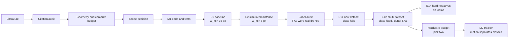

# Design Process, Findings & Lessons Learned

How this project got to where it is: what was asked, what was assumed, what the measurements said, what turned out to be wrong, and what changed as a result. It is written for a supervisor who wants to see the *reasoning and the learning*, not only the final numbers.

> [!NOTE]
> Written 2026-09-28; rows 28-36 of §7 and the last rows of §10 added 2026-10-01 after the design review ([19](19_design_review_parameters_and_novel_directions.md)). Covers 2026-09-18 to 2026-09-28: literature phase, design, milestone-1 code, experiments E1-E12, E14 (moved to Colab), the hardware and latency analysis ([18](18_hardware_optimisation_and_realtime_latency.md)), and the first milestone-2 tracking result. Numbers are taken from the logs they cite: [14](14_build_log_and_experiments.md) (results and findings), [15](15_detector_training_methods_and_findings.md) (method and interpretation), [16](16_training_run_log.md) (every run, in order), [11](11_research_deliberations_and_user_pushback_log.md) (design arguments) and [01 Appendix A](01_research_papers_compendium.md#appendix-a-what-changed-in-the-2026-09-21-audit) (citation audit).

---

## 1. The Project in One Paragraph

A **vision-only counter-drone detection system**: one or two fixed ground cameras looking up, a small neural detector, then (later) a tracker and a rule-based decision layer with a human in charge. Detection only, in Canada, as private academic research. The research question that emerged is the **"drone eyes" problem**: find small, distant drones, and do *not* call birds, aircraft or clutter a drone.

---

## 2. Timeline at a Glance

| Dates | Phase | What happened | Key turn |
| :--- | :--- | :--- | :--- |
| 09-18/19 | Literature | Compendium of papers, repos, datasets, architectures (docs 01-12) | Broad, and too trusting of its own sources |
| 09-21 | **Audit** | Every reference checked at the primary source | Most citations were wrong; 10 papers did not exist. All rebuilt |
| 09-22 | Design from first principles | Geometry and compute worked out numerically (doc 13) | *The lens, not the model, sets warning time* |
| 09-23 | Scope + Milestone 1 code | Vision only, 1-2 cameras; `cuas/` package with tests | Registration on sky is harder than expected |
| 09-24 | E1, E2 (Colab) | Baseline, then training on simulated distance | Smallest reliably found drone: 16 px → 8 px |
| 09-24 | Diagnostics | Looked at the "false alarms" | Most were **unlabelled real drones** |
| 09-25 | E11, E12 (local GPU) | New dataset: the drone class failed; multi-dataset training fixed it | New main error: clutter |
| 09-27 | E14 preparation | Mining clutter as negative examples | Found a burned-in caption artefact; added proper statistics |
| 09-28 | E14 training | Ran locally, lost a night to hibernation, paused after epoch 10, then moved to a Colab L4 | Operational lessons (sleep, battery, shared GPU) |
| 09-28 | Hardware and latency | Camera pixel budget, detector demand vs capacity, glass-to-track latency (doc 18) | Range, field of view, frame rate: *pick two* |
| 09-28 | Milestone 2 starts | Tracker and track features on Halmstad | Motion alone separates drones from birds and aircraft (AUC 0.92) |

---

## 3. Phase 1: Literature, and the First Big Lesson

### 3.1 What was done
Docs 01-12 surveyed papers, code repositories, datasets, industry systems, sensor physics, detector architectures, camera placement, tracking and a decision layer.

### 3.2 What went wrong: the citations
A review requested on 2026-09-21 checked every reference against arXiv, Crossref and Semantic Scholar:
* Of 32 paper entries, **4 were accurate**, 14 were real but misattributed, 4 studied a different task, and **10 did not exist**.
* 11 of 16 arXiv IDs and all 19 DOIs pointed to unrelated papers or to nothing. Some invented authors were derived from GitHub usernames.
* Several carried precise-looking statistics ("98.9% discrimination", "99.8% Pd") that belonged to no real paper.

**Response:** every reference was rebuilt from verified records; the removed ones are listed with their bogus claims so they cannot creep back ([01 Appendix A](01_research_papers_compendium.md#appendix-a-what-changed-in-the-2026-09-21-audit)). The process was changed, not just the content:
* `papers_database.json` is the single source of truth, with `verified` and `verified_on` fields.
* The bibliography is **generated** from it, never hand-edited.
* `tools/check_docs.py` fails if a verified paper is uncited or the bibliography drifts.

**Lesson:** plausible-looking references are not evidence. A literature base has to be verifiable by tooling, not by trust.

### 3.3 Two opposite reasoning errors
Recorded in [11 §1](11_research_deliberations_and_user_pushback_log.md#1-pushback--resolution-log):
* **Dismissing something new from stale memory.** YOLO26 was first treated as speculative. The official docs and paper showed it was the current Ultralytics family, and it became the detector.
* **Over-accepting after pushback.** Gaussian splatting and Mamba were first endorsed for drone tracking. On checking, the cited Mamba paper was about *salient-object* detection, and 3D pose tracking needs far more pixels than a drone at 165 m provides (4-15 px).

**Lesson:** the fix is the same in both directions: check the primary source, then check feasibility *for this geometry*. This became a standing rule ("verify claims both ways").

---

## 4. Phase 2: Designing From First Principles

### 4.1 Pixels on target dominate everything
The detection range follows from one formula ([13 §2](13_system_requirements_and_geometry_budget.md#2-pixels-on-target-the-constraint-that-dominates-everything)):

$$R_{\max} = \frac{f_x \cdot S}{w_{\min}}$$

where $f_x$ is the focal length in pixels, $S$ the drone size and $w_{\min}$ the smallest drone (in pixels) the detector reliably finds. Two consequences shaped the design:
* **A better model cannot create pixels the lens did not capture.** Every 100 m of range is worth 2.5 s of warning against a 40 m/s FPV drone, far more than milliseconds of inference.
* **$w_{\min}$ was an assumption (10 px)** that had to be measured. It became the headline metric for every experiment, instead of the usual averaged accuracy score (mAP), which hides small-target behaviour.

### 4.2 Elevation: distant drones sit near the horizon
A drone 30 m above the camera is at 16.7° elevation at 100 m but 3.4° at 500 m ([13 §2.4](13_system_requirements_and_geometry_budget.md#24-elevation-where-distant-drones-actually-appear)). A camera "looking up" sees mostly nearby drones, and a low FPV only in its last half-second. **Decision:** tilt the long-range camera low, lower edge just above the skyline, and mask the ground.

### 4.3 Compute: full-resolution scanning does not fit
Tiling a 4K frame into 32 detector tiles costs ~80 ms per frame on a T4, i.e. ~12 FPS on datacentre hardware ([13 §3.1](13_system_requirements_and_geometry_budget.md#31-compute-what-full-resolution-detection-costs)). Downscaling would throw away the very pixels §4.1 requires. **Decision:** detect on crops around motion and existing tracks, plus a periodic full scan.

### 4.4 Decision layer: advisory, not authority
An external reasoning API ("Jev") was considered for threat assessment. Analysis placed it as an *advisory* layer under a deterministic rules floor with a human authorising; it was later **deferred** as not worth it at this scope ([12](12_typesafe_jev_system_one_c2_threat_engine.md)). Reviewing the rules code found a real bug: imminence came from being *inside* the zone, so a spoofed Remote ID could relax a fast track closing from outside. Imminence now comes from time-to-collision.

### 4.5 Scope narrowed (2026-09-23)
Vision only, 1-2 cameras, detection only, laptop GPU + Colab for training, a Raspberry Pi 5 as a future capture node. Narrowing made the project testable within weeks.

---

## 5. Phase 3: Milestone 1 Code

Built: tiling that never downscales targets, motion cueing, a swappable detector interface (the detector library is AGPL, so it is kept behind an interface), evaluation by box width, video replay and dataset converters, all with unit tests (now 26).

**Finding while building motion cueing** ([14 §5](14_build_log_and_experiments.md#5-findings-so-far)): to detect motion, consecutive frames must first be aligned (camera shake). On a near-featureless sky:
1. Plain phase correlation was only ~1 px accurate.
2. Running it on gradient magnitude gave ~0.24 px, **but** one dark, high-contrast drone then outweighed every cloud edge. The alignment locked onto the *drone*, the hit rate fell to 0.42, and ~3,000 false motion blobs appeared.
3. **Clipping the gradient at its 99th percentile** fixed it: hit rate 1.0, 5 false blobs in 60 frames. Both failure cases are now regression tests.

**Lesson:** the target itself can break a preprocessing stage designed to ignore it. Synthetic tests with a known answer caught this before any real footage.

---

## 6. Phase 4: Experiments, One Question at a Time

Rules adopted from the start: change **one thing** per experiment; split data **by video**, never by frame (neighbouring frames are near-duplicates); run a 2-epoch smoke test before every long run; log every run in [16](16_training_run_log.md).

### 6.1 Sanity check: the dataset had no small drones
The Halmstad dataset (285 visible videos, 640×512) has median drone width 33.8 px and **no box under 8 px**, so it could not measure $w_{\min}$ at all. **Workaround:** `cuas/zoomout.py` shrinks frames k-fold into k×k mosaics to simulate distance (a 34-px drone becomes ~8.5 px at k = 4). It is an **optimistic proxy**: shrinking averages away noise and blur that a real distant drone would have.

### 6.2 E1 (baseline): $w_{\min}$ = 16 px, not 10
YOLO26s fine-tuned on native-size frames. Recall collapses below 12 px (0.36 at 8-12 px, 0.03 at 4-8 px). With the formula in §4.1, **detection range is 62% of plan**: a Mavic-class drone at ~226 m instead of ~361 m with the candidate 16 mm lens.

Also learned: **confidence scores are not probabilities.** Drone scores topped out around 0.4-0.5, so at a threshold of 0.4 even large-drone recall fell to 0.62-0.67. Thresholds must be chosen from data, and scores calibrated before any rule consumes them.

### 6.3 E2: training on simulated distance cuts $w_{\min}$ to 8 px
Adding shrunken training mosaics (one change vs E1): recall at 4-8 px 0.03 → 0.86, 8-12 px 0.36 → 0.97 (conf 0.25), with no loss at normal size. **The E1 limitation was the data, not the model.** Stated caveat at the time: train and test mosaics come from the same generator, so this is an upper bound.

### 6.4 Refining the measurement changed the story twice
The first E1 result reported 326 "background" false alarms. Instead of accepting that number:
1. **A three-way split** (on a real drone / on a bird or aircraft / on background) showed **230 of the 326** were duplicate or misplaced boxes on real drones. Only 96 were true background.
2. **Looking at pictures** of the remaining false alarms: **12 of 12** native and **11 of 12** shrunken examples were **real drones with no label**. In this dataset "no label" often means "not annotated", not "no drone", and those frames had been used as empty training examples.
3. After fixing the converter and rebuilding: E2's background false alarms fell **103 → 4**, and ~99.5% of its drone calls were correct.

The deployment false-alarm estimate moved accordingly: ~1.3 per full 4K scan (first, counted per image) → ~0.3 (per unit area) → **~0.011** (after removing unlabelled drones), i.e. ~80 per hour at a 2 Hz scan before tracking.

**Lesson:** an aggregate error count is a hypothesis, not a finding. Split it, then look at examples. Labels are data and can be wrong.

### 6.5 E11: the "drone" class did not transfer to a new dataset
On Anti-UAV300 (different cameras, sites, drones, lighting), both models called **≤ 4%** of drones "drone".
* First suspicion was a pipeline bug. Two checks ruled it out: a **class-agnostic** check (E1 placed a correct box on 75% of drones, but labelled them *airplane* or *helicopter*), and a **local-vs-Colab reproduction** that matched every number exactly.
* Likely cause: the bird and airplane class heads were inherited from COCO pretraining (broad "flying object" priors), while "drone" was learned from one dataset of mostly dark silhouettes. White quads on grey sky looked more like "airplane".
* E2's *small-object localisation* did transfer (~50-60% of shrunken unseen drones boxed at 7-14 px); the *classification* failed.

**Lesson:** in-domain numbers (8 px, 99.5% precision) held only for footage like the training set. This reframed every earlier result as in-domain.

### 6.6 E12: multi-dataset training fixed the class, exposed clutter
Training on Halmstad + Anti-UAV's training videos (Anti-UAV test held out):
* Held-out test recall **0.05 → 0.87**, $w_{\min}$ **8 px**, drones mislabelled as airplane **5,064 → 13**. So the planned "remove COCO class heads" experiment (E13) was deprioritised: data alone fixed it.
* **New main error: clutter false alarms.** Precision 0.78 (1,568 background false drones over 2,217 images): night lights (~40%), buildings, cranes and pylons (~35%), dark foliage or cloud (~15%). **Cause:** Anti-UAV contributed only tiles containing a drone, so the model never saw its clutter labelled as "nothing".
* Costs, reported honestly: native Halmstad recall fell 0.93 → 0.85; airplane recall has declined in every experiment (0.81 → 0.71 → 0.675).
* **Caveat:** the test set is unseen *videos* of a dataset the model trained on, not an unseen dataset. That test is E15.

### 6.7 E14: hard-negative mining
Run E12 over its own training frames, cut 640-px tiles around its false alarms, and add them as empty examples. Preparing it produced three findings:
1. **A dataset artefact.** Contact sheets showed ~60% of the mined "false alarms" were a **burned-in Chinese caption** (民航飞机, "civil aviation aircraft") in the bottom-left corner of some night videos. The overlay-removal mask missed it because it only keeps pixels present in ≥ 30% of frames *dataset-wide*, and this caption appears in some sequences only (train 31, val 12, **test 0**). Excluded from mining; evaluation sets left unchanged so E14 stays comparable with E12.
2. **A code bug.** 1,016 tiles were written but only 1,004 files existed: two false alarms near a frame edge could clip to the same tile origin. Fixed with a test, and the first version of that test was itself wrong (its boxes didn't trigger the bug) and was corrected until it reproduced the failure on the old code.
3. **A statistics gap closed.** The validation set is effectively ~57 videos, not 1,782 frames, so differences of 3-5 points were noise. Per-video (cluster) bootstrap confidence intervals and a paired run comparison were added. E12's first intervals: Anti-UAV native recall 0.899 [0.864, 0.932], precision 0.689 [0.659, 0.720].

**Result (2026-10-01).** At its own val-chosen threshold, E14 looked 9× cleaner than E12 on the held-out test (background false alarms 133 → 15 per 1000 frames). But the threshold had moved (0.40 → 0.55) and recall fell 0.90 → 0.76.

Compared at the **same validation recall**, with a paired per-video bootstrap, the real effect is smaller: background false alarms −44%, precision +2 points, recall −2 points, all statistically clear. On Halmstad, the Anti-UAV negatives made things slightly worse. Hard negatives helped a little; they did not solve clutter.

The lesson generalises: *compare models at the same recall, not at thresholds each chose for itself* (`compare_runs.py --match`, now used for E18). The same sweep showed that Halmstad drones score 0.40-0.55, so a threshold chosen on Anti-UAV removes most of them. Thresholds must be set on the deployment site's own footage.

### 6.7b E15: the first truly unseen dataset
On DUT Anti-UAV, never used for training or thresholds, recall fell to 0.14. Contact sheets confirmed the evaluation was right, and splitting the drones by background showed two different failures:
* drones against buildings, trees and ground (outside this project's sky-facing scope) were almost never found;
* drones against sky were *found* 57% of the time, but mostly **named helicopter or airplane**. This is the COCO class-head failure first seen in E11, returning on close, clearly visible quadcopters unlike the small distant drones in training.

In-domain test numbers (recall 0.90) said little about a new dataset. That is the main threat-to-validity lesson so far, and it re-prioritises the class-head experiment (E13) and more varied training data.

### 6.9b Milestone 2 on real detector output (2026-10-01)
Replacing the simulated (ground-truth) boxes with the real detector's output across all 285 Halmstad videos did not hurt. Track features separated drones from birds, airplanes and helicopters with AUC 0.92 from one second of track, and 0.93 from two, on videos held out from both the detector and the classifier. That is 0.15-0.18 above the size-and-position baseline.

The detector's own class votes were perfect on these videos (AUC 1.00), and that is the trap: E15 had just shown the same class head failing on a new dataset. The pipeline therefore keeps a **track-only** classifier as the default outside familiar footage (12% "unknown", 93% correct on the rest). Its evidence does not depend on how a drone looks, only on how it moves.

### 6.8 Hardware and latency: the camera forces a choice
Doc 18 worked out what the field system needs. The candidate camera (Pi HQ, IMX477) delivers about **120 megapixels per second in every mode**: full resolution at ~10 fps, or 2×2 binned at 40 fps with half the range. **Range, field of view, frame rate: pick two per camera.**
* At 10 fps a crossing drone at 100 m jumps ~400 px between frames, and confirming a track takes ~0.4-0.5 s against a 0.3 s budget. At 40 fps both problems go away, but range halves.
* **Compute:** the Pi 5 CPU runs ~15 detector tiles/s against a need of at least 44, so it stays a capture node. A Jetson Orin Nano Super fits with the small model only, which turned model size (E3) into a hardware question.
* **Latency** matters little for warning time (~6% of an FPV's ~8 s) but a lot for handing a track to a zoom camera. So frames are timestamped at exposure and the tracker predicts forward.

**Lesson:** the hardware question was answered by arithmetic before any purchase, and the arithmetic changed the priorities: frame rate and model size matter more than raw inference speed.

### 6.9 Milestone 2: telling drones from birds by how they move
A tracker (a Kalman filter matching detections to the *predicted* position, timestamp-based) and per-track features were built and tested on the CPU. The features are speed in body lengths per second, hovering, straightness, turn rate, shape change and wing-flap periodicity. The first experiment used Halmstad's ground-truth boxes with jitter and 10% dropped detections, cross-validated by video (280 videos).
* Drone vs not-drone AUC: **0.88 from 1 s of track, 0.92 from a whole ~10 s track.** Motion features carry most of it (0.91 alone).
* At 10 fps the overall result barely changes, but wing-flap features alone drop (0.78 → 0.69): the first evidence for doc 18's frame-rate concern.
* **A deliberate confound probe:** box size and position alone, which say nothing about behaviour, reach AUC 0.72-0.76, because each class was filmed in its own sessions. The motion result is well above that, but ruling the confound out needs a dataset where drones and birds share the same scenes (Drone-vs-Bird).
* **Decision on masks:** no segmentation network. At 8-30 px a mask adds almost nothing over a box, and no dataset has mask labels. The useful part (silhouette area over time, the flap signal) comes almost free from thresholding inside the box against sky.

**Lesson:** a result is only as good as the baseline that could explain it away. Building the "size and position only" probe into the experiment showed the limit of the claim immediately.

---

## 7. Catalogue of What Went Wrong

| # | What was wrong | How it was found | Impact | Fix | Lesson |
| :-: | :--- | :--- | :--- | :--- | :--- |
| 1 | Most citations wrong; 10 papers nonexistent | Requested expert review; primary-source checks | Literature base unusable as it stood | Rebuilt from verified records; tooling enforces it | Verify references by tooling, not trust |
| 2 | YOLO26 dismissed as speculative | User pointed to official docs | Nearly chose an older detector | Adopted after checking | Don't dismiss from memory |
| 3 | 3DGS and Mamba over-endorsed | Checking the cited papers and the pixel geometry | Would have sent effort to infeasible ideas | Scoped to synthetic data only | Don't flip to agreement without checking |
| 4 | Rules floor let spoofed Remote ID relax an approaching track | Code review of the decision layer | Safety logic gap | Imminence from time-to-collision | Review safety logic against adversarial inputs |
| 5 | $w_{\min}$ assumed 10 px | E1 measured 16 px | Range 62% of plan | E2 training recovered 8 px | Measure the assumption that sets the design |
| 6 | Registration locked onto the drone | Synthetic test with known answer | Motion cueing would fail on dark targets | Clip gradients at 99th percentile | The target can break stages meant to ignore it |
| 7 | Unlabelled drones used as "empty" examples | Looking at false-alarm pictures | False alarms overstated ~25×; training taught "drone = nothing" | Converter no longer uses unlabelled frames as background | "No label" is not "no object" |
| 8 | False-alarm estimate revised three times (1.3 → 0.3 → 0.011 per scan) | Each refinement of the measurement | Early estimates would have mis-sized the tracker requirement | Per-area rates on clean labels | Report the unit and the caveat with every rate |
| 9 | In-domain results read as general | E11 on a new dataset | 8 px / 99.5% held only for similar footage | E12 multi-dataset; E15 never-seen dataset | A test set from the training distribution is not generalisation |
| 10 | Overlay mask, first version | Its own unit test | Would have erased moving-drone trails | Persistence-based mask | Test preprocessing against the target, not just the artefact |
| 11 | Overlay mask missed a sequence-specific caption | Contact sheets of mined train false alarms | ~60% of mining budget would have gone to an artefact; val precision understated | Template-match exclusion | Inspect false alarms on *every* split |
| 12 | Duplicate tiles; first regression test didn't reproduce the bug | File count ≠ expected count | 12 wasted writes, no content change | De-duplicate origins; test confirmed failing on old code | A test must fail on the bug it guards |
| 13 | Small differences between experiments treated as meaningful | Epoch-to-epoch swings of ±3-5 points | Risk of false conclusions | Per-video bootstrap CIs, paired comparison | Count independent units (videos), not frames |
| 14 | "Smallest drone" metric reports 64 px on one run | One size bin at 0.79 (just under the 0.8 cut) | Misleading headline number | Read the full recall-by-width table | A threshold metric can hinge on one bin |
| 15 | Operational: shared GPU, overnight hibernation, battery throttling, a resume flag that didn't work as documented | Run logs, Windows event log | E14 lost a night; ran at half speed | Queue behind the GPU, AC power, fixed the script; GPU work moved to Colab | Long runs need the machine state checked, not just the code |
| 16 | New tracks read as "hovering" (the filter starts at zero velocity) | A unit test with a known answer | Would have biased the hover feature | Velocity features skip warm-up samples | Filter start-up is not data |
| 17 | Halmstad bird labels jump between flock members | The tracker refused jumps of 7-20 box widths in one frame | Fragmented bird tracks (a label issue, not a tracker bug) | Documented; use the longest track | Labels can be physically impossible; a motion model exposes it |
| 18 | Class could be predicted from recording conditions | A size/position-only baseline (AUC 0.72-0.76) | The motion result may partly reflect filming sessions | Test on a dataset with shared scenes | Build the baseline that could explain the result away |
| 19 | Time-to-collision read 0.5 s late (a least-squares fit estimates the window's middle) | An end-to-end pipeline test with a known answer; the unit test's loose tolerance had hidden it | Late alerts, by half the fit window | Subtract the lag; tighten the test to ±0.1 s | A test tolerance can hide a systematic bias |
| 20 | Calibration error reported as 0.000 | The number was too good to be true | Would have overstated how trustworthy p(drone) is | Cross-fit the calibrator too; test it | A calibrator scored on its own training data proves nothing |
| 21 | Classifier fits 50× slower than expected | Timing one fit at 16, 4 and 1 threads | A 3-minute unit test; slow experiments | Cap OpenMP at 1 thread for small data | Measure before guessing; defaults are tuned for big data |
| 22 | A latency benchmark ran while another project's LLM held the GPU | Erratic ratios (a bigger model timed faster than the base) | Wrong cost numbers for the hardware budget | Rerun interleaved, best of 3 rounds; check `nvidia-smi` and act on it | A shared machine needs a measurement design, not just a check |
| 23 | A tiny training test "passed" while no weight had changed | Checked that the new parameters had moved from zero; the pretrained ones had not moved either | Would have certified an add-on training path that was never exercised | Ultralytics accumulates to a nominal batch of 64; set `nbs` equal to the batch in tiny tests | A test that could not have failed proves nothing: check that the thing actually moved |
| 24 | Two runs compared at the thresholds each chose on validation | A threshold sweep of the older run: at a higher threshold it matched the newer one | Would have reported hard-negative mining as a 9× false-alarm cut when it mostly moved the scores | Compare at matched recall (`--match`), always with a sweep | A threshold is part of the operating point, not the model |
| 25 | A Colab stage crashed at its final save, after all the inference | The traceback's line numbers pointed at `json.dump`; numpy float32 is not JSON | A lost GPU stage; the real error message was hidden by the output filter | Plain Python numbers at the source; check serialisability after the first item; print the output tail on failure | Fail fast, and never filter away the error |
| 26 | A first read of E14 drawn from one side of a comparison | E14's own sweep, once its detections were local, refined "no better" into "−44% background false alarms at −2 points recall" | A small real gain nearly reported as none | Wait for both runs' full data before a verdict; label provisional readings as such (it was) | Provisional is fine if it says so; the correction goes into the record too |
| 27 | The M2 extraction ran under the wrong Python | `ModuleNotFoundError: mcos_decoder` | Minutes | Use the venv the docstring names | Two interpreters on one machine: name the interpreter in every command |
| 28 | The dataset converters were never in the repository | A code review listing ignored files: `datasets/` in `.gitignore` also matched `cuas/datasets/` | A clone could not run the tests or rebuild any dataset; the label-handling rules had no history or backup | Anchor ignore rules to the root | Check what git *ignores*, not only what it tracks |
| 29 | A new track could take an established track's detection | Reading the association code against its own comment, then reproducing it | Track starvation in clutter (rare on Halmstad: 14 in 25,000 updates) | Match confirmed tracks first | A comment is a claim; test it |
| 30 | Time to collision was noise on young tracks | Simulating non-closing tracks with the measured box jitter: 75% read "under 10 s" | Would have flooded any rule that trusted it | A significance test, a minimum span, a longer window, and an exact 1/width fit | Put the noise through the estimator before trusting its output |
| 31 | A flapping bird read as "0.2 s to impact" | The simulated scene | A false alert on every flapping bird | Require a whole wing beat in the fit | A simulator earns its keep by producing failures nobody listed |
| 32 | One seed per experiment | The second seed of an unchanged recipe was "clearly" different | Several reported effects are the size of a seed difference | Three seeds per arm | An interval over test videos says nothing about training variance |
| 33 | The best-of-N checkpoint was treated as "the model" | Scoring the last checkpoint of the same run | Checkpoint choice moved false alarms by 2× at matched recall | Fixed epochs, final weights | Every selection step is a noise source; fix it or count it |
| 34 | Small-target recall measured only on clean images | Degrading real frames (E21) | 0.93 → 0.08 at ~8.5 px under moderate blur, noise and compression | Degrade the training images (E22) | A caveat written down is not a caveat measured |
| 35 | A 93%-accurate track classifier gave 71 false declarations per hour | Running the whole system on whole videos (E20) | The per-window number overstated the system by a wide margin | A hold time now, a sequential test next | Score the system, not the component |
| 36 | The registration reference never changed | A synthetic sky whose clouds change | Motion cueing would fail within minutes outdoors (hit rate 0.44, 56 false blobs per frame) | A reference that follows the scene | Short tests cannot see slow failures |
| 37 | A "fixed 25 epochs" rule was written from validation-mAP best epochs, in the same document that showed validation mAP picks the wrong checkpoint | The user asked whether 25 was enough | Would have shortened every later run on the wrong evidence | Keep the full 40; test 80 with a paired run | A rule must rest on the criterion you trust, not the one you just rejected |
| 38 | Two faults were named from other people's papers before they were measured here: a single inference scale, and sparse labels trained as complete | E28 (multi-scale inference on DUT) and a count of confident boxes on unlabelled spots in the training tiles | Both shrank: +0.03 recall at one false drone per drone gained; 25 candidate boxes in 10,272 tiles | Reported as measured; no coarse pass, no pseudo-label experiment | A fault read from the literature is a hypothesis about our system until it is measured on our data |
| 39 | Every E18 run was compared with one baseline run, which turned out to be the weakest of six (seed 0, stopped early) | The ECA control, a near-null change, was called "better" than it as often as the real add-ons | "B better" lines in every comparison file flattered the add-on | Read each arm against the second plain seed; three seeds per arm from E22 | Include a control arm that should do nothing: if it wins, the baseline is the problem |
| 40 | "Drones are found but named helicopter or airplane" was read as a naming error in the class head | E13: training with the drone class only | The drone-only model missed 97% of DUT sky drones; the other heads had been doing the finding | Keep four classes; treat any airborne box as a candidate; get more varied drone data | A wrong label on a correct box does not mean the right label was nearly chosen. Test the reading before building on it |
| 41 | Two seeds were averaged into one model without checking that they started from the same weights | The soup found no drones at all; the installed source and the logs ("Remapped 2/4") showed the drone row of the class layer starts at random per seed | 35 minutes of GPU scoring a dead model; a wrong statement in doc 19 that three class rows came from COCO | E31 shelved; the statement corrected | Check a method's precondition in our own setup before running it. The log line had been there since E12 |
| 42 | Each model was scored at its own threshold, chosen by maximum F1, which flips between 0.40 and 0.55 | E22a's degradation and DUT columns sat at different thresholds from the plain model's; a threshold-free score (E35) was computed | Several comparisons mixed "better model" with "lower threshold"; a "Halmstad cost" was reported twice that AP shows is not there | AP and recall at a fixed false-alarm budget are the headline scores | Compare models with a score that has no knob. Keep the knob for describing one operating point |
| 43 | The held-out test sets were scored after every run, and recipes were chosen on them | Reviewing the validation scheme against principle 6 | The numbers of an adopted recipe are slightly optimistic; no set is left truly unseen | Reserve one dataset until a recipe is final | A test set you consult to make decisions has become a validation set |
| 44 | A validation set that every model scores 0.995 on was still quoted as evidence | AP on Halmstad native val: 0.993-0.997 for seven runs | Differences there were threshold effects, read as model differences | Use its shrunken and degraded versions; native frames are a sanity check | Check that a benchmark can still tell your models apart |
| 45 | Box error was never measured, though range and time to collision are computed from box width | E35 | Width is 25% too large under 8 px: range reads short and time to collision long, unquantified until now | Quote the bias; correct per size when range is built | Measure the input error of every quantity you derive |
| 46 | The first pasted-drone tiles had night drones (lights on black) in daylight skies and halos of old sky | The contact sheet, looked at before training | A quarter of one direction's tiles would have taught something no camera sees | A brightness rule, night patches dropped, edge pixels un-mixed | Look at generated training data before training on it; a loss curve cannot show this |
| 47 | A second detector (RF-DETR) was written and put in the Colab queue without ever having run | A local smoke run the next day (16 #85) | Faults that would each have cost a Colab round trip: missing training packages, symlinks on Google Drive, an epoch count nobody had sized | Run locally on a small sample; its own Colab environment; a time budget sets the epochs | Code that has never run does not go into the queue |
| 48 | A session ended with new code, a 1.5 GB data build and queue changes, but no log entry and no handoff note; the code zip was stale | The next chat found 15 uncommitted files that no document mentioned | Time spent reconstructing the state; one build fault (a video skipped after a decode timeout) had gone unread | The log entries were written from the code and build logs; the missing video rebuilt (16 #83, #84) | Write the log entry and the handoff before the long build, not after; a build that reports missing frames must stop |

---

## 8. Conclusions So Far

**What the evidence supports:**
* **Training on degraded images is the first change whose effect is several times the seed spread** (E22a, three seeds): recall under blur, noise and compression rises at every size, also for kinds of degradation never trained on.
* **Training data, not architecture, has been the limiting factor every time.** Small targets (E1 → E2), cross-dataset classification (E11 → E12) and, being tested, clutter (E12 → E14) were each addressed by changing data, with the model unchanged.
* **Small drones are learnable from simulated distance:** $w_{\min}$ 8 px at conf 0.4, in-domain and on unseen videos of a training dataset, roughly doubling range versus the baseline.
* **Birds are rarely called drones** by the detector alone (~1% of bird instances at the operating point in E1; 0 in E2).
* **Per-frame detection cannot meet a sensible false-alarm-per-hour target by itself.** Temporal confirmation (tracking) is a requirement, not an extra.
* **Track motion separates drones from birds and aircraft** on ground-truth boxes (AUC 0.88 from 1 s, 0.92 from ~10 s), and 10 fps is enough for the motion part.
* **The camera's pixel budget forces a choice** between range, field of view and frame rate (doc 18), and model size decides the edge hardware.

**What it does not yet support:**
* Generalisation to a dataset never trained on (E15, DUT Anti-UAV, pending download).
* Performance on real long-range footage from the intended camera (simulated distance is optimistic).
* A false-alarm rate over empty sky (all validation frames contain a target).
* Dusk, rain, fog or night within scope.
* That the motion result holds on real detector tracks, and on a dataset where drones and birds share scenes (it may partly reflect recording conditions).
* Any measured latency or throughput on the intended hardware.

---

## 9. Principles That Emerged

1. **Work the geometry first.** Pixels on target decide range; range decides warning time; model choice is downstream.
2. **Measure the number the design depends on** ($w_{\min}$), not the number the field usually reports (mAP).
3. **One change per experiment,** a smoke test first, every run logged.
4. **Split by video.** Count independent units when judging differences; use per-video intervals.
5. **Never trust an aggregate.** Split errors by type, then look at examples.
6. **Hold out a test set and score it once;** choose thresholds on validation.
7. **State the optimistic caveat alongside every good number.**
8. **Verify at the primary source, in both directions:** neither dismiss nor accept without checking.
9. **Write it down immediately.** Every decision, error and fix goes into the docs, because anything decided only in conversation is lost.
10. **Build the baseline that could explain the result away** (here: box size and position only), and report it next to the result.
11. **Do the hardware arithmetic before buying,** and measure on the target before trusting a published number.
12. **Make a new idea earn its place against noise and cost.** A published gain from one run is a hypothesis: test it against a second-seed baseline, and weigh it against the extra compute per tile.
13. **Fix every selection step or count it as noise:** seed, checkpoint, threshold. Three seeds, fixed epochs, final weights, matched recall.
14. **Score the system, not the component.** Per-image and per-window numbers do not add up to false alarms per hour.
15. **Measure a suspected fault before ranking it.** Two of the faults a literature sweep suggested were small when measured here (19 §10.2); two cheap checks saved two experiments.
16. **Compare models with a score that needs no threshold; describe an operating point with one that does.** And keep one test set that no decision has touched.

---

## 10. Open Questions and Next Steps

| Step | Question | Status |
| :--- | :--- | :--- |
| E14 | Do mined clutter negatives raise precision without losing recall? | Done: at matched recall −44% background false alarms, −2 points recall; worse on Halmstad |
| M2 | Does motion still separate classes on real detector tracks, calibrated, and on another dataset? | **Real tracks: yes** (AUC 0.92 at 1 s on held-out videos; track-only classifier 93% on decided windows). Another dataset: needs Drone-vs-Bird |
| E15 | Does the detector generalise to a dataset it never saw? | **No (2026-10-01):** recall 0.14 on DUT; on sky backgrounds 57% found but mostly named helicopter/airplane. Next: E13 (class head), more varied data |
| Drone-vs-Bird | Real small drones and birds at range, in shared scenes (the confound test for M2; real-target $w_{\min}$, E19) | Training set granted; test set withheld; drones-only labels (public, verified 2026-09-30). Waiting for the videos |
| E3 / E16 / E17 | Small vs current model, laptop latency, 320-px crops: these decide the edge hardware (doc 18) | Planned |
| E18 | Do YOLOBirDrone's architecture changes (deformable convs, multi-scale dual attention) beat the noise and pay for 1.6-1.8× compute? | **No evidence they do (2026-10-01):** the full model sits between two seeds of the plain model on the test, Halmstad and DUT, and is worse on Anti-UAV val (19 §3.5). **Ablations done (2026-10-02, 19 §3.6):** none beats plain seed 1, attention only is worse, and the ECA control "beats" seed 0 as much as any add-on. Closed |
| E5 | How much video compression costs | Planned |
| E22 | Does small-target recall survive a noisy, blurred, compressed image if training shows it one? | **Yes, in part (2026-10-04, three seeds):** ~34 px 0.37 → 0.85, ~8.5 px 0.12 → 0.32, held-out degradations included; clean accuracy slightly up; no help on the unseen dataset. Adopted (15 §6.14) |
| E31 | Can the seeds be averaged into one model? | **Shelved (2026-10-03):** invalid as run, and the seeds now agree (19 §3.8) |
| E22c | Is the drone class tied to the scenes it was filmed in? | Built 2026-10-04 (real drones pasted across datasets); queued on Colab |
| E22b | Do lighter mosaic and scale settings add to degraded training? | **No (2026-10-04, three seeds):** the same recall, 1.7 times the false alarms |
| Epochs | Is 40 enough? | **For experiments, yes (2026-10-04):** 80 halves in-domain false alarms at the same recall but changes nothing on the unseen dataset or under degradation |
| E30 | Does calibrating detector scores per size make one threshold work everywhere? | **No (2026-10-03):** the score gap is per dataset; set thresholds on site footage (19 §3.10) |
| E33 | Is small-target recall an artefact of IoU matching? | **Only below 4 px (2026-10-03)** |
| E34 | What does tracking boxes of any class cost? | **Done (2026-10-03):** on the unseen dataset (DUT) boxes of any class reach 2.2-2.6 times as many drones as "drone" boxes (0.353 against 0.138 at 0.55) for 4 times the stray candidates, and still reach more at an equal stray-candidate rate; on the trained datasets it gains no drone and costs 2.5-5 times the candidates. The pipeline already tracks every class; keep it, with a strict track decision. |
| Seeds | How large is run-to-run variation? | **Small under the fixed protocol (2026-10-03):** two seeds within 0.02 in test recall; the earlier spread was mostly early stopping and `best.pt` (19 §3.1). Third seed queued |
| E20 | What does the whole system do on whole videos? | In-domain: no false declaration in 5.9 min (upper bound 30 per hour); 1.03 s to declare. Needs hours of target-free footage |
| E28 | Do large, close drones need a coarser look at the frame? | **Barely (2026-10-01):** DUT recall 0.141 → 0.170 at one false drone per drone gained; the misses are mostly the class (19 §10.3) |
| E13 | Does drone-only training stop unseen drones being named helicopter or airplane? | **No (2026-10-02):** it stops them being found at all (DUT recall 0.041). Keep four classes (19 §3.7) |
| TTC | Can optical expansion trigger an alert? | Not yet: 1-2 distant aircraft or birds per minute read under 3 s. Needs footage with range truth |
| Own footage | The real test: the intended camera, the intended site, verified-empty sky | After hardware choice |

---

## 11. Where the Evidence Lives

| Topic | Document |
| :--- | :--- |
| Every run, crash, resume and evaluation in order | [16](16_training_run_log.md) |
| Results tables and dated findings | [14 §4, §5](14_build_log_and_experiments.md#4-experiments) |
| Method, capabilities, limitations, threats to validity | [15](15_detector_training_methods_and_findings.md) |
| Geometry, compute and scope decisions | [13](13_system_requirements_and_geometry_budget.md) |
| Field hardware, compute budget and latency | [18](18_hardware_optimisation_and_realtime_latency.md) |
| Design arguments and reversals | [11](11_research_deliberations_and_user_pushback_log.md) |
| Citation audit | [01 Appendix A](01_research_papers_compendium.md#appendix-a-what-changed-in-the-2026-09-21-audit) |
