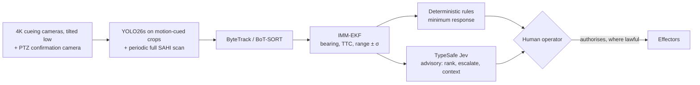

# AI Drone Detection & Defense (C-UAS) Research Compendium

Research notes, verified references, design documents and a growing implementation of a **vision-based counter-drone detection system**: a ground camera looking up, a YOLO26 detector on motion-cued crops, a tracker and kinematic filter, and a decision layer. It is private academic research (Canada, detection only, vision only, 1-2 cameras). Milestone 1 of the code lives in `cuas/`; see [14](14_build_log_and_experiments.md) for what's built and the experiments to run.

> [!IMPORTANT]
> **Verification audit, 2026-09-21.** The paper references were rebuilt from scratch after an audit found that most arXiv IDs and DOIs in the earlier compendium pointed to unrelated papers or to nothing, and that 10 cited papers did not exist. Every reference now in [01](01_research_papers_compendium.md), [06](06_bibliography.bib) and [papers_database.json](papers_database.json) was checked against arXiv, Crossref and/or Semantic Scholar. Technical errors across docs 03-12 were corrected in the same pass (see [Changelog](#changelog)).

---

## 🧭 Current Design at a Glance



| Decision | Choice | Where it's argued |
| :--- | :--- | :--- |
| Camera geometry | Case 1 (fixed, ground-to-air) with the long-range camera tilted low, lower edge just above the skyline; horizon (Case 2) later | [08](08_camera_angles_and_operational_pov_selection.md), [13 §2.4](13_system_requirements_and_geometry_budget.md#24-elevation-where-distant-drones-actually-appear) |
| Lens / range | Set by pixels-on-target for the fastest small threat (FPV). Test-field scenario: **4 × 4K cameras at ≤ ~25°** plus a wider upper row. The cueing camera, not the PTZ, sets detection range. Rerun for the real site | [13 §6.1](13_system_requirements_and_geometry_budget.md#61-reference-scenarios) |
| Scope | Private academic research (open source after publication), detection only (effectors simulated). All four threat tiers analysed, with a 5 s detection-only timeline | [13 §6](13_system_requirements_and_geometry_budget.md#6-decisions) |
| Detector | Ultralytics YOLO26s (STAL for small targets; AGPL-3.0) on motion-cued crops, plus a periodic full SAHI scan (full-frame tiling at 30 FPS doesn't fit on-device) | [07](07_deep_learning_architectures_cnn_transformer_mamba.md), [13 §3.1](13_system_requirements_and_geometry_budget.md#31-compute-what-full-resolution-detection-costs) |
| Kinematics | IMM-EKF; time-to-collision as the primary cue; range treated as coarse | [09](09_monocular_depth_frame_tracking_and_kinematics.md) |
| Decision layer | Rules floor + human authority. **Jev deferred** (sign-up closed; little to add at this scope) | [12](12_typesafe_jev_system_one_c2_threat_engine.md) |
| Drone vs not-drone | The core research focus: detector classes plus track-history features and a calibrated classifier, to reject birds, aircraft and decoys | [14](14_build_log_and_experiments.md) |
| Hardware | 1-2 visible cameras (candidate: Pi HQ camera + 12-25 mm lens), no thermal. Laptop RTX 4060 + Colab for training, Raspberry Pi 5 as capture node | [13 §6](13_system_requirements_and_geometry_budget.md#6-decisions) |
| Framework | PyTorch 2.x in a separate CUDA venv (`C:\cuas_venv`); code in `cuas/` | [14 §3](14_build_log_and_experiments.md#3-setup) |

---

## 📚 Suggested Reading Order

1. **[13 Requirements & geometry budget](13_system_requirements_and_geometry_budget.md)**: why the lens, not the model, sets warning time.
2. **[08 Camera angles / POV](08_camera_angles_and_operational_pov_selection.md)**: why ground-to-air first.
3. **[07 Architectures](07_deep_learning_architectures_cnn_transformer_mamba.md)**, then **[09 Depth & kinematics](09_monocular_depth_frame_tracking_and_kinematics.md)**: the perception stack.
4. **[12 Jev decision layer](12_typesafe_jev_system_one_c2_threat_engine.md)**: how decisions are made and who authorises what.
5. **[03 Datasets](03_datasets_and_benchmarks_catalog.md)** and **[01 Papers](01_research_papers_compendium.md)**: when you start training.
6. **[11 Deliberations log](11_research_deliberations_and_user_pushback_log.md)**: why earlier positions changed.

---

## 🔗 Related Projects

Sibling folders, scope docs only for now:
* [Drone_to_Drone](https://github.com/JoshChomps/Drone-to-Drone): drones detecting and locating each other, sharing state and planning paths (cooperative swarm first; theoretical defensive tracking in simulation later).
* Wildfire_Survey: a vision-first wildfire survey drone for the BC interior, with the BC fire program.

---

## 🗂️ Repository Map

| File | Contents |
| :--- | :--- |
| [01_research_papers_compendium.md](01_research_papers_compendium.md) | **78 verified papers** by modality, each with a project-relevance note, plus an appendix listing what the audit removed |
| [02_github_repositories_and_codebases.md](02_github_repositories_and_codebases.md) | **29 verified repositories** with maturity ratings (maintained / research / hobby / archived) |
| [03_datasets_and_benchmarks_catalog.md](03_datasets_and_benchmarks_catalog.md) | **16 datasets**: real vs synthetic, access route, fit to Case 1, working loaders |
| [04_cuas_defense_systems_and_industry.md](04_cuas_defense_systems_and_industry.md) | Vendors (Anduril, DroneShield, Fortem, Dedrone, D-Fend, …), JIATF-401, battlefield lessons |
| [05_ai_technical_architectures.md](05_ai_technical_architectures.md) | RF, radar (micro-Doppler) and acoustic signal models; tested 1D ResNet; fusion; Jetson deployment |
| [06_bibliography.bib](06_bibliography.bib) | BibTeX for every verified paper. **Generated** from `papers_database.json`; don't edit by hand |
| [07_deep_learning_architectures_cnn_transformer_mamba.md](07_deep_learning_architectures_cnn_transformer_mamba.md) | CNN vs Transformer vs Mamba for tiny targets; YOLO lineage to YOLO26/27; environments |
| [08_camera_angles_and_operational_pov_selection.md](08_camera_angles_and_operational_pov_selection.md) | Ground-to-air vs horizon vs air-to-air vs top-down |
| [09_monocular_depth_frame_tracking_and_kinematics.md](09_monocular_depth_frame_tracking_and_kinematics.md) | Pinhole range and its bias, TTC, ByteTrack/BoT-SORT, IMM-EKF (maths checked numerically) |
| [10_adverse_weather_datasets_and_benchmarks_2026.md](10_adverse_weather_datasets_and_benchmarks_2026.md) | Newest vision benchmarks, fog/rain/low-light physics, metrics |
| [11_research_deliberations_and_user_pushback_log.md](11_research_deliberations_and_user_pushback_log.md) | Decision log: YOLO26, frameworks, Gaussian splatting, Mamba, citation audit, Jev |
| [12_typesafe_jev_system_one_c2_threat_engine.md](12_typesafe_jev_system_one_c2_threat_engine.md) | Jev as an advisory layer: architecture, tested reference code, calibration check |
| [13_system_requirements_and_geometry_budget.md](13_system_requirements_and_geometry_budget.md) | Pixels-on-target, detection range, latency budget, legal scope, decisions and reference site scenarios |
| [14_build_log_and_experiments.md](14_build_log_and_experiments.md) | **What's built, setup, the experiment plan (E1-E9) and results.** Start here for code work |
| [15_detector_training_methods_and_findings.md](15_detector_training_methods_and_findings.md) | **How the detector is trained and evaluated, results, capabilities, limitations, threats to validity, glossary.** Standalone write-up for a supervisor |
| [16_training_run_log.md](16_training_run_log.md) | **Chronological log of every data build, training run, evaluation, crash and fix**, on Colab and the local GPU, with settings, durations and outcomes |
| [17_design_process_and_lessons_learned.md](17_design_process_and_lessons_learned.md) | **The project's story for a supervisor:** timeline, design reasoning, each experiment's question and answer, a catalogue of what went wrong and how it was caught, conclusions and principles |
| [18_hardware_optimisation_and_realtime_latency.md](18_hardware_optimisation_and_realtime_latency.md) | **Field hardware and real-time latency:** the camera's fixed pixel budget (range, field of view, frame rate: pick two), detector tiles/s demand vs Pi 5 / Hailo / Jetson / laptop capacity, glass-to-track latency, optimisation levers, what to measure before buying |
| [19_design_review_parameters_and_novel_directions.md](19_design_review_parameters_and_novel_directions.md) | **Design review (2026-10-01):** code findings and fixes, seed and checkpoint noise, the degradation sweep, system-level results, a verdict on every parameter, novel directions ranked, the PX4/simulation plan, how to run the program |
| [20_field_sessions_own_footage.md](20_field_sessions_own_footage.md) | **Field sessions with our own drones (living plan, 2026-10-05):** why own footage, the checklist, camera setup, the shot list (sync, distance ladder, approach, crossings, manoeuvres, backgrounds, empty sky), distances for a given pixel size, the clip log, what happens to the files, data rules, and the session log |
| `cuas/` | The pipeline package: tiling, motion cueing, detector interface, evaluation, tracker, track features and classifier, rules floor, **the program** (`python -m cuas`), scene simulator, simulated-distance (zoom-out) sets, dataset converters |
| `tests/test_cuas.py` | Tests for `cuas/` (numpy + OpenCV, no GPU): `python -m unittest discover -s tests` |
| `experiments/E1_baseline_detector.ipynb` | Colab notebook for the first training run |
| `experiments/*.py` | Local GPU scripts: E11 evaluation, E12 build / train / evaluate / diagnose, local-vs-Colab reproduction check (14 §2) |
| [papers_database.json](papers_database.json) | **Single source of truth** for references: the 77 papers with bibliographic fields, `verified`, `verified_on` and `abstract_reviewed` |
| [tools/fetch_arxiv_papers.py](tools/fetch_arxiv_papers.py) | arXiv search, with optional merge of *unverified* candidates into the database |
| [tools/build_bibliography.py](tools/build_bibliography.py) | Generates `06_bibliography.bib` from the verified database entries (`--check` to test for drift) |
| [tools/geometry_budget.py](tools/geometry_budget.py) | Camera budget per site: needed range, max lens HFOV, cameras per row, warning time per threat, skyline/elevation limits (doc 13 §6.1) |
| [tools/tidy_runs.py](tools/tidy_runs.py) | Sorts `C:\cuas_data\runs` after a Drive download: unpacks the zips, moves each run's reports into `<run>\reports\`, never deletes (`--apply` to act) |
| [tools/check_docs.py](tools/check_docs.py) | Offline checks: every link and `#anchor` resolves, bib in sync, every verified paper cited in 01, Mermaid labels parse |
| [tools/test_tools.py](tools/test_tools.py) | Tests for the four tools (standard library only, no network) |

---

## Threat Spectrum

Approximate figures from open-source reporting. Variants differ widely.

| Tier | Examples | Speed | Guidance / links | Main C-UAS challenge |
| :--- | :--- | :--- | :--- | :--- |
| 1. Micro / mini | DJI Mavic, Autel EVO | up to ~75 km/h | 2.4/5.8 GHz control + video, GNSS | Tiny optical/radar signature; bird confusion |
| 2. FPV strike | 7-10" kamikaze quads | ~100-180 km/h | Analog/digital video links; **fibre-optic tethers** | Seconds of warning; fibre versions are immune to RF detection and jamming |
| 3. Tactical | Lancet, Orlan-10 | ~100-300 km/h (dive) | Encrypted links, GNSS + optical navigation | Stand-off altitude, frequency hopping, decoys |
| 4. Long-range one-way attack | Shahed-136 class | ~150-200 km/h | Inertial + GNSS; often little or no RF uplink in cruise | Mass raids; cost-exchange ratio |
| 5. Swarms | Coordinated multi-UAV | - | Autonomous / mesh | Sensor saturation, operator triage, effector exhaustion |

Tiers 2-4 increasingly fly **RF-silent**. That is the core argument for passive EO/IR detection, and why this project starts there ([04](04_cuas_defense_systems_and_industry.md)).

---

## 🔬 Sensor Modalities

Ranges are **highly system-dependent**. For cameras they are set by the lens ([13 §2](13_system_requirements_and_geometry_budget.md#2-pixels-on-target-the-constraint-that-dominates-everything)).

| Modality | Principle | Strengths | Weaknesses | Typical AI |
| :--- | :--- | :--- | :--- | :--- |
| **RF (passive)** | Detects control/video-link emissions | Passive; can locate the pilot's transmitter | Blind to RF-silent, autonomous and fibre-guided drones | 1D CNNs on I/Q, spectrogram CNNs ([05 §2.2](05_ai_technical_architectures.md#22-rf-classifier-1d-resnet-on-raw-iq)) |
| **Radar** | Range, Doppler, rotor micro-Doppler | Day/night, weather-tolerant, gives range | Clutter; small RCS; birds without micro-Doppler; emits | STFT/VMD + CNN ([05 §1.2](05_ai_technical_architectures.md#12-radar-micro-doppler)) |
| **EO (visible)** | Appearance and motion | High angular resolution; visual confirmation | Daylight and weather dependent; small drones need narrow lenses to be seen at range | YOLO26 on motion-cued crops + tracker ([13 §3.1](13_system_requirements_and_geometry_budget.md#31-compute-what-full-resolution-detection-costs)) |
| **Thermal (LWIR/MWIR)** | Emitted heat (motors, battery) | Day/night; better than RGB in haze | Cost; thermal crossover; still pixel-limited | Same detectors trained on IR ([03](03_datasets_and_benchmarks_catalog.md)) |
| **Acoustic** | Motor/propeller sound | Cheap, passive, non-line-of-sight | Short range; wind and urban noise | Mel-spectrogram CNN/CRNN + GCC-PHAT bearing ([05 §1.3](05_ai_technical_architectures.md#13-acoustic-direction-of-arrival-doa)) |

---

## Getting Started

### Search arXiv for new papers
```bash
# Print matches only (nothing is written)
python tools/fetch_arxiv_papers.py --query 'abs:"counter-UAS" AND abs:"deep learning"' --max_results 5

# Also merge them into papers_database.json (tagged "arxiv-auto", verified: false)
python tools/fetch_arxiv_papers.py --query 'abs:"anti-UAV"' --max_results 10 --update_db
```
* Queries use arXiv field prefixes (`all:`, `ti:`, `abs:`, `au:`).
* The tool backs off and retries when arXiv throttles (HTTP 406/429/503), and it never overwrites a database it cannot parse.
* **Auto-fetched entries are candidates, not citations.** They are stored with `"verified": false`, so they never reach the bibliography until someone checks them.
* The tool leaves the database untouched when nothing new was found.

### Adding or verifying a reference
`papers_database.json` is the single source of truth; the `.bib` is generated from it.
1. Confirm the title, authors and identifier on the arXiv abstract page or the publisher page (via doi.org).
2. Add or complete the entry in `papers_database.json`: fill `summary` (paraphrased from the paper's own abstract, never from a secondary summary), set `"verified": true`, and set `verified_on` to today's date.
3. Regenerate the bibliography: `python tools/build_bibliography.py`
4. Write its entry in `01_research_papers_compendium.md`, linking the DOI or arXiv page.
5. Run the checks (next section). They fail if the paper isn't cited in 01 or the `.bib` is stale.

### Maintenance checks
```bash
python tools/check_docs.py
```
Checks that every link and `#anchor` resolves, the bibliography is in sync, and Mermaid labels parse.
```bash
python -m unittest discover -s tools -v
```
Tests the tools themselves (no network needed).

---

## Changelog

**2026-10-22: field test of a frozen model; night and trees now in scope** (16 #93, 14 §5)
* The user widened the scope: drones against trees, and night, are in scope (13 §2.4, §6). Vision only still holds.
* `cuas_v1` (E24 seed 1, threshold chosen on validation, track-only classifier) is frozen in `C:\cuas_data\models\cuas_v1\`, and `experiments/field_test.py` scores it on whole real videos per condition: is the drone declared, how soon, false declarations per hour.
* First reading on DUT tracking videos: the drone is tracked most of the time, but the track classifier often calls it "not drone". Full results on DUT, Anti-UAV test and multi-view videos are running.
* A background search for more test datasets (night, trees) is downloading to `D:\cuas_data\datasets\`.

**2026-10-10: the freeze variants are scored; E24 stays the base recipe** (16 #89, #90, 15 §6.19)
* E24b (freeze half the backbone), E24c (freeze, then release for the last ten epochs) and E24d (freeze on the plain recipe), three seeds each: DUT AP 0.166, 0.227 and 0.169 against E24's 0.311. None keeps the gain.
* The gain needs the deep half of the backbone kept as pretrained for the whole run, together with degraded images and pasted drones.
* More epochs are not the lever: validation loss is flat from about epoch 25. E24 at 80 epochs stays queued as the one open test.
* The temporal-input, RF-DETR, 80-epoch and DUT-train runs have not started; the code zip is rebuilt for them.

**2026-10-08: three new arms built and queued: temporal input, RF-DETR, DUT train split** (16 #83, #87)
* **E23:** the detector sees three registered grey frames (t−6, t−3, t) as its three channels; 18,016 frame stacks rebuilt from the source videos (`cuas/temporal.py`, `experiments/build_e23.py`, `train_local.py --temporal`), against a control with frame t in all three channels.
* **E25:** RF-DETR Small (Apache-2.0, DINOv2 backbone) behind the detector interface (`experiments/train_rfdetr.py`, `cuas.detector.RFDETRDetector`); trained and scored locally on a small sample, which found and fixed several faults before any Colab time was spent.
* **E39:** DUT's train split downloaded and tiled (5,211 tiles) as extra training data. It runs last, because after it DUT test is no longer an unseen dataset.
* Also queued: the base recipe (E24) at 80 epochs as the candidate final model. Runtime is no longer capped; RF-DETR runs resume after a disconnect (16 #88).
* No results yet: everything waits in `experiments/colab_e18.py` behind the E24b/c/d runs.

**2026-10-06: a frozen backbone transfers better; E24 adopted provisionally** (16 #81, 15 §6.19)
* `--freeze 10` on the E22c recipe: DUT AP 0.195 → 0.311 in every seed (0.242 → 0.330 on DUT images with the drone against sky), at a cost of daytime Anti-UAV recall at a strict false-alarm budget (0.895 → 0.871). The Objects365 start (E27) did not help reliably.
* New: `experiments/e37_dut_sky.py` (DUT split by background), `tools/tidy_runs.py` (sorts the runs folder), `e35_metrics.py --out`.

**2026-10-05: field-session plan for filming our own drones** ([20](20_field_sessions_own_footage.md), 16 #77)
* A living shot list for filming the drone club's drones with their flight logs from a fixed camera: range and speed truth, real distant drones, hours of empty sky, and an unscored test set. Daytime first; dusk and night are a later session type.

**2026-10-05: E36, what the false drones are** (16 #76)
* By eye: on DUT a quarter of confident false drones are burned-in text and logos, most of the rest buildings and foliage; on Anti-UAV, night lights and unlabelled objects in the sky. Night is out of scope.
* E35 now scores the daytime Anti-UAV videos: there, at a fixed false-alarm budget, E22c equals E22a and beats plain.

**2026-10-05: E22c adopted as the base recipe; DUT scored without a threshold** (16 #75)
* DUT AP over three seeds: plain 0.193, E22a 0.122, E22c 0.195. E22c keeps E22a's in-domain and robustness gains without its DUT cost, but at a strict false-alarm budget it stays below plain on DUT.
* Queued: E27 (Objects365-pretrained start) and E24 (frozen backbone) on the E22c recipe.

**2026-10-05: E26, a track is declared a drone by accumulated evidence** (16 #74)
* `cuas/decide.py`: a sequential test on the calibrated probability, weighted so overlapping windows are not counted twice. Better than "drone for h seconds" at every matched false-declaration rate; adopted as the program's default (`--evidence 5.0`).
* Project priority recorded: accuracy first, then speed.

**2026-10-05: E22c over three seeds** (16 #73)
* E22c beats E22a on the unseen dataset in all three seeds (DUT drone recall 0.126 → 0.203, same precision), in-domain AP unchanged, more low-scoring false alarms. Level with the plain recipe on DUT at one threshold; DUT AP over the nine runs decides adoption.

**2026-10-05: E22c seed 0 scored; DUT added to the threshold-free scores** (16 #72)
* E22c (real drones pasted across datasets) is the first run to move the unseen dataset: DUT drone recall 0.117 → 0.219 against E22a of the same seed, in-domain unchanged, three times the false drones. Not yet shown to beat the plain recipe.
* Without a threshold, E22a halves DUT AP (seed 1: 0.090 against 0.190).
* `e35_metrics.py --dut`; `colab_e18.py` scores every run on DUT as its last step. E22b closed on E35 over three seeds.

**2026-10-04 (night): a demo video** (16 #71)
* `experiments/make_demo.py` renders the program on three held-out videos and a before/after of degraded training.

**2026-10-04 (late): 80 epochs and E22b** (16 #70)
* 80 epochs halve the false alarms on trained datasets at the same recall and change nothing on the unseen dataset; experiments stay at 40.
* E22b (lighter mosaic and scale) is not adopted: same recall as E22a, more false alarms, over three seeds.

**2026-10-04 (later): E22c built** (16 #69)
* `cuas/paste.py` and `experiments/build_e22c.py`: real drones cut out and pasted across datasets (3,000 training tiles), to test whether the drone class is tied to the scenes it was filmed in. Queued on Colab; the threshold-free scores now run after every run.

**2026-10-04: validation and scoring reviewed** (19 §11; 16 #68)
* The validation design holds; the scoring changes: drone AP and recall at a fixed false-alarm budget replace per-model thresholds as the headline comparison (`experiments/e35_metrics.py`).
* First measurement of box error: width is 25% too large on drones under 8 px.

**2026-10-04: degraded training adopted** (15 §6.14; 16 #67)
* E22a over three seeds: recall under blur, noise and compression rises at every size (about 8.5 px: 0.12 to 0.32; about 34 px: 0.37 to 0.85), also for degradations never trained on, with clean test recall up 0.02. No gain on the unseen dataset.

**2026-10-03 (evening): three CPU checks** (19 §3.10; 16 #66)
* Per-size score calibration refuted: the score gap is per dataset, so thresholds belong to the site.
* Centre matching for tiny targets changes recall only below 4 px.
* Any-class candidates: on the unseen dataset (DUT) boxes of any class reach 2.2-2.6 times as many drones as "drone" boxes (0.353 against 0.138 at 0.55) for 4 times the stray candidates, and still reach more at an equal stray-candidate rate; on the trained datasets it gains no drone and costs 2.5-5 times the candidates. The pipeline already tracks every class; keep it, with a strict track decision.

**2026-10-03: two seeds agree; seed averaging shelved** (19 §3.1, §3.8; 16 #64)
* Under the fixed protocol (40 epochs, final weights) two seeds of the plain recipe are within 0.02 in test recall. The earlier spread was mostly early stopping and checkpoint choice.
* The averaged-seed model found no drones: the drone row of the class layer starts at random per seed. E31 shelved.

**2026-10-02 (evening): E22 built; seed averaging; simulation and terrain plan** (19 §3.8, §3.9, §6; 16 #62)
* `cuas/degrade.py` + `train_local.py --degrade`: training on blurred, noisy, compressed images. E21 gained held-out degradations.
* `experiments/soup.py` (E31): the seeds of one recipe averaged into one model. A first local soup of two different recipes was worse than either member; the seed soup is queued. The Colab queue now runs the plain seeds and E22.
* Simulation is for testing with range truth, not for training pixels; varied terrain comes from own target-free footage and pasted real drone crops.

**2026-10-02: E13 refuted** (19 §3.7, 16 #61)
* Drone-only training equals the plain model in-domain and is the worst run on the unseen dataset (recall 0.041). Four classes stay.

**2026-10-02: E18 closed** (19 §3.6, 16 #60)
* The three add-on ablations finished on Colab. None beats a second seed of the plain model; attention only is worse; a near-null control "beats" the first seed as much as any add-on.

**2026-10-01 (night): wider literature sweep** (19 §10)
* About 30 further sources (arXiv and *Sensors*): long-range drone datasets, the small-bird challenges, tiny-object methods, robustness, missing labels, calibration. 77 verified papers.
* Verdict: the architecture is mainstream; the faults are around it (clean-only training, no object-level augmentation, IoU matching at a few pixels, one threshold for all sizes).
* Two suspected faults measured and found small: unlabelled objects in the training tiles (25 candidate boxes in 10,272 tiles) and a single inference scale.
* **E28 (multi-scale inference on DUT, same weights):** recall 0.141 → 0.170, large drones 0.10 → 0.19 (64-128 px) and 0.06 → 0.12 (128-256 px), at about one extra false drone per drone gained. Scale is a small part of the DUT failure; the class is the large part. No coarse pass in the program for now.

**2026-10-01 (late): the recipe set beside published recipes** (19 §9)
* The official YOLO26s checkpoint's own training arguments, the 2025 Drone-vs-Bird winner, YOLOMG's ablations and D-FINE's fine-tuning settings, side by side with ours; plus a direct test of the label assigner (small drones get half the positive samples; a P2 head only helps 12-16 px).
* Plan: an augmentation arm in E22, an Objects365-pretrained start (E27), temporal input ahead of the P2 head.

**2026-10-01 (late): the add-on model shows no gain; 40 epochs, not 25**
* `E18_full_s0` (deformable convolutions + multi-kernel attention) lands between two seeds of the plain model on the held-out test, Halmstad and DUT, is worse on Anti-UAV val, and trains 1.35× slower (19 §3.5).
* The "fixed 25 epochs" rule was wrong (it leaned on validation-mAP best epochs). Rule: the full 40 epochs, no early stopping, final weights; `E18_base_s1_e80` tests whether 80 is better.
* `<run>@last` scores a run's final weights in `e12_eval.py`, `compare_runs.py`, `e15_dut.py`; `colab_e18.py` does it for every run and queues a third seed and the 80-epoch run before the ablations.

**2026-10-01 (evening): design review, fixes, the program, system-level numbers** ([19](19_design_review_parameters_and_novel_directions.md))
* **Review of all code and method.** 16 defects fixed, each with a test that fails on the old code. The largest: the dataset converters were never in git (`.gitignore`), time to collision was noise on young tracks (75% of non-closing tracks read under 10 s), a new track could take an established track's detection, the motion-cueing reference went stale, and `optimizer=auto` was 3% from silently switching optimizer.
* **Seed check (`E18_base_s1`):** two seeds of one recipe differ "clearly" under the per-video bootstrap (test recall 0.76 vs 0.84 at the same threshold; DUT 0.076 vs 0.149). Three seeds per arm, fixed epochs and final weights from now on.
* **E21 (degraded real frames):** recall at ~8.5 px falls from 0.93 to 0.08 under moderate blur + noise + JPEG. The 8-px figure is a clean-image number; E22 (training on degraded images) is next.
* **E20 (the system on whole held-out videos):** no false drone declaration in 5.9 min of bird/airplane/helicopter video (upper bound 30 per hour), a drone declared 1.03 s after it appears. The track-only classifier gives 71 false declarations per hour.
* **The program:** `python -m cuas <video | camera | stream>` runs detection → tracking → classification → TTC → rules, with an annotated video and an events file. `cuas/sim.py` renders scenes with ground truth (and reads PX4 flight logs) for testing.
* **Novel research:** 15 papers checked at arXiv and ranked against our measured failures (19 §5): temporal input, a foundation backbone, a sequential track decision, a P2 head.

**2026-10-01 (later): E13 ready**
* `colab_e18.py` re-runs safely even if a runtime died between the end of training and its done-marker (16 #53).
* E13 = drone-only training (`train_local.py --classes 0`; birds/aircraft become background). It is the first run of `experiments/colab_e18.py`, which now also runs E15 after each run.

**2026-10-01: E14 confirmed, E15 result, M2 on real detections**
* M2 on real E12/E14 tracks over all Halmstad videos: track features give AUC 0.92 (1 s) / 0.93 (2 s) on held-out videos, against 0.74-0.78 for the size/position probe. Detector class votes score 1.00 in-domain but fail out of domain (E15), so `classify` now also saves a track-only pipeline classifier (12% unknown, 93% accurate on the rest) (14 §5).
* E14 vs E12 at matched recall (paired, per video): background false alarms −44%, recall −2 points on the Anti-UAV test; slightly worse on Halmstad. A small gain, not the 9× of the own-threshold view (15 §6.5).
* E15 (DUT, never trained on): recall 0.14. On sky backgrounds the detector finds 57% of drones but names most helicopter/airplane; on building/tree/ground backgrounds (out of scope) it misses 86%. `e15_dut.py` reports the split. E13 (class head) re-prioritised (15 §6.6).

**2026-09-30 (evening): E14 result; Colab M2 crash fixed**
* E14 (hard negatives), first read: at its own threshold it looked 9× cleaner than E12, but E12 at a higher threshold reaches the same recall/precision on test. The negatives shifted the scores, not the trade-off. The Halmstad threshold does not transfer (15 §6.5).
* `compare_runs.py --match` / `--sweep`: compare at matched recall, not at each run's own threshold. E18 uses it.
* The M2 Colab stage crashed on numpy float32 in `json.dump`: fixed at the source (`cuas/detector.py`); Colab failures now print their last output lines.

**2026-09-30 (later still): Drone-vs-Bird reply**
* Only the training set is given (test set withheld). Its annotations are the public GitHub files: 77 videos, 119,259 boxes, **drones only** (birds unlabelled), median width 25 px, 29% under 16 px. Verified with `cuas.datasets.dvb`; copy in `C:\cuas_data\dvb\annotations`.
* Plan: our own video-level split; E19 (real-target $w_{\min}$); M2 non-drone tracks = unmatched detector tracks in the same videos, audited by eye (03, 14 §5).

**2026-09-30 (later): E18 built, YOLOBirDrone's add-ons as tested code**
* `cuas/arch.py`: AELAN (deformable convs), MPDA/RMPDA (multi-scale dual attention) and an ECA control for YOLO26. Each starts as the identity, so no pretraining is lost. The add-on spec is stored in checkpoints, so resume and evaluation work. 10 tests (GPU venv), including ONNX export through a new DeformConv mapping.
* Cost per 640 tile: the full set is 1.6-1.8×, ECA ~1.05× (14 §5, 18 §4). The accuracy runs are one Colab cell, `experiments/colab_e18.py`, after E14: the base with a second seed, full, attention only, deformable only, ECA.
* Fixed the Colab setup message ("expected ~46,000 images" was wrong; 25,520 is correct). Added `e15_dut.py --out` and `pack_for_colab.py --code`.

**2026-09-30: Colab run started; YOLOBirDrone architecture reviewed**
* E14, the M2 detector runs and E15 are running on a Colab L4 (16 #47). Data requests emailed for Drone-vs-Bird and BirDrone.
* YOLOBirDrone's YOLO changes (deformable convolutions and multi-scale dual attention on YOLOv9) are not adopted. The model ties plain YOLOv8 in single runs, each module alone is at or below baseline, there are no small-target results, and no code is released. Lightweight attention is kept as a possible later ablation (01 §2.8, 11 row 8, 15 §8).

**2026-09-29 (later): M2 verified, DUT ready, BirDrone paper checked**
* Full tests pass (38 + 18). The slow classifier fits were OpenMP oversubscription (16 threads ~50× slower than 1 on this small data); capped at 1 thread.
* Calibration is now measured honestly (the calibrator is cross-fitted too): ECE ~0.09 → 0.02-0.07. The pipeline classifier leaves 23% of 2-s windows "unknown" and is 88% accurate on the rest. AUCs unchanged (0.88 from 1 s, 0.92 whole track).
* DUT Anti-UAV test converted (2,200 images, 2,245 drones, median 55 px wide) and added to the Colab run as stage 6 (E15). Zips rebuilt.
* New reference: YOLOBirDrone / BirDrone (arXiv 2601.08319), still images only and partly released, so not a Drone-vs-Bird substitute (01 §2.8, 03).

**2026-09-29: M2 built through; one-cell Colab run**
* IMM filter, time to collision (half-window lag corrected), calibrated track classifier with an "unknown" output, the doc 12 rules floor in code (`cuas/rules.py`), and `cuas/pipeline.py` joining detector → tracker → classifier → rules. Drone-vs-Bird reader. 38 tests.
* `experiments/colab_run_all.py`: one Colab cell for E14 training and evaluation plus the M2 detector runs over the Halmstad videos.
* The Kaggle "drone-vs-bird" set is an image-classification set, not the WOSDETC videos (03). The DUT test link is correct.
* Pending: rerun tests and the oracle M2 experiment after the rewrite (16 #45).

**2026-09-28 (later): M2 tracker started; E14 moved to Colab**
* New `cuas/track.py` (Kalman + ByteTrack-style association gated on predicted position) and `cuas/track_features.py` (motion, shape and wing-flap features; cheap silhouette instead of segmentation masks). 32 tests.
* First M2 result on Halmstad (oracle boxes): track features separate drone from not-drone at AUC 0.88 from 1 s of track, 0.92 from a whole track; 10 fps loses flap cues but motion carries it. Size/position alone reach 0.72-0.76 (a recording confound to rule out on other data). Details in 14 §5.
* E14 will be retrained on a Colab L4: `experiments/pack_for_colab.py` and `experiments/colab_e14_cells.md`; GPU scripts accept `CUAS_DATA`.
* [17](17_design_process_and_lessons_learned.md) updated (§6.8 hardware, §6.9 tracking, mistakes 16-18, two new principles), and the professor page republished to match.

**2026-09-28: E14 training, process write-up**
* E12 re-evaluated with per-video intervals. E14 training started, lost a night to hibernation, resumed, and is paused after epoch 10 ([16 #41, #42](16_training_run_log.md)). `train_local.py --resume` now works without `--data`/`--name`.
* New [17](17_design_process_and_lessons_learned.md): the design and learning process, findings, mistakes and conclusions, written for a supervisor.
* Sibling projects: phase-1 research recorded in Wildfire_Survey (datasets verified) and [Drone_to_Drone](https://github.com/JoshChomps/Drone-to-Drone) (multi-drone rules, simulator, air-to-air data), with this project's lessons. No code copied. Trajectory prediction from momentum noted as a much-later feature (14 §6).
* New [18](18_hardware_optimisation_and_realtime_latency.md): first-pass field hardware and real-time latency analysis. New planned experiments E16 (laptop latency benchmark) and E17 (320-px crops); E3 is now also a hardware decision.

**2026-09-27: E14 hard-negative mining (in progress), bootstrap intervals, E15 prepared**
* Mining E12's false alarms on Anti-UAV train frames showed that ~60% were a **burned-in caption** the overlay mask misses (train and val only, not test). E12's test diagnosis stands. The caption is excluded from mining, and the mining pool was enlarged with extra train frames.
* Per-video bootstrap confidence intervals in `cuas/eval.py`; paired run comparison `experiments/compare_runs.py`.
* E15 code ready: `cuas/datasets/dut.py`, `experiments/e15_dut.py` (awaits the DUT download).
* E14 data final: 10,675 train frames mined → 1,004 negative tiles (6.5% of training). Fixed a duplicate-tile bug in `cuas.tiling.crops_around`. The first training start stalled because another project's local LLM was using the GPU, so training is now queued behind it (`experiments/run_e14_queue.sh`).
* 26 tests. Full step-by-step history in [16 #36, #40](16_training_run_log.md#2026-09-27-e14-hard-negative-mining-bootstrap-intervals-e15-preparation).

**2026-09-25: project moved to D:**
* The project now lives in `<path-to>\.Drone Detection`. Data (`C:\cuas_data\`), the GPU venv (`C:\cuas_venv`) and the Anti-UAV zip stayed on C: and are referenced by absolute path, so nothing needed changing.
* Verified after the move: 18 tool tests and 22 `cuas` tests pass, `check_docs.py` is clean, and the venv sees CUDA (torch 2.14.0+cu130, Ultralytics 8.4.162).

**2026-09-25: multi-dataset training (E12), local**
* Training on Halmstad + Anti-UAV fixed the drone class: held-out Anti-UAV test recall went from 0.05 to **0.87**, `w_min` is 8 px, and drones called "airplane" fell from 5,064 to 13.
* New main error: clutter false alarms (precision 0.78: night lights, buildings, cranes, foliage). Anti-UAV contributed positive tiles only.
* Mild in-domain cost on native Halmstad frames (recall 0.93 → 0.85 at conf 0.4).
* New scripts `experiments/e12_eval.py` and `e12_diag.py`.
* Next: hard-negative mining (E14), then a never-trained-on dataset (E15, DUT Anti-UAV). Details in docs 14, 15 and 16.

**2026-09-25: cross-dataset test (E11) on the local GPU**
* The local RTX 4060 pipeline is verified identical to Colab.
* On Anti-UAV300 the Halmstad-trained "drone" class fails (≤ 4% recall; drones called "airplane"), although E2 still localises small unseen drones.
* Next: multi-dataset training (E12). Details in docs 14, 15 and 16.

**2026-09-24: first training results**
* E1 (YOLO26s on Halmstad) measured **w_min ≈ 16 px** (doc 13 assumed 10), so detection range is ~62% of plan. Birds are rarely called drones; background false alarms dominate.
* New doc 15: training methods, results, capabilities and limitations. E2 (training on simulated distance) is running.

**2026-09-23: scope update and Milestone 1 code**
* **Scope:**
  * Vision only, 1-2 cameras, in Canada.
  * The repo is private with no licence until publication.
  * Jev deferred.
  * Compute: laptop RTX 4060, Colab and a Raspberry Pi 5.
  * Recorded in 13 §5: §6 and 12.
* **Code:** new `cuas/` package, 15 tests and the E1 Colab notebook, plus a local git repo with a `.gitignore` for data and weights.
* **New doc 14:** build log, setup and the experiment plan.
* **E1 sanity check:** Halmstad has no drones under ~20 px, so `cuas/zoomout.py` simulates distance. The converter skips unlabelled video tails. Halmstad added to 03.
* **Finding:** registering sky frames needs gradient-based phase correlation with clipped gradients. Otherwise a dark drone hijacks the stabilisation (14 §5).

**2026-09-22 (later): decisions and site budget**
* **Doc 13 §6 filled in:**
  * Scope: open-source academic research, detection only.
  * Threats: all four tiers analysed.
  * Timeline: 5 s, detection only.
  * Site: not chosen yet, so three reference scenarios (§6.1) are worked instead. For the test-field MVP that means 4 × 4K cameras at ≤ ~25° plus a wider upper row.
  * §4 and §5 updated to match (lens range; AGPL fits open-source use).
* **New `tools/geometry_budget.py`:** camera budget per site, taking elevation and the skyline into account. 3 new tests (18 total).
* **Doc 12 fix:**
  * `rules_floor()` treated only in-zone tracks as imminent, so a spoofed Remote ID could relax a track closing from outside the zone. Imminence now comes from TTC.
  * The floor can request a human decision on its own when TTC is under 3 s.
  * `combine()` ignores unknown labels.
  * Re-tested against an SDK mock (16 cases).

**2026-09-22: reasoning review and tooling**
* **Design logic (docs 07, 08, 11, 13):**
  * **Elevation geometry:** distant drones sit near the horizon, so the long-range camera must be tilted low. A "look up at 15°+" camera sees a low FPV only in its last ~0.5 s. MVP scope is now stated honestly: FPVs skimming below the skyline are out of reach.
  * **Compute:** tiling a full 4K frame is ~80 ms per frame on a T4 (~12 FPS), so detection is now motion-cued crops plus a periodic full scan.
  * **Detection range:** the *cueing* camera sets it. The PTZ only identifies what was already found.
  * **Timeline:** required range is now worked backwards from the full response timeline.
* **Jev (12):**
  * The rules response is now immediate (the old code waited up to 0.6 s for Jev).
  * Spoofable Remote ID can no longer silence an imminent track.
  * Validation now measures the numbers the code actually uses, with a shadow-mode rollout. Tested against an SDK mock.
* **Maths and claims:**
  * 09: TTC sign, the IMM Markov/mixing steps, noise-amplification figure, PTZ frame note, tracker descriptions.
  * 05: PRF requirement, odd-blade flash period, microphone geometry, association loop, Joseph form, asynchronous timestamps.
  * 04: interceptor costs.
* **Tooling:**
  * `papers_database.json` is now the single source of truth, with bibliographic fields.
  * New `build_bibliography.py`, `check_docs.py` and `test_tools.py` (15 tests).
  * `fetch_arxiv_papers.py`: no wasted sleep after the last retry; auto entries use the curated schema; stable LF line endings; no rewrite when nothing is new.

**2026-09-21: verification audit and corrections**
* **References:** rebuilt 01, 06 and `papers_database.json` from 32 verified records. Of the original 32 entries, 4 were accurate, 14 were real but misattributed (13 corrected, 1 off-topic one dropped), 4 studied a different task, and 10 did not exist ([01 Appendix A](01_research_papers_compendium.md#appendix-a-what-changed-in-the-2026-09-21-audit)). Fixed 2 dead repo links; added maturity ratings.
* **Tool:** `fetch_arxiv_papers.py` no longer wipes the database on a JSON error, writes atomically, de-duplicates across arXiv versions (`v1`/`v2`), detects arXiv error responses, retries on throttling, and drops the Windows-only `curl.exe` fallback.
* **Docs:**
  * 03: loaders fixed (Anti-UAV keys `gt_rect`/`exist`; RFUAV is `.rar` archives).
  * 04: JCO → JIATF-401.
  * 05: correct micro-Doppler model and TDOA sign; residual net now really residual (tested); pyramid strides fixed.
  * 07: YOLO26 no longer called speculative; Mamba edge claims corrected.
  * 09: Q-matrix label, units, size-prior bias, observability.
  * 10: Anti-UAV metric, DroneGround described as synthetic.
  * 11: GS/Mamba feasibility.
  * 12: Jev restructured as an advisory layer, with verified API and tested code.
* **New:** [13 System requirements & geometry budget](13_system_requirements_and_geometry_budget.md).

**2026-09-18/19**: initial compendium (docs 01-12).
